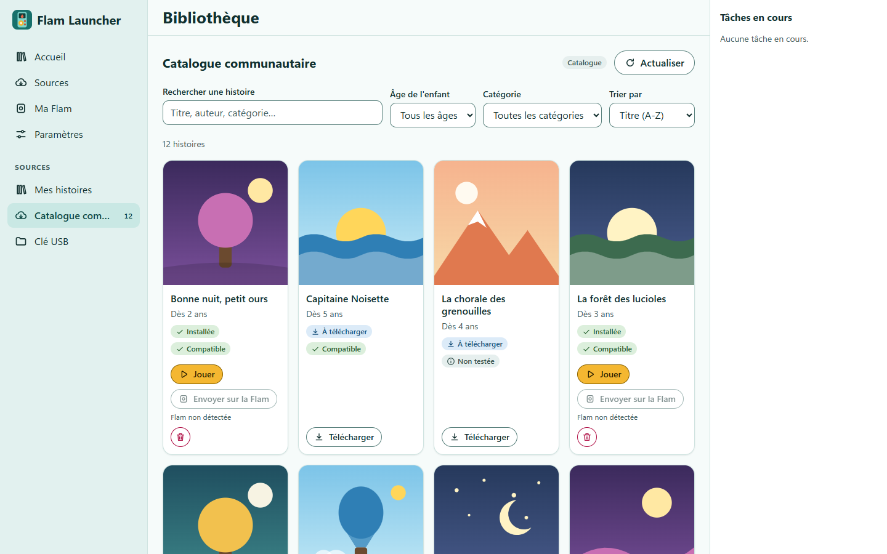
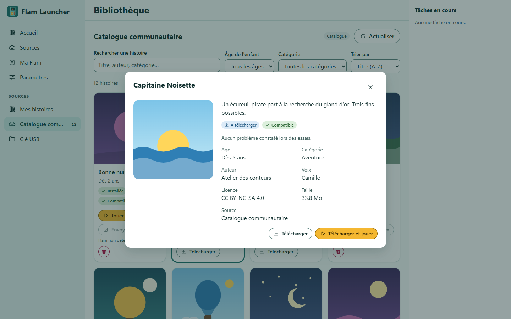
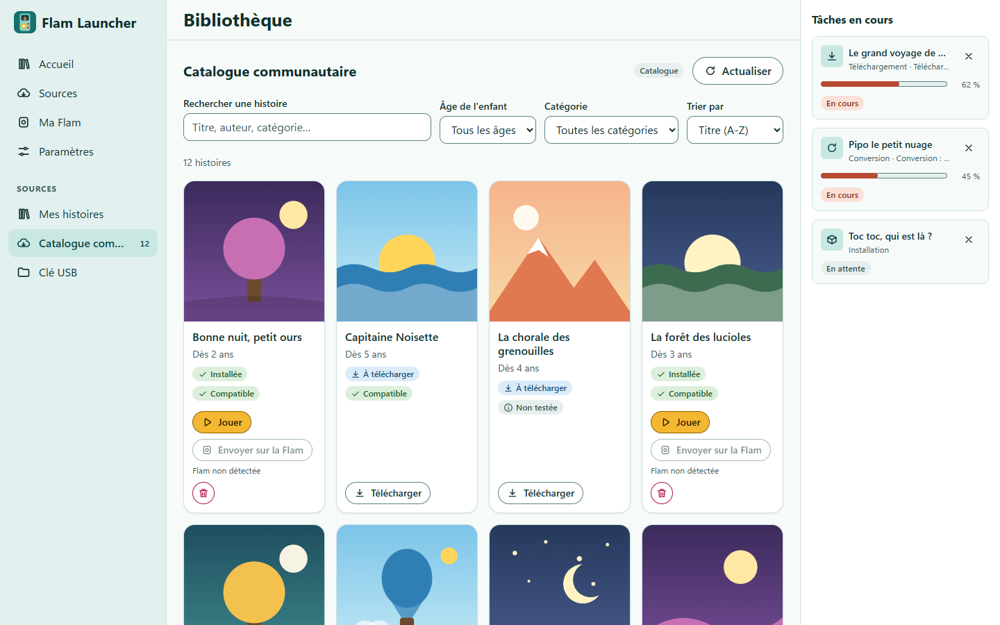
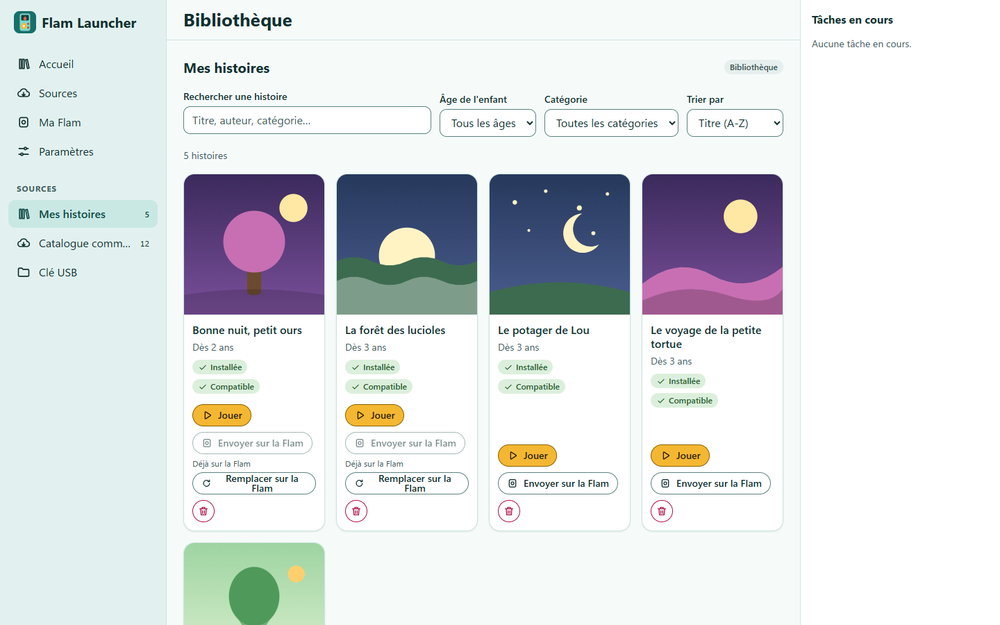
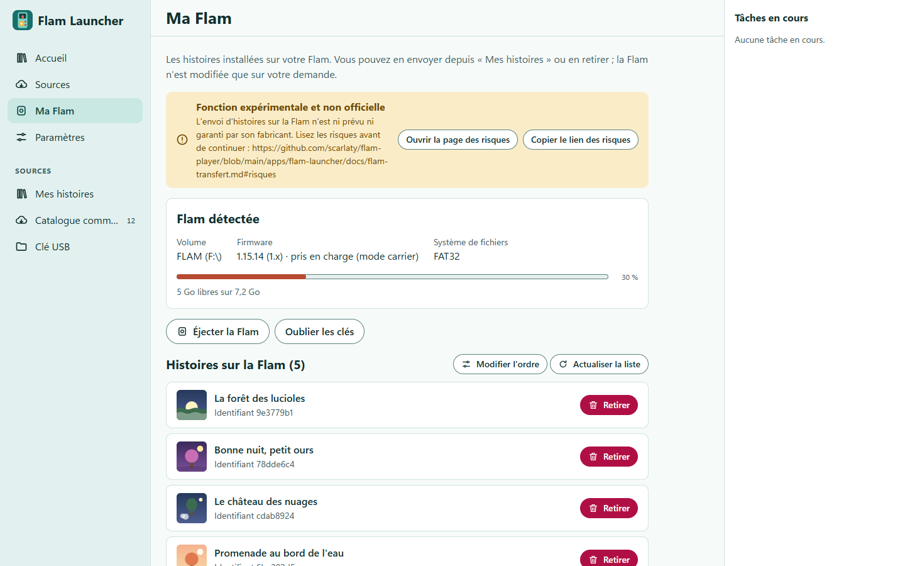
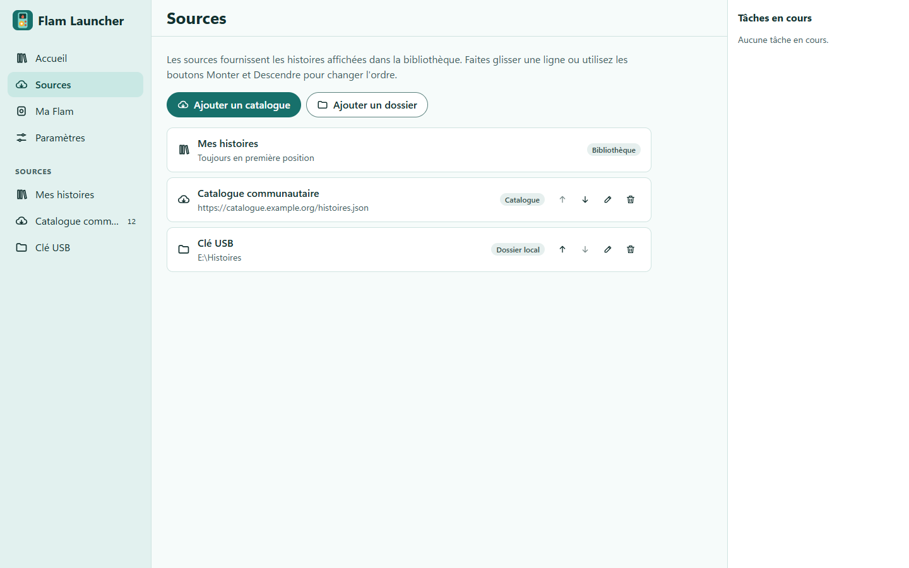
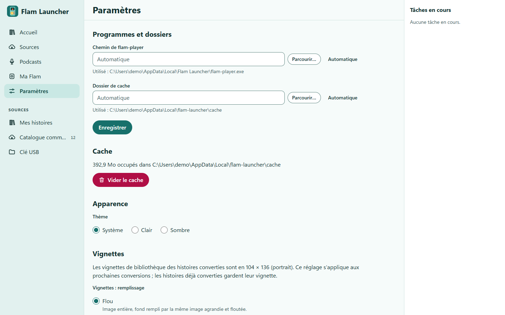
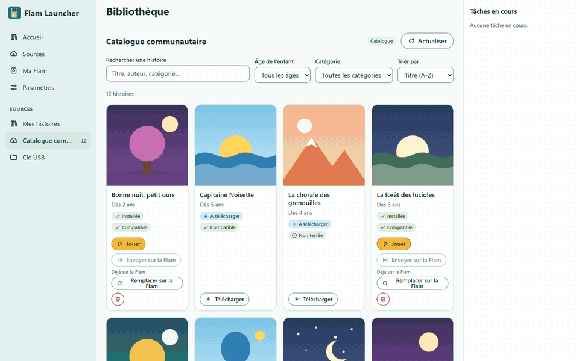

# Flam Launcher

**Des histoires interactives libres pour la Flam, en quelques clics.**

Flam Launcher est une application Windows qui trouve des histoires TELMI, les convertit pour la
Flam, les fait jouer sur le PC et les copie sur l'appareil.

 

[**Télécharger**](https://github.com/scarlaty/flam-player/releases?q=launcher) ·
[Démarrage rapide](#démarrage-rapide) ·
[FAQ](#faq) ·
[Nouveautés](CHANGELOG.md) ·
[Contribuer](#contribuer)

  <picture>
    <source media="(prefers-color-scheme: dark)" srcset="docs/assets/catalogue-sombre.png">
    
  </picture>

> [!NOTE]
> Flam Launcher est en **pré-version** (bêta). Il est indépendant du fabricant de la Flam :
> ni officiel, ni soutenu par lui.

## Fonctionnalités

### Parcourir des catalogues et vos dossiers

Ajoutez des catalogues d'histoires en ligne ou un dossier de votre PC. Cherchez par titre, par
âge ou par catégorie. Chaque fiche donne la description, l'auteur, la licence et la taille. Un
badge indique si l'histoire a été testée et fonctionne sur la Flam.

<picture>
  <source media="(prefers-color-scheme: dark)" srcset="docs/assets/fiche-sombre.png">
  
</picture>

### Convertir sans ligne de commande

« Télécharger » récupère l'archive TELMI et la convertit au format de la Flam (`.plain.pk`). Le
convertisseur est intégré à l'application : rapide, sans aucun programme à installer à côté (ni
Python, ni bibliothèque d'images). Les tâches s'affichent à droite avec leur avancement, et
chacune peut être annulée.

<picture>
  <source media="(prefers-color-scheme: dark)" srcset="docs/assets/installation-sombre.png">
  
</picture>

### Jouer sur le PC

Les histoires installées sont rangées dans « Mes histoires ». « Jouer » les lance dans
`flam-player`, un émulateur du firmware de la Flam, intégré à la fenêtre de l'application. La
progression de l'enfant est sauvegardée d'une session à l'autre.

<picture>
  <source media="(prefers-color-scheme: dark)" srcset="docs/assets/mes-histoires-sombre.png">
  
</picture>

### Envoyer sur la Flam (expérimental)

Branchez la Flam en USB : l'écran « Ma Flam » liste ses histoires avec leurs titres et
vignettes. Vous pouvez en envoyer depuis « Mes histoires », en retirer, changer leur ordre et
éjecter la Flam. Chaque copie est vérifiée avant d'être mise en place.

<picture>
  <source media="(prefers-color-scheme: dark)" srcset="docs/assets/ma-flam-sombre.png">
  
</picture>

> [!WARNING]
> Cette fonction est **non officielle** et n'est ni prévue ni garantie par le fabricant.
> Lisez [les risques](apps/flam-launcher/docs/flam-transfert.md#risques) avant de l'utiliser
> et gardez une copie du contenu de votre Flam.

### Sources, réglages et thème sombre

Ajoutez, renommez et ordonnez vos sources. Les paramètres règlent le chemin de flam-player, le dossier de
cache (et la place qu'il occupe), le thème et le remplissage des vignettes. L'interface suit le thème clair ou sombre de Windows, ou celui
que vous choisissez.

<table>
  <tr>
    <td width="50%">
      <picture>
        <source media="(prefers-color-scheme: dark)" srcset="docs/assets/sources-sombre.png">
        
      </picture>
    </td>
    <td width="50%">
      <picture>
        <source media="(prefers-color-scheme: dark)" srcset="docs/assets/parametres-sombre.png">
        
      </picture>
    </td>
  </tr>
</table>

### Créer un pack de podcasts

Disponible dans la prochaine version : transformez des épisodes de podcasts en une histoire à
écouter sur la Flam, avec son propre menu.

1. Dans **Sources**, ajoutez l'adresse (`https://…`) du flux d'un podcast.
2. Dans **Podcasts**, cochez les épisodes (50 au plus par pack, 1 Gio au total) ; le raccourci
   « Cocher les 10 derniers épisodes » aide. Les épisodes explicites ne sont jamais cochés
   d'office.
3. Ouvrez **Composer le pack** : rangez les épisodes en catégories (3 niveaux de menus, 50
   options par menu), réglez titre, âge et couverture. Votre travail est enregistré
   automatiquement.
4. **Créer l'histoire** : l'audio est téléchargé et converti, l'histoire arrive dans « Mes
   histoires », puis s'envoie sur la Flam comme les autres. Les épisodes qui échouent sont
   retirés du pack et signalés.

Les podcasts appartiennent à leurs auteurs : ces histoires sont réservées à votre usage
personnel et familial, à ne pas partager. L'audio est repris tel que l'éditeur le diffuse,
publicité comprise. Un message le rappelle à la première création
([spécification](apps/flam-launcher/docs/podcasts.md)).

## Le parcours en image

Du catalogue à la Flam : choisir une histoire, la télécharger, puis l'envoyer sur l'appareil.

  

## Installation

1. Ouvrez la page des [**versions publiées**](https://github.com/scarlaty/flam-player/releases?q=launcher)
   et prenez la plus récente nommée « Flam Launcher » (marquée « Pre-release » pendant la bêta).
2. Téléchargez le fichier `Flam-Launcher_<version>_x64-setup.exe` et lancez-le.
3. L'installation se fait pour votre compte Windows, **sans droits d'administrateur**.

> [!IMPORTANT]
> **Avertissement SmartScreen.** L'installateur n'est pas signé. Windows affiche « Windows a
> protégé votre ordinateur » : cliquez sur « Informations complémentaires », puis sur
> « Exécuter quand même ». Le fichier `SHA256SUMS.txt` de la version permet de vérifier le
> téléchargement.

Tout est inclus : l'application, `flam-player` et le convertisseur (un programme Rust autonome),
sans Python à installer. WebView2 est requis ; il est présent sur Windows 11 et sur Windows 10
à jour. Vos sources, paramètres et progressions survivent aux mises à jour. Détails,
désinstallation et dépannage :
[apps/flam-launcher/README.md](apps/flam-launcher/README.md#installation-windows).

## Démarrage rapide

1. **Ouvrez une source.** Un catalogue d'histoires TELMI est déjà configuré. Vous pouvez en
   ajouter d'autres, ou un dossier de votre PC, depuis l'écran « Sources ».
2. **Choisissez une histoire** et cliquez sur « Télécharger » (ou « Télécharger et jouer »).
   La conversion se fait toute seule.
3. **Jouez** depuis « Mes histoires », ou **envoyez-la sur la Flam** branchée en USB.

## FAQ

<b>Windows bloque l'installateur (SmartScreen). Est-ce normal ?</b>

Oui. L'installateur n'est pas signé numériquement, donc Windows ne connaît pas son éditeur.
Cliquez sur « Informations complémentaires », puis sur « Exécuter quand même ». Vous pouvez
comparer l'empreinte du fichier avec `SHA256SUMS.txt`, publié avec chaque version.

<b>Quelles versions du firmware de la Flam sont prises en charge ?</b>

- **Firmware 1.x** : l'envoi a été validé sur un appareil réel (1.15.14). Il demande la clé
  d'une histoire officielle déjà présente sur la Flam (« mode carrier »), avec un
  avertissement à accepter.
- **Firmware 2.x** : pris en charge, mais **jamais testé sur un appareil**. C'est l'objet de
  la bêta : le [guide testeur](apps/flam-launcher/docs/guide-testeur.md) explique comment
  essayer et faire un retour.

Le firmware détecté s'affiche dans l'écran « Ma Flam ». Un firmware inconnu bloque l'envoi.
Détails : [flam-transfert.md](apps/flam-launcher/docs/flam-transfert.md).

<b>Quels formats d'histoires sont acceptés ?</b>

- archives TELMI `.zip` (description `nodes.json`), converties à l'installation par le
  convertisseur intégré. Il lit les archives ZIP sans compression ou compressées en deflate, et
  les images PNG, y compris les PNG atypiques (entrelacés, palettes, 16 bits...) ;
- histoires déjà au format de la Flam : dossiers `.plain` et archives `.plain.pk`, copiées
  telles quelles.

Le format STUdio (`story.json`) n'est pas pris en charge. Les images GIF ou JPEG
et les ZIP compressés en bzip2, LZMA ou Zstandard ne le sont pas non plus : l'archive est
refusée avec un message explicite. Une source peut être un catalogue en
ligne au format Telmi Store, ou un dossier local, qui n'est jamais modifié.

<b>Faut-il une Flam pour utiliser l'application ?</b>

Non. Sans Flam, vous pouvez parcourir, convertir et jouer les histoires sur le PC avec
`flam-player`.

<b>Existe-t-il une version Mac ou Linux ?</b>

Non. Seul Windows 10 ou 11 en 64 bits est pris en charge et publié. L'émulateur et le
convertisseur se compilent aussi ailleurs, mais sans version prête à installer.

<b>Où sont mes données ?</b>

Sources, paramètres et sauvegardes de progression sont dans `%APPDATA%\flam-launcher`. Le cache
et les histoires installées sont par défaut dans `%LOCALAPPDATA%\flam-launcher`. La
désinstallation les conserve : supprimez ces dossiers pour tout effacer.

## Contribuer

Les contributions sont bienvenues : rapports de bogue, retours de test sur une Flam, code et
documentation.

- [CONTRIBUTING.md](CONTRIBUTING.md) : organisation du travail, réservation d'une tâche,
  qualité attendue et revue.
- [Guide testeur](apps/flam-launcher/docs/guide-testeur.md) : tester la bêta sur une Flam et
  envoyer un retour.
- [Documentation développeur du launcher](apps/flam-launcher/README.md) : prérequis,
  commandes, architecture.
- Les captures de cette page sont produites par
  [`apps/flam-launcher/scripts/screenshots.mjs`](apps/flam-launcher/scripts/screenshots.mjs)
  (`npm run screenshots`), avec des données fictives.

## Sous le capot

Flam Launcher est une application [Tauri 2](https://tauri.app/) (backend Rust, interface React
et TypeScript). Il s'appuie sur d'autres briques de ce dépôt :

| Composant | Rôle | Documentation |
|-----------|------|---------------|
| `flam-player` | Émulateur du firmware de la Flam (C, LVGL, Lua, SDL2) | [docs/player.md](docs/player.md) |
| `telmi2flam` (Rust) | Convertisseur TELMI vers FLAM livré avec le launcher (version 2.0.0) | [crates/telmi2flam](crates/telmi2flam/) |
| `tools/telmi2flam` | Version Python d'origine : référence de parité et outils de campagne, plus livrée aux utilisateurs | [tools/telmi2flam](tools/telmi2flam/README.md) |
| Jeux homebrew | Jeux en Lua pour la Flam | [docs/player.md](docs/player.md#jeux-et-contenus-homebrew) |
| Skill `flam-homebrew` | Fabriquer un contenu `.plain.pk` avec une IA | [skills/flam-homebrew](skills/flam-homebrew/SKILL.md) |
| Formats de la Flam | Volume USB, index, chiffrement | [flam-device-format.md](docs/flam-device-format.md), [flam-carrier.md](docs/flam-carrier.md) |
| Sécurité | Audit et inventaire d'un appareil | [docs/security/](docs/security/) |

## Licence

Flam Launcher et le reste du dépôt sont distribués sous licence
[GNU GPL v3 ou ultérieure](LICENSE) (`GPL-3.0-or-later`). Les composants tiers redistribués
par l'installateur gardent leur propre licence : voir
[apps/flam-launcher/LICENSES.md](apps/flam-launcher/LICENSES.md).

Flam et Lunii sont des marques de leurs propriétaires. Ce projet n'est ni affilié à eux ni
approuvé par eux.
