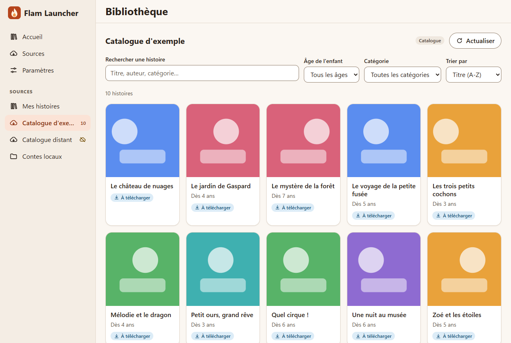
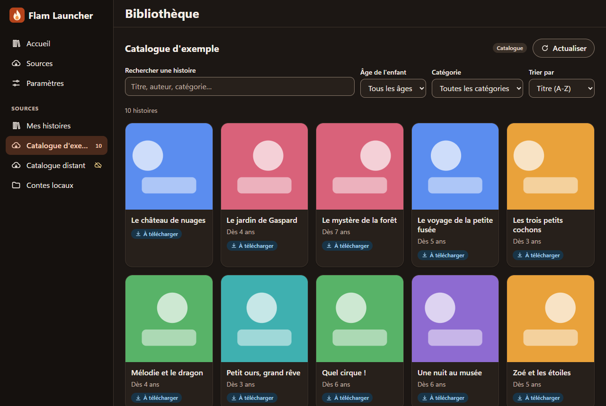
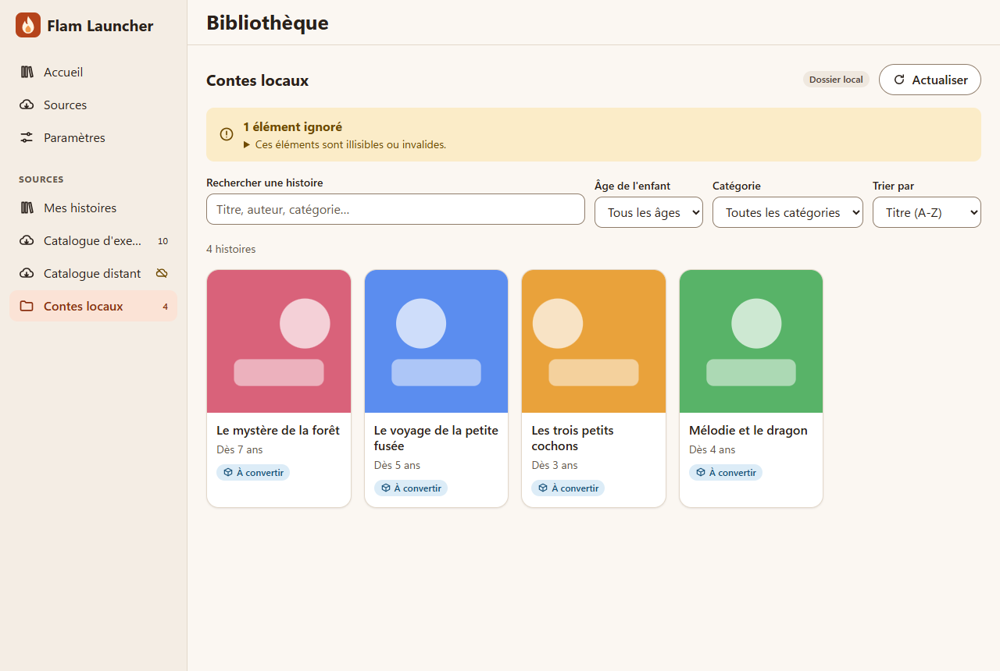
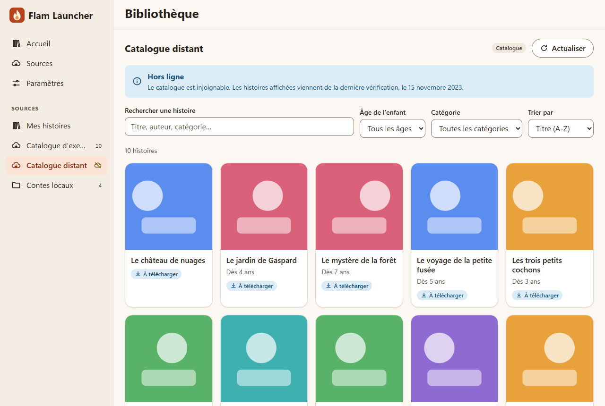
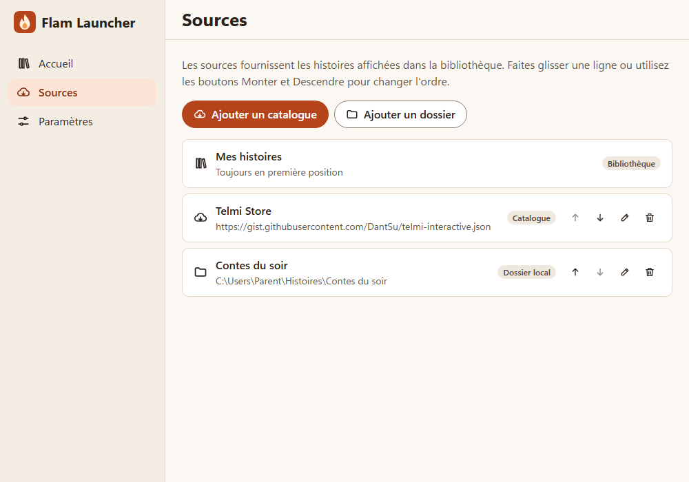
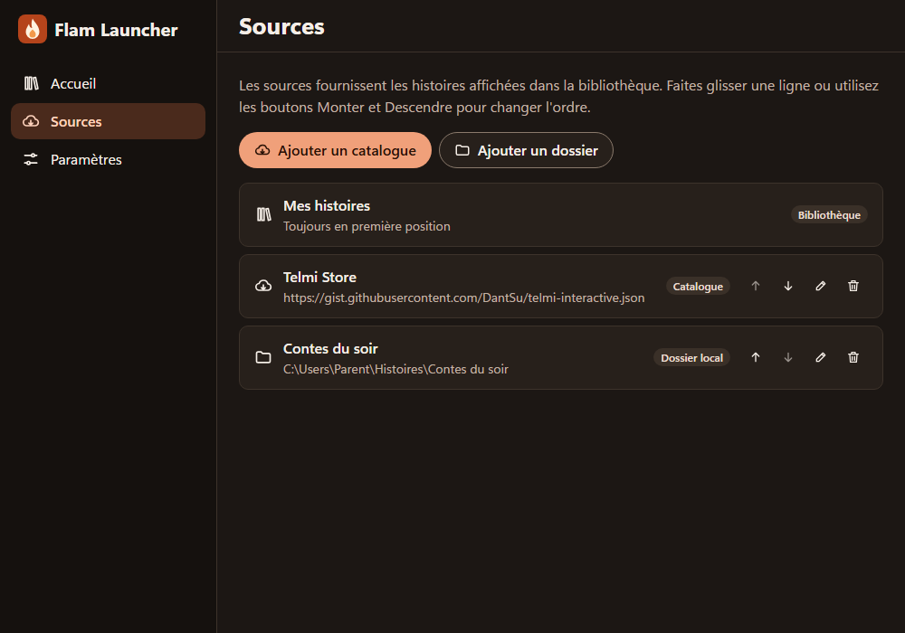
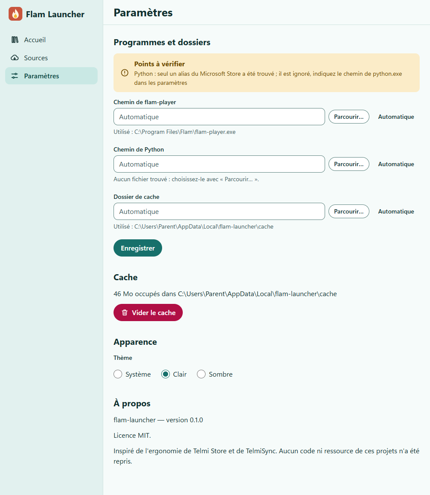
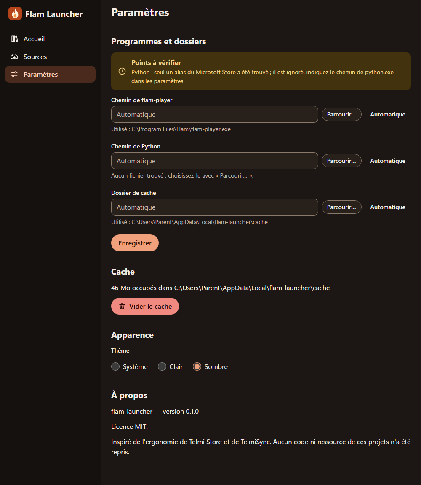

# flam-launcher

Surcouche de bureau (Windows d'abord) pour parcourir des sources d'histoires, les convertir
avec `telmi2flam` et les lancer dans `flam-player`. Application Tauri 2 : backend Rust,
interface React + TypeScript (strict). Licence **MIT** (voir [LICENSE](LICENSE)).

L'ergonomie s'inspire de TelmiSync, **sans reprendre de code ni de style** (TelmiSync est
en GPL-3.0). Suivi : issue « Suivi : surcouche flam-launcher ».

Ce document décrit l'architecture visée. Les éléments marqués _prévu_ n'existent pas encore
et arrivent avec les issues du jalon M3.

## Prérequis

Rust stable (MSVC), Visual Studio 2022 avec les outils C++ x64, WebView2, Node 24+ et npm.

## Commandes

Depuis `apps/flam-launcher/` :

| Commande                             | Effet                                          |
| ------------------------------------ | ---------------------------------------------- |
| `npm install`                        | Installe les dépendances front et la CLI Tauri |
| `npm run tauri dev`                  | Lance l'application en développement           |
| `npm run dev` / `npm run build`      | Front seul (Vite) / build du front             |
| `npm run lint` / `npm run typecheck` | ESLint / TypeScript strict                     |
| `npm test`                           | Vitest + Testing Library (API Tauri simulée)   |
| `npm run tauri build`                | Exécutable et installeurs (MSI, NSIS)          |
| `npm run tauri build -- --no-bundle` | Exécutable seul, sans installeur               |
| `npm run build:converter`            | Construit le convertisseur embarqué (réseau)   |

Dans `src-tauri/` : `cargo fmt --check`, `cargo clippy -- -D warnings`, `cargo test`.

## Convertisseur embarqué

L'application installée ne suppose aucun Python sur la machine : le convertisseur est livré avec
un Python embarquable officiel (3.14.8, signé PSF) et Pillow 12.3.0, sous `<exe>/telmi2flam/`
(`python/python.exe`, `telmi2flam.py`, `lif.py`, `mp3map.py`, `engine/`, `runtime/`,
`LICENSES.md`, `BUILD.txt`). `convert.rs` et l'annulation Ctrl+Break sont inchangés : ils lancent
`python -E -s -u -X utf8 telmi2flam.py`. Environ 20 Mo sur disque, 9 Mo compressés dans
l'installeur.

1. **Construire l'artefact** (réseau, PowerShell seul, sans Python sur la machine de build) :
   `npm run build:converter`. Le script télécharge Python et Pillow à des versions épinglées,
   **vérifie leur SHA-256** (publié par python.org / PyPI), allège le paquet, écrit
   `build/telmi2flam/` (ignoré par Git) puis le contrôle sans Python dans le `PATH`.
2. **L'embarquer** : `src-tauri/tauri.bundle.conf.json` déclare la ressource
   `../build/telmi2flam/` vers `telmi2flam/`. Il est passé explicitement, car l'ajouter à
   `tauri.conf.json` ferait échouer tout build sans l'artefact :

   ```
   npm run build:converter
   npm run tauri build -- --config src-tauri/tauri.bundle.conf.json                 # installeurs
   npm run tauri build -- --no-bundle --config src-tauri/tauri.bundle.conf.json     # exe seul
   ```

   Même avec `--no-bundle`, Tauri copie `telmi2flam/` à côté de l'exe dans
   `src-tauri/target/release/` (vérifié : copie identique à l'artefact). Sans `--config`, le
   build reste valable mais sans convertisseur (le launcher cherche alors Python dans le `PATH`).

3. **Vérifier en réel** (Python absent du `PATH`) : deux tests Rust ignorés par défaut
   (`install::convert::tests::embarque`) pilotent le convertisseur embarqué, conversion puis
   annulation :

   ```powershell
   # depuis src-tauri/ ; `cargo test --lib --no-run` affiche le binaire de test
   $env:FLAM_TEST_CONVERTER_DIR = "<...>\target\release\telmi2flam"
   $env:FLAM_TEST_ARCHIVE = "<histoire de test>.zip"   # synthétique, hors dépôt
   $env:PATH = "C:\Windows\System32"
   & <binaire-de-test>.exe --ignored --nocapture embarque
   ```

   L'archive de test se génère avec `make_story.py` (issue #46) ; ne jamais committer de
   contenu sous licence. Pillow embarqué n'a pas FreeType : avec le Python embarqué, retirer
   `font_size=48` de ce script.

**Licences redistribuées** : Python (PSF-2.0 et composants) et Pillow (MIT-CMU et bibliothèques
intégrées) ; leurs textes sont dans l'artefact et `LICENSES.md` les référence. Les licences de
`runtime/` et du dépôt (« usage personnel et éducatif ») restent à confirmer avant
redistribution (#21).

## Architecture

```
apps/flam-launcher/
  src/                     Front React/TypeScript
    api/                   Couche typée au-dessus de `invoke` / événements Tauri
    router.ts              Routage par hash (`#/`, `#/sources`, `#/settings`, `#/library[/<id>]`, `#/demo` en dev)
    features/<domaine>/    Écrans et logique par fonctionnalité (app, welcome, sources, settings,
                           library, compat, stories, recovery, demo en dev)
    components/            Composants partagés sans logique métier (design system)
    theme/                 Jetons CSS (clair/sombre) et choix du thème
    i18n/                  Textes de l'interface (français)
  docs/DESIGN.md           Design system : principes, palette, composants
  src-tauri/
    src/
      lib.rs               Initialisation (traces, builder Tauri)
      app.rs               Commandes générales (`app_info`)
      error.rs             `AppError` (thiserror), sérialisée en `{ kind, message }`
      storage.rs           Persistance JSON : écriture atomique, `*.bak`, migration de schéma
      settings.rs          `settings.json`, détection du player et de Python, commandes `settings_*`
      cache.rs             Taille du cache et vidage (sous-dossiers de l'application seulement)
      sources.rs           `sources.json`, source par défaut et implicite, commandes `sources_*`
      story.rs             `StoryEntry` / `StoryKind` : type commun des histoires de toutes les sources
      catalog.rs           Source catalogue : téléchargement, lecture tolérante, cache, vignettes
      folder.rs            Source dossier local (`.zip` Telmi, `.plain`, `.plain.pk`), commandes `folder_*`
      lif.rs               Décodeur LIF (port de `src/formats/lif_decoder.c`)
      thumbnail.rs         Vignettes : PNG, réduction, cache `thumbs/`, URL `data:`
      install/             Pipeline d'installation : file, téléchargement, conversion (`mod.rs`,
                           `download.rs`, `convert.rs`, `pack.rs`), commandes `install_*`
      library.rs           Bibliothèque `<cache>/library/` et `library.json`, commandes `library_*`
      compat.rs            Statut de compatibilité (`status.json` de la campagne + conversions locales), commande `compat_statuses`
```

### Modules Rust

Présents : `app` (commandes générales), `error`, `storage`, `settings`, `cache`, `sources`, `story`, `catalog`, `folder`, `lif`, `thumbnail`, `install`, `library`, `compat`, `player`.

### Commandes Tauri

Chaque module Rust porte ses propres commandes (`#[tauri::command]` dans le module concerné,
enregistrées dans `generate_handler!` de `lib.rs`) : pas de fichier `commands.rs` fourre-tout.

Les commandes sont asynchrones (`tokio`), renvoient `AppResult<T>` et sont enregistrées dans
`generate_handler!` (`lib.rs`). Chacune a un wrapper typé dans `src/api/`.

| Commande               | Arguments                  | Retour                      | Module     |
| ---------------------- | -------------------------- | --------------------------- | ---------- |
| `app_info`             |                            | `{ name, version }`         | `app`      |
| `settings_get`         |                            | `SettingsView`              | `settings` |
| `settings_set`         | `settings: Settings`       | `SettingsView`              | `settings` |
| `sources_list`         |                            | `SourcesView`               | `sources`  |
| `sources_add`          | `input: SourceInput`       | `Source`                    | `sources`  |
| `sources_update`       | `id`, `input: SourceInput` | `Source`                    | `sources`  |
| `sources_remove`       | `id`                       | rien                        | `sources`  |
| `sources_reorder`      | `ids: string[]`            | `Source[]` (liste complète) | `sources`  |
| `config_ack_recovery`  | `file?: string`            | rien                        | `storage`  |
| `cache_usage`          |                            | `{ path, bytes }`           | `cache`    |
| `cache_clear`          |                            | `{ freed_bytes }`           | `cache`    |
| `catalog_refresh`      | `source_id`                | `CatalogView`               | `catalog`  |
| `catalog_entries`      | `source_id`                | `CatalogView`               | `catalog`  |
| `catalog_thumbnail`    | `source_id`, `thumb_url`   | URL `data:` (string)        | `catalog`  |
| `folder_scan`          | `source_id`, `recursive?`  | `FolderScan`                | `folder`   |
| `folder_thumbnail`     | `source_id`, `entry_id`    | URL `data:` (chaîne)        | `folder`   |
| `install_start`        | `source_id`, `entry_id`    | `InstallTask`               | `install`  |
| `install_cancel`       | `task_id`                  | rien                        | `install`  |
| `install_list`         |                            | `InstallTask[]`             | `install`  |
| `library_list`         |                            | `LibraryEntry[]`            | `library`  |
| `library_remove`       | `uuid`, `purge_saves?`     | rien                        | `library`  |
| `player_launch`        | `uuid`                     | `PlayerSession`             | `player`   |
| `player_launch_folder` | `source_id`, `entry_id`    | `PlayerSession`             | `player`   |
| `player_status`        |                            | `PlayerSession \| null`     | `player`   |

`sources_list` renvoie `SourcesView { sources, recovery }` ; `settings_get` / `settings_set`
renvoient `SettingsView { settings, resolved, issues, recovery }` (voir « Données »).
`settings_set` **remplace l'objet complet** (pas de fusion partielle).

Wrappers front : `src/api/settings.ts` (`getSettings`, `setSettings`), `src/api/sources.ts`
(`listSources`, `addSource`, `updateSource`, `removeSource`, `reorderSources`) et
`src/api/recovery.ts` (`ackRecovery`) et `src/api/catalog.ts` (`refreshCatalog`,
`getCatalogEntries`, `getCatalogThumbnail`, types `StoryEntry`, `CatalogView`). La logique
`src/api/cache.ts` (`getCacheUsage`, `clearCache`) et `src/api/dialog.ts` (`pickFolder`,
`pickExecutable` : sélecteurs natifs du plugin `tauri-plugin-dialog`), `src/api/install.ts`
(`startInstall`, `cancelInstall`, `listInstalls`, `onInstallProgress`, `onInstallDone`,
`onInstallError`) et `src/api/library.ts` (`listLibrary`, `removeFromLibrary`, `hasUpdate`). La logique
(`SettingsStore`, `SourcesStore`, détection) ne dépend pas de Tauri et reçoit son dossier de
configuration en paramètre : elle est testée sur des dossiers temporaires ; les commandes
ne sont que de fines enveloppes qui prennent un verrou (`ConfigState`) autour de chaque opération.

### Source dossier local (`folder_scan`, `folder_thumbnail`)

`folder_scan(source_id, recursive?)` analyse une source de type `folder` (autre type :
`validation` ; dossier absent : `folder_unavailable`) et renvoie
`FolderScan { entries: StoryEntry[], warnings: { path, message }[] }`. Le parcours est
non récursif par défaut (récursif : 8 niveaux, 5000 histoires au plus, liens symboliques et
jonctions ignorés) ; un fichier invalide est **ignoré et signalé** dans `warnings`, jamais une
erreur. Le verrou de configuration n'est pas tenu pendant l'analyse (thread dédié).

| Entrée            | `kind`       | Lu                                                                                                                                     |
| ----------------- | ------------ | -------------------------------------------------------------------------------------------------------------------------------------- |
| `*.zip`           | `telmi_zip`  | `metadata.json` (UTF-8, BOM toléré) du dossier racine (`find_root` de `telmi2flam`), vignette `title.png` ou `cover.png` selon `image` |
| dossier `*.plain` | `flam_plain` | 1re ligne d'`info.plain` (titre), `uuid.bin` (16 octets, uuid en hexadécimal), `img/thumbnail.lif`                                     |
| `*.plain.pk`      | `flam_pk`    | idem, dans l'archive (zip « stored »)                                                                                                  |

`StoryEntry` (`src-tauri/src/story.rs`, partagé avec la source catalogue ; miroir
`src/api/story.ts`) : `source_id, uuid, version, title, description, age, category, author,
voice, license, thumb_url, download_url, size, updated_at, kind`. Pour un dossier,
`download_url` est le **chemin local absolu** de l'archive ou du dossier `.plain`, `size` est
absente pour un `.plain`, `updated_at` est la date de modification (ISO 8601 UTC) ; les champs
inconnus valent `null`.

**Doublons** : un `.plain` et un `.plain.pk` de même `uuid` donnent **deux entrées** (`kind`
différent). Chaque entrée porte un `entry_id` (stable d'un scan à l'autre, unique
dans la source) à utiliser comme clé d'affichage et pour `folder_thumbnail`. Format
`"<source_id>:<hash>"`, comme le catalogue (`"<source_id>:<uuid>"`) ; le hash est un FNV-1a 64 bits du
chemin relatif au dossier de la source (séparateurs `/`).

**Identifiants non fiables** : l'`uuid` d'un zip Telmi (et `version` si c'est une chaîne) doit
respecter `^[0-9A-Za-z][0-9A-Za-z._-]{0,63}$`, sans `..` ni nom réservé Windows (`CON`, `PRN`,
`AUX`, `NUL`, `COM1-9`, `LPT1-9`) ; sinon l'histoire est ignorée avec un avertissement.

**Archives non fiables** : rien n'est extrait sur disque ; `metadata.json` et `info.plain` sont
limités à 1 Mio, les vignettes à 8 Mio (lecture bornée même si la taille déclarée est fausse ; PNG
décodé : 8192 px et 64 Mio au plus) ; les entrées aux noms dangereux (`..`, absolu, lecteur,
`__MACOSX`, `._*`) sont écartées ; les `\` des noms de zip sont lus comme des `/` ; 100 000 entrées
au plus par archive.

**Vignettes à la demande** : `folder_scan` ne renvoie aucune image (5000 entrées feraient des
centaines de Mio d'IPC). `thumb_url` est une **référence à résoudre par `folder_thumbnail`** (égale à
`entry_id`) ou `null` sans vignette : ce n'est pas une URL affichable. `folder_thumbnail(source_id, entry_id)` renvoie
l'URL `data:image/png;base64,…` d'une seule histoire (compatible CSP `img-src data:`), uniquement
pour une entrée du **dernier scan** de cette source (sinon `not_found`, jamais un chemin libre).
L'image (PNG ou LIF via `lif.rs`) est réduite à 160 px et gardée dans `<cache>/thumbs/<clé>.png`
(clé = chemin, taille et date de l'archive, plus taille et date de `img/thumbnail.lif` pour un
`.plain`) ; le cache est consulté **avant** d'ouvrir l'archive.

**Cache de métadonnées** : en mémoire, par archive (chemin, taille, date de modification), pour ne
pas rouvrir chaque zip à chaque scan ; les dossiers `.plain` sont relus à chaque scan.

`thumbs/` est enregistré dans `APP_CACHE_SUBDIRS` (`cache.rs`) : « Vider le cache » le nettoie.

**Suite** : surveillance du dossier (`notify`) et purge de `thumbs/` : issue #37.

### Erreurs

`AppError` (`src-tauri/src/error.rs`, `thiserror`) est sérialisée en objet stable
`{ "kind": "<code_stable>", "message": "<texte lisible en français>" }` (ex. `kind: "io"`).
Le miroir front est `src/api/error.ts` (type `AppError`, garde `isAppError`) ; le helper
`invokeCommand<T>(cmd, args?)` appelle `invoke` et normalise toute erreur en `AppError`
(`kind: "unknown"` si la forme est inattendue). Convention : chaque module ajoute ses variantes
à `AppError` avec un `kind` stable ; le front teste le `kind`, jamais le `message`.

| `kind`                  | Sens                                                                                                |
| ----------------------- | --------------------------------------------------------------------------------------------------- |
| `io`                    | Erreur d'entrée/sortie                                                                              |
| `validation`            | Valeur refusée (URL, chemin, extension, nom, ordre) ou opération interdite                          |
| `not_found`             | Élément introuvable (identifiant de source inconnu)                                                 |
| `config_version`        | Fichier de configuration écrit par une version plus récente (laissé intact)                         |
| `config_dir`            | Dossier de configuration introuvable                                                                |
| `serialization`         | Échec de sérialisation JSON                                                                         |
| `network`               | Réseau indisponible, délai dépassé, réponse HTTP en échec, réponse trop grosse                      |
| `catalog_invalid`       | Catalogue (ou vignette) reçu inexploitable : JSON invalide, pas de liste `data`, image non reconnue |
| `folder_unavailable`    | Dossier d'une source locale absent ou inaccessible (disque débranché…)                              |
| `cancelled`             | Tâche d'installation annulée                                                                        |
| `download_invalid`      | Téléchargement incomplet, trop gros (4 Gio), ou qui n'est pas l'archive attendue                    |
| `converter_unavailable` | Python ou `telmi2flam.py` introuvable                                                               |
| `conversion`            | Échec de `telmi2flam` ; le code du convertisseur (`missing_asset`…) est dans `TaskError.code`       |
| `player_unavailable`    | `flam-player.exe` introuvable (ni configuré ni détecté) ou impossible à lancer                      |
| `player_busy`           | Un player tourne déjà (un seul à la fois)                                                           |
| `story_file_missing`    | Le fichier de l'histoire à lancer a disparu                                                         |
| `unknown`               | Côté front uniquement : erreur de forme inattendue                                                  |

Un fichier de configuration **corrompu** n'est pas une erreur : il est renommé en
`<fichier>.<AAAAMMJJ-HHMMSS>.bak`, un avertissement est tracé et les valeurs par défaut sont utilisées.
Cette restauration est mémorisée dans `recovery.json` et renvoyée dans le champ `recovery`
(`{ file, backup }`) de `settings_get` / `sources_list` **jusqu'à** `config_ack_recovery`
(même après un redémarrage) : l'interface avertit l'utilisateur puis acquitte.

### Source catalogue (`catalog`)

Un catalogue est un JSON au format Telmi Store : `{ banner, data: [ { uuid, version?, title,
description, age, category, author, voice, license, thumbs: { small, medium }, download,
updated_at, … } ] }`. Il est normalisé en `StoryEntry` (module partagé `story.rs` / `src/api/story.ts`,
aussi utilisé par la source dossier local) :
`source_id, entry_id, uuid, version?, title, description?, age?, category?, author?, voice?,
license?, thumb_url?, download_url, size?, updated_at?, kind (telmi_zip | flam_plain | flam_pk)`.

- **Identifiants** : `entry_id` est unique et stable dans une source ; c'est la clé de grille de
  l'interface et la clé de cache des vignettes côté front. Catalogue : `"<source_id>:<uuid>"`.
  `story::validate_story_id` (`^[0-9A-Za-z][0-9A-Za-z._-]{0,63}$`, sans `..`, sans point final,
  hors noms réservés Windows `CON`, `PRN`, `AUX`, `NUL`, `COM1-9`, `LPT1-9`) valide tout
  identifiant destiné à devenir un nom de fichier ; une entrée dont l'`uuid` ne passe pas est
  ignorée avec un avertissement.
- **`thumb_url`** n'est **pas** une URL affichable : la CSP bloque les images distantes. C'est une
  référence que le front résout avec `getCatalogThumbnail` (voir « Vignettes »).
- **`download_url`** est une URL absolue http **ou https**, telle que publiée par le catalogue.
  Le pipeline d'installation (#15) accepte le http clair : l'archive est de toute façon traitée
  comme non fiable (lectures bornées, conversion par `telmi2flam`), et les redirections de https
  vers http restent refusées.
- **`size`** est toujours absente pour le Telmi Store (le format ne la fournit pas) : #15 doit
  s'appuyer sur le `Content-Length` du téléchargement.
- **Lecture tolérante** : champs inconnus ignorés ; champ absent ou de mauvais type = valeur par
  défaut (`null` pour les champs optionnels, y compris les textes vides ; titre vide si absent) ;
  entrée sans `uuid` valide ou sans lien `download` http(s) valide ignorée avec un avertissement
  (`warnings`, 50 maximum puis résumé) ; `uuid` en double ignoré (premier conservé, détection en
  temps constant). Au-delà de 10 000 entrées, les suivantes sont ignorées (avertissement). URL
  relatives résolues par rapport à l'URL du catalogue ; vignette `small` (grille) sinon `medium`.
  Une racine qui est directement une liste, ou un BOM UTF-8, sont acceptés. Sans liste
  d'histoires : erreur `catalog_invalid`. La lecture se fait hors du fil asynchrone
  (`spawn_blocking`).
- **Réseau** : `reqwest` avec rustls (pas d'OpenSSL), délai de connexion 10 s, délai total 30 s,
  corps limité à 16 Mio (contrôlé sur `Content-Length` puis sur le flux reçu),
  `User-Agent` `flam-launcher/<version> (+https://github.com/scarlaty/flam-player)`.
  Redirections : 5 sauts au plus, jamais de https vers http. Requête conditionnelle
  `If-None-Match` / `If-Modified-Since` quand un cache de confiance existe.
- **Risque SSRF** : le launcher fait des GET « à l'aveugle » vers des adresses publiées par le
  catalogue (catalogue, vignettes, plus tard téléchargements). Un catalogue hostile peut donc
  faire joindre une adresse locale ou privée ; la réponse n'est jamais exposée telle quelle
  (JSON analysé, images reconnues par leurs premiers octets), mais la requête part. Le front ne
  peut demander que des vignettes présentes dans le catalogue en cache. N'ajouter que des
  catalogues de confiance.
- **Cache hors ligne** sous `<cache>/catalogs/<source_id>/` : `catalog.json` (dernier catalogue
  valide, tel que reçu), `meta.json` (`url`, `etag`, `last_modified`, `sha256`, `fetched_at`),
  `thumbs/<sha256 de l'URL>.img`. L'identifiant de source doit être un nom de dossier sûr
  (`[A-Za-z0-9_-]`, 64 max).
  - Un cache dont l'URL diffère de celle de la source est ignoré.
  - `meta.json` contient le SHA-256 de `catalog.json` : s'il ne correspond pas au chargement
    (écriture interrompue, fichier modifié), le catalogue reste lisible mais l'ETag est ignoré
    (téléchargement complet).
  - Un seul `catalog_refresh` à la fois par source (verrou par source) ; les suivants attendent.
  - Un catalogue **valide mais sans aucune entrée exploitable** (`data: []`) ne remplace pas un
    cache non vide : le cache est conservé et `status.error` (`catalog_invalid`) l'indique.
- **`catalog_refresh`** renvoie `CatalogView { source_id, entries, warnings, status }` avec
  `status { offline, updated_at, error }` :

  | Réponse du serveur                        | Résultat                                                                                |
  | ----------------------------------------- | --------------------------------------------------------------------------------------- |
  | 200 valide                                | nouveau cache, `offline: false`                                                         |
  | 304                                       | cache conservé, `updated_at` = maintenant                                               |
  | échec réseau, délai, redirection, 4xx/5xx | cache servi, `offline: true`, `error.kind = "network"` (ou erreur `network` sans cache) |
  | 200 mais catalogue invalide               | cache servi, `offline: false`, `error.kind = "catalog_invalid"` (ou erreur sans cache)  |
  | 200 valide mais vide, cache non vide      | cache conservé, `offline: false`, `error.kind = "catalog_invalid"`                      |

  `status.updated_at` (secondes Unix) alimente l'indicateur « hors ligne / dernière mise à jour ».

- **`catalog_entries`** lit uniquement le cache (aucun réseau) : à appeler d'abord pour afficher
  immédiatement, puis `catalog_refresh`.
- **Vignettes** : `catalog_thumbnail(source_id, thumb_url)` télécharge la vignette à la première
  demande (2 Mio max, PNG / JPEG / GIF / WebP reconnus à leurs premiers octets, SVG refusé, 6
  téléchargements simultanés au plus) puis la lit sur le disque, et la renvoie en URL `data:`
  utilisable dans ``. `thumb_url` doit appartenir à une entrée du catalogue en cache :
  l'ensemble des `thumb_url` connues est gardé en mémoire par source (remplacé à chaque
  rafraîchissement), le catalogue n'est donc pas relu à chaque vignette. Le protocole d'asset de
  Tauri n'est **pas** activé : le dossier de cache est configurable, un scope d'asset statique
  serait faux ou trop large, et la CSP (`img-src … data:`) reste inchangée.
- **Limite connue** : `thumbs/` et `catalogs/<id>/` ne sont pas nettoyés à la suppression d'une
  source, et les vignettes en cache ne sont jamais revalidées (suite : #38).

### Événements

Convention : événements émis par le backend, nommés `domaine://action` (ex. `install://progress`),
avec une charge utile sérialisable typée côté `src/api/`.

| Événement            | Charge                                                                                                                                                          |
| -------------------- | --------------------------------------------------------------------------------------------------------------------------------------------------------------- |
| `install://progress` | `{ task_id, state, percent, received, total, phase }` (au plus toutes les 200 ms par tâche, plus chaque changement d'état)                                      |
| `install://done`     | `{ task_id, entry: LibraryEntry, warnings }`                                                                                                                    |
| `install://error`    | `{ task_id, state: "failed" \| "cancelled", error: TaskError }`                                                                                                 |
| `player://started`   | `PlayerSession { origin, uuid, title, pid, started_at }`                                                                                                        |
| `player://exited`    | `{ session, code, success, duration_ms, stderr, saves_error }` (`code` nul : processus tué ; `saves_error` : progression non conservée telle quelle, sinon nul) |

### Lancement du player (`player`)

`player_launch(uuid)` lance une histoire de la bibliothèque, `player_launch_folder(source_id,
entry_id)` une histoire `.plain` / `.plain.pk` du dernier scan d'une source dossier (sans
installation ; un zip Telmi est refusé). **Le front ne fournit jamais de chemin** : le fichier est
relu de `library.json` ou du scan, le player vient de `settings::resolve` (configuré valide, sinon
détecté) et est revérifié juste avant l'exécution. Commande : `flam-player.exe "<fichier>"` sans
shell, un seul argument en tableau, dossier courant = dossier du player.

- **Un seul player à la fois** : un second lancement est refusé (`player_busy`) ; le créneau est
  libéré avant `player://exited`, on peut relancer dès réception. `player_status` restitue l'état
  après un rechargement de l'interface.
- **Fin** : `player://exited` porte le code, la durée et les 20 dernières lignes de stderr
  (8 Kio) ; `success = false` (code non nul ou processus tué) : afficher `stderr`, c'est la
  raison d'un échec au démarrage (« Erreur de chargement… »).
- **Copie de travail** : le player extrait un `.plain.pk` et écrit ses sauvegardes (`saves/<nom>`)
  à côté de l'histoire (le code C n'offre aucune option pour le changer en mode histoire). Il
  n'est donc **jamais lancé sur l'original** (dossier de l'utilisateur ni `library/`) : l'histoire
  est copiée dans `<cache>/play/<empreinte de la clé>/<nom>` (`Workspace::stage`, sous le portillon
  du cache en lecture), vidée avant chaque lancement, puis lancée. Clé : `library:<uuid>` ou
  `folder:<source>:<entrée>`. La source doit être, sans suivre de lien, un fichier ordinaire
  (`.plain.pk`) ou un dossier (`.plain`) conforme au `kind` de l'entrée.
  Le refus d'une **jonction** est testé en CI ; celui d'un **lien symbolique** ne l'est pas (test
  `#[ignore]` : sa création demande le mode développeur ou l'élévation) : à lancer à la main avec
  `cargo test check_source_refuse_les_liens_symboliques -- --ignored`.
- **Sauvegardes hors cache** : la progression vit dans `<config>/saves/<empreinte>/` (données
  de l'application, **jamais effacées par « Vider le cache »**). Avant le lancement elle est
  recopiée vers `<copie>/saves/` ; à la fin du player, succès ou échec (avant la libération du
  créneau), `<copie>/saves/` est rapatrié (copie vers un dossier `.tmp` voisin puis échange par
  renommage, l'ancienne version étant gardée en `.old` jusqu'au succès et reprise au lancement
  suivant si l'application s'arrête entre les deux). Liens ignorés, au plus 5000 fichiers et
  64 Mio, 16 niveaux ; au-delà, voir « Limites des sauvegardes ». Le nom du sous-dossier
  suit le fichier lancé : une nouvelle version d'une histoire de la bibliothèque
  (`<uuid>-<version>.plain.pk`) repart donc d'une progression vierge.
- **Limites des sauvegardes** : au-delà des limites (5000 fichiers, 64 Mio, 16 niveaux), la
  progression n'est plus un motif de blocage. Le `saves/` trop gros est mis de côté en
  `<config>/saves/<empreinte>.rejected` (**une seule génération** : un nouveau rejet remplace
  le précédent, remplacé seulement une fois le nouveau contenu en sécurité dans
  `<empreinte>.rejected.new` ; si le renommage échoue (autre volume), copie sans aucune limite
  (profondeur comprise ; parcours itératif, pas de débordement de pile) puis suppression de la
  source seulement après réussite : jamais de suppression sans copie ; le déplacement passe par
  `<empreinte>.rejected.wip`, qui peut rester partiel, puis un renommage atomique en
  `.rejected.new`, toujours complet ; le repli par copie **ignore** les liens de la source, qui
  disparaissent avec elle, sans toucher à leur cible). Si le remplacement de `.rejected` échoue
  **après** ce déplacement, ce n'est **pas une erreur** : la progression est intacte dans
  `.rejected.new`, la note le dit à l'utilisateur (`saves_error`) et l'état est réparé au
  lancement ou rapatriement suivant (`.rejected.new` promu en `.rejected`, `.rejected.wip` partiel
  supprimé). La version précédente est
  conservée, un avertissement est tracé et le message est renvoyé dans
  `player://exited.saves_error` (`string | null` côté TS) : l'interface doit l'afficher. Même
  traitement d'une sauvegarde conservée devenue trop grosse au moment de la restaurer (le
  lancement a lieu sans progression, l'information est portée par la fin de cette partie).
  Au-delà de 16 niveaux, c'est une erreur explicite (« arborescence trop profonde »), plus
  jamais une copie tronquée en silence. Les autres échecs (disque plein, fichier verrouillé)
  restent des erreurs : au rapatriement de fin de partie ils sont aussi dans `saves_error`, au
  lancement ils refusent le lancement sans rien supprimer.
- **Compromis sur un plantage du player** : le rapatriement a lieu aussi quand le player
  échoue ; un `saves/` partiel (écriture interrompue) remplace donc la version précédente, qui
  n'est pas gardée au-delà de l'échange (`.old` supprimé après succès). Choix assumé : sans lui,
  une partie jouée longtemps avant un plantage serait perdue. Si cela pose problème, garder
  `.old` jusqu'au rapatriement suivant est une évolution simple.
- **Progression supprimée à la main** : effacer `<config>/saves/<empreinte>` à la main ne remet
  pas la progression à zéro tant que `<cache>/play/<empreinte>/saves` existe : elle est
  rapatriée depuis la copie de travail au lancement suivant (et ainsi « revient »). Pour une
  vraie remise à zéro, supprimer aussi la copie de travail (« Vider le cache » le fait) ou
  désinstaller avec `purge_saves`. Si l'interface ajoute une remise à zéro, elle devra purger
  les deux.
- **Désinstallation et mise à jour** : `library_remove(uuid, purge_saves?)` supprime la copie de
  travail `<cache>/play/<empreinte>/` ; la progression (`<config>/saves/<empreinte>/` et ses
  `.tmp`, `.old`, `.rejected`, `.rejected.new`, `.rejected.wip`) n'est supprimée que si `purge_saves` est vrai (défaut : faux,
  une progression d'enfant ne se perd jamais par défaut ; réinstaller l'histoire la retrouve).
  Refusé avec `player_busy` si le player lit cette histoire. Tout se passe sous le créneau du player (un lancement ne peut pas s'intercaler ; un lancement
  qui attendait relit l'index sous le créneau et reçoit `not_found`) : verrou de la
  bibliothèque (attente de **2 s au plus** : si une autre instance le tient, erreur `io`
  « bibliothèque utilisée par une autre instance… réessayer » sans rien purger, pour ne pas
  retarder `player_launch` ni la sortie du player), vérification de l'installation (`not_found`
  avant toute suppression), puis purge, puis retrait, le tout sous ce verrou. La purge est
  faite **avant** le retrait de la bibliothèque : un échec laisse
  l'histoire installée (désinstallation à retenter). Les `.rejected` ne sont libérés qu'avec
  `purge_saves` (une génération par histoire au plus). Aucun composant n'affiche encore
  `saves_error` ni n'appelle `purge_saves` (suite : #18). Mettre à jour une histoire
  (nouvelle version du même `uuid`) ne supprime rien : la progression de l'ancienne version
  reste dans `saves/<empreinte>/<uuid>-<ancienne version>.plain.pk/…` (le player relit
  `saves/<nom du fichier lancé>`, voir ci-dessus : la nouvelle version repart de zéro) et n'est
  libérée qu'à la désinstallation avec `purge_saves`. Sans UI pour l'instant (suite : #18).
- **Statut sans blocage** : `player_status` (commande `async`) utilise `try_lock` : le créneau
  est tenu pendant la préparation d'un lancement, un vidage du cache (`while_idle`) et une
  désinstallation (`while_not_playing`, possible pendant qu'un player lit une autre histoire), et
  ne doit pas bloquer un worker tokio. Créneau tenu : réponse `null` **même si un player
  tourne** (pas une preuve d'absence) ; fiez-vous à `player://started` / `player://exited`. La
  règle du player unique reste garantie par `launch` (`player_busy`).
- **Partie non rapatriée** : si le launcher a été fermé ou tué pendant la partie, ou si le
  rapatriement a échoué, `<copie>/saves/` existe encore au lancement suivant. `stage` le
  rapatrie (même fonction, idempotente) **avant** de vider la copie de travail ; en cas
  d'échec, le lancement est refusé (erreur explicite) et rien n'est supprimé.
- **Robustesse** : le créneau est tenu par une garde libérée même en cas de panique ou d'échec de
  thread ; la fin du player ne dépend pas de la fermeture de stderr (attente bornée à 500 ms).
- Tests : l'exemple `src-tauri/examples/fake_player.rs` (scénario lu dans le fichier d'histoire)
  sert de faux player ; `cargo test` le construit. Wrappers : `src/api/player.ts`
  (`launchPlayer`, `launchFolderStory`, `getPlayerStatus`, `onPlayerStarted`, `onPlayerExited`).
- **Instance unique du launcher** : plugin officiel `tauri-plugin-single-instance` (2.4.5,
  MIT ou Apache-2.0, enregistré en premier dans `lib.rs`). Un second lancement se termine
  aussitôt et ramène la fenêtre de la première instance au premier plan (restaurée, focus).
  Deux launchers ne se disputent donc ni le cache, ni `<config>/saves/`, ni la file
  d'installation.
- Non fait : réduire la fenêtre de la surcouche pendant la lecture (option facultative).

### Pipeline d'installation (`install`, `library`)

`install_start(source_id, entry_id)` crée une tâche pour une entrée **retrouvée par le backend**
(catalogue : cache, sans réseau ; dossier : dernier `folder_scan`, sinon `not_found`) : le front ne
transmet jamais d'URL ni de chemin. Une tâche active pour le même `uuid` est renvoyée telle quelle.
`InstallTask { id, entry, state, percent, error, created_at }`, `state` parmi `queued`,
`downloading`, `converting`, `installing`, `done`, `failed`, `cancelled` ;
`TaskError { kind, message, code }` (`code` : code `telmi2flam` pour `kind = "conversion"`).

1. **Téléchargement** (lien http(s) seulement) vers `<cache>/archives/<uuid>-<version>.<zip|plain.pk>`
   via `<…>.part` : flux, progression, taille vérifiée sur `Content-Length` / `Content-Range`
   (4 Gio au plus), archive zip vérifiée en entier (répertoire central lisible : sans
   `Content-Length`, une coupure ne passe pas pour un succès), reprise par `Range` + `If-Range` (ETag fort ou
   `Last-Modified`, mémorisé dans la file) ; un `416` ou une réponse `200` repart de zéro. Délai
   de connexion 15 s, 60 s au plus sans données, pas de délai total. Annulation : `.part` supprimé.
2. **Conversion** (zip Telmi) : `python telmi2flam.py <archive> -o <cache>/library/.staging/<tâche>.plain.pk
--progress-json`, processus sans console (`CREATE_NO_WINDOW` + `CREATE_NEW_PROCESS_GROUP`),
   interpréteur durci (`-E -s -u -X utf8`, lancé depuis `library/.staging/` ; `-I` retirerait
   le dossier du script de `sys.path`, d'où `telmi2flam` importe ses modules). stdout est lu ligne par ligne (ligne non JSON ou événement inconnu
   ignoré) ; stderr, décodé en tolérant les erreurs, ne sert qu'au message de repli (fin du
   flux, lu par morceaux dans un tampon borné à 4 Kio) si aucun événement `error` n'est reçu
   (`code` = `exit_<n>`). Le convertisseur est lancé **suspendu** (`CREATE_SUSPENDED`), rattaché
   à un Job Object Windows (`KILL_ON_JOB_CLOSE`), puis son thread principal est repris : aucun
   sous-processus ne peut échapper au job, et l'arrêt forcé les termine tous. Si le job ne peut pas
   être créé (avertissement tracé), la conversion continue sans lui : l'arrêt forcé se limite alors
   au processus direct. La création du job et la reprise (appels Win32 bloquants) s'exécutent
   hors du runtime (`spawn_blocking`).
   **Annulation** : `CTRL_BREAK_EVENT` (le convertisseur nettoie et sort avec 130), envoyé par un
   court assistant Python isolé (`-I`) sans fenêtre qui s'attache à la console cachée du convertisseur (une
   application graphique n'a pas de console, et `GenerateConsoleCtrlEvent` ne vise que la
   sienne) ; arrêt forcé après 5 s de grâce ; puis suppression de `<sortie>.<pid>.part`.
   Un `.plain.pk` est vérifié (`info.plain`, `uuid.bin`, `main.lua`) et copié ; un dossier `.plain`
   est empaqueté en zip « stored » : racine, fichiers requis ou entrées qui sont des liens
   symboliques ou jonctions sont **refusés** (fichiers ouverts sans suivre les liens), taille
   cumulée bornée à 4 Gio. Les fichiers **OneDrive « à la demande »** (non téléchargés) sont des
   points de réanalyse : ils sont refusés de même, sans téléchargement silencieux ; copier le
   dossier hors du dossier synchronisé, puis réanalyser (« toujours conserver sur cet appareil »
   n'est pas garanti de lever le refus).
3. **Installation** : `uuid` et `version` **revalidés** (`story::validate_story_id`), renommage
   vers `<cache>/library/<uuid>-<version>.plain.pk` (version inconnue : `0`), chemin vérifié sous
   `library/`, index `library.json` mis à jour, archive téléchargée supprimée. Ordre sûr : un marqueur d'intention `.staging/<fichier>.pending` est écrit, l'ancien fichier de
   même nom passe en `.staging/*.bak` (**unique par fichier** : une installation est refusée tant
   qu'un `.bak` ou un marqueur du même fichier subsiste, un `.bak` n'est donc jamais écrasé ; il
   n'est jamais jugé à sa taille, seul le marqueur fait foi), le nouveau est renommé, l'index est écrit, puis le
   marqueur est effacé (échec : retour à l'état précédent). Au chargement, seules les
   publications **qui ont un marqueur** sont défaites ; un `.plain.pk` non indexé sans marqueur
   n'est jamais supprimé. Le marqueur n'est effacé que si la restauration a réussi ; sinon
   marqueur et `.bak` sont conservés (avertissement) et la réconciliation suivante réessaie (publication terminée : le `.bak` est supprimé avant le marqueur, qui reste si la suppression échoue ; marqueur illisible avec un `.bak` : rien n'est supprimé) ; tant qu'ils subsistent, une nouvelle installation du même fichier est refusée (erreur de validation), sans rien toucher.
   Le marqueur identifie la publication par `installed_at` **et la taille attendue** du fichier
   publié (deux publications du même fichier dans la même seconde restent distinguées), et liste
   les **anciennes versions du même `uuid`** : leur suppression se fait avant celle du marqueur, qui
   reste (avertissement) si l'une échoue, donc rien ne fuit après un arrêt. Un index **corrompu**
   (mis de côté) ne défait ni ne nettoie rien, et tant qu'un `library.json.*.bak` existe, un index
   absent est traité de même. Le marqueur porte l'entrée d'index de la publication : avant de
   réécrire l'index, `install` **réintègre** les publications terminées (fichier présent à la
   taille attendue), de la plus ancienne à la plus récente (la plus récente d'un même `uuid`
   l'emporte, les fichiers évincés sont supprimés avec les anciennes versions). Un marqueur
   **non jugeable** (ancien format, illisible, fichier absent ou de taille différente) qui
   concerne le fichier ou l'`uuid` installé fait refuser l'installation, sans rien toucher :
   « installation de `<fichier>` refusée : le marqueur `.staging/<x>.pending` ne peut pas être
   jugé (index perdu, sauvegardé en `library.json.*.bak`). Vérifier `library/<x>`, puis
   supprimer ce marqueur (et `.staging/<x>.bak` s'il existe) ou restaurer l'index depuis la
   sauvegarde, et réessayer ». Ce refus est **précontrôlé avant le téléchargement** (au début de la
   tâche) quand l'index est perdu. Les marqueurs non jugeables des **autres** histoires ne
   bloquent pas l'installation, mais ils sont **neutralisés** au moment où l'index est réécrit :
   `.staging/<x>.pending` devient `.staging/<x>.pending.unjudged` (avertissement tracé). Sans
   cela, la réconciliation suivante les jugerait inachevés et supprimerait leur fichier (ou
   restaurerait son `.bak`). La réconciliation ne lit pas les `*.pending.unjudged` et ne touche
   jamais à leur fichier ni à leur `.bak` : à traiter à la main (vérifier `library/<x>`, puis
   supprimer le `.pending.unjudged`).
   **Fuite ponctuelle** : un marqueur écrit par une version antérieure de l'application ne
   liste pas les anciennes versions du même `uuid` (`old_files`) ; s'il est terminé après la
   mise à jour de l'application, ces anciens `.plain.pk` restent dans `library/`, non indexés et
   sans marqueur, donc jamais supprimés (choix sûr) : à supprimer à la main, une seule fois.
   Aucun `.plain.pk` réintégré n'est perdu. L'attente du verrou de la bibliothèque est unique
   (30 s) : au-delà, erreur « bibliothèque utilisée par une autre instance… réessayer » et le
   fichier préparé est supprimé.
   Publication et réconciliation tiennent un verrou inter-processus
   (`library/.lock`, aussi entre threads, sans autre verrou devant lui) ; `library_list` ne fait
   que l'essayer, donc ne se fige jamais derrière une installation ou une autre instance ;
   `install` et `remove` l'attendent au plus 30 s (2 s pour `library_remove`, voir plus haut)
   (erreur `io` explicite « bibliothèque occupée… réessayer plus tard » au-delà) ; si une autre instance le tient, ou si le verrou ne peut pas être ouvert,
   la liste lit simplement l'index sans réconcilier (l'installation et la suppression, elles,
   échouent). Les avertissements répétés à chaque `list` (verrou indisponible, restauration ou
   nettoyage bloqué) ne sont émis qu'une fois par site d'appel et par processus, puis en `debug`.

- **Concurrence** : `max_downloads` téléchargements simultanés (`settings.json`, 1 à 4, 2 par
  défaut, relu à chaque tâche), **une** conversion à la fois.
- **Cache** : chaque tâche tient le portillon du cache (`CatalogService::cache_gate`) en lecture :
  « Vider le cache » attend la fin des tâches en cours et bloque les nouvelles.
- **File persistée** : `<config>/install_queue.json` (`schema_version`, tâches non terminées avec
  leur validateur HTTP). Au démarrage, le fichier est relu comme une donnée non fiable : une tâche
  dont l'identifiant n'est pas un UUID canonique est ignorée, et l'entrée est **ré-résolue depuis
  sa source** (`source_id`, `entry_id` : cache du catalogue, ou analyse récursive du dossier)
  au lieu d'être reprise du fichier ; introuvable, la tâche est abandonnée (journal). Les
  téléchargements reprennent si le lien et la version n'ont pas changé. Tout chemin dérivé
  (`.staging/<tâche>.plain.pk`, `archives/<uuid>-<version>.<ext>`) est vérifié directement sous
  son dossier. Une tâche annulée (y compris en attente du créneau de conversion) supprime son
  archive téléchargée.
  Les tâches terminées ne sont gardées qu'en mémoire (100 au plus). Le lien et le validateur
  d'une archive sont mémorisés dans `archives/<archive>.meta.json` (4 Kio au plus, validateur revalidé) : une nouvelle demande après
  une coupure reprend le `.part`, et une archive complète n'est réutilisée que si son lien et
  sa taille correspondent (sinon elle est retéléchargée). L'écriture de `install_queue.json` se
  fait hors des verrous, sur un thread bloquant, avec des écritures ordonnées.
- **Convertisseur** : `<exe>/telmi2flam/telmi2flam.py` (application installée ; construit par `npm run build:converter`, voir « Convertisseur embarqué »),
  sinon en développement `tools/telmi2flam/telmi2flam.py` d'un dossier ancêtre. Python : `resolved.python_path`.
- **Bibliothèque** : `library.json` = `{ schema_version, stories: LibraryEntry[] }` avec
  `LibraryEntry { uuid, version, title, file, size, installed_at, converter, source: StoryEntry }`.
  `converter` est la version de `telmi2flam` lue dans le champ `version` de l'événement `start`
  (#60), avec en repli l'empreinte `sha256:<12 hex>` de `telmi2flam.py`. **Une installation par `uuid`** : la dernière installée remplace la précédente (autre
  version, ou `.plain` / `.plain.pk` de même `uuid` d'un dossier source). Un index corrompu est
  sauvegardé en `*.bak` et repart vide. `library_list` ignore les entrées dont le fichier a
  disparu.
- **Mises à jour** : `hasUpdate(installed, entry)` (front) et `LibraryEntry::is_outdated_by`
  (Rust) : même `uuid`, versions connues et différentes.
- **Suivis de revue** (stderr borné, Job Object, reprise après erreur réseau, réconciliation de
  l'index…) : #62.
- **Test réel** (hors CI) : `FLAM_TELMI_ZIP=<archive.zip> cargo test installation_reelle -- --ignored --nocapture`.

### Données

- Configuration : `%APPDATA%/flam-launcher` (`settings.json`, `sources.json`), détaillée ci-dessous.
- Cache (catalogues, vignettes, téléchargements, histoires converties) : dossier configurable, par défaut sous les
  données locales de l'application. Jamais dans le dépôt.

#### `settings.json`

```json
{
  "schema_version": 1,
  "player_path": null,
  "python_path": null,
  "cache_dir": null,
  "default_catalog_url": "https://gist.githubusercontent.com/DantSu/49ed776755f3a01c995e78e3fd1cb79f/raw/telmi-interactive.json",
  "theme": "system",
  "max_downloads": 2
}
```

`max_downloads` (1 à 4, 2 par défaut) borne les téléchargements simultanés du pipeline
d'installation ; absent d'un fichier ancien, il prend sa valeur par défaut (`#[serde(default)]`).

`theme` (`system`, `light` ou `dark`) est le thème de l'interface. Le champ est lu avec
`#[serde(default)]` : un fichier écrit avant son ajout prend `system`, sans migration de schéma
(`schema_version` reste 1) ; une valeur inconnue retombe aussi sur `system` au lieu de faire
rejeter le fichier. Au démarrage, l'interface applique le thème enregistré.

Un chemin à `null` signifie « automatique » ; `settings_get` renvoie aussi les valeurs effectives
(`resolved`) :

- `player_path` : `flam-player.exe` à côté de l'exécutable de l'appli, sinon (build de
  développement) `build/flam-player.exe` dans un dossier ancêtre (racine du dépôt) ;
- `python_path` : d'abord le Python embarqué `<exe>/telmi2flam/python/python.exe` (présent seulement si
  `<exe>/telmi2flam/telmi2flam.py` l'est aussi), sinon `python.exe`, `python3.exe` puis `py.exe` (lanceur Windows) trouvés dans le
  `PATH` (aucun processus ni script n'est exécuté ; les entrées relatives du `PATH` sont ignorées) ;
- `cache_dir` : `%LOCALAPPDATA%/flam-launcher/cache`.

**Alias du Microsoft Store** : un fichier vide dans `WindowsApps` est ignoré (savoir s'il désigne
un Python réellement installé exigerait de le lancer). Si c'est tout ce qui est trouvé,
`issues` contient `{ field: "python_path", kind: "store_alias" }` : l'interface invite à choisir
le chemin de `python.exe`.

`settings_set` normalise (espaces, chaîne vide = automatique) puis valide :

- `player_path` et `python_path` : chemin **absolu**, **local** (UNC `\\serveur\…`, `\\?\UNC\…`
  et lecteurs réseau refusés), extension `.exe` (insensible à la casse), fichier existant ;
- `cache_dir` : chemin absolu qui n'est pas un fichier, ni racine de disque, ni dossier
  utilisateur, ni dossier Windows. L'application ne supprime **jamais** que les sous-dossiers
  qu'elle a elle-même créés dans le cache, jamais le dossier configuré lui-même (voir
  « Cache » ci-dessous) ;
- `default_catalog_url` : URL http(s) avec hôte, 2048 caractères max, sans identifiants
  (`user:pass@`).

Le fichier existant est relu avant d'écrire : version de schéma future refusée sans toucher au
fichier, fichier corrompu sauvegardé en `*.bak`.

**Revalidation à la lecture** : à chaque `settings_get`, une valeur configurée devenue invalide
ou disparue est écartée au profit de la détection automatique dans `resolved`, et signalée dans
`issues` (`[{ field, kind, message }]`, `kind` = `invalid_path`, `not_found` ou `store_alias`).
La valeur enregistrée dans `settings` n'est pas modifiée. `resolved.*` n'est **pas une
garantie** : le fichier peut disparaître ensuite, le lancement (#16) revérifie juste avant
d'exécuter. Accesseurs Rust pour les issues suivantes : `SourcesStore::get(id)` et
`SettingsStore::resolved_cache_dir` (dossier créé si absent).

#### Cache

`cache_usage` renvoie le dossier de cache effectif et les octets occupés ; `cache_clear`
supprime et renvoie les octets libérés. Le dossier de cache pouvant être choisi par
l'utilisateur, ces deux commandes ne comptent et ne suppriment **que** les sous-dossiers créés
par l'application, listés dans `APP_CACHE_SUBDIRS` (`cache.rs`) : `archives`, `catalogs`, `compat-local`,
`library`, `play`, `thumbs`. Le reste du dossier et le dossier lui-même ne sont jamais touchés ; les
liens symboliques et jonctions ne sont ni suivis ni supprimés. `play/` ne contient que des copies de travail jetables ; les sauvegardes du player sont dans `<config>/saves/`, hors cache (voir « Lancement du player »). **Tout module qui crée un nouveau
sous-dossier de cache doit l'ajouter à cette liste.** L'interface demande une confirmation
(boîte `alertdialog`, focus sur « Annuler ») qui rappelle les dossiers concernés et la taille
libérée. `cache_clear` est refusé avec `player_busy` tant qu'un player tourne (sa copie de
travail est dans `play/`) ; le créneau du player est tenu pendant le vidage
(`PlayerService::while_idle`), aucun lancement ne peut démarrer entre-temps.

#### `sources.json`

```json
{
  "schema_version": 1,
  "sources": [
    {
      "type": "catalog",
      "id": "telmi-store",
      "name": "Telmi Store",
      "url": "https://…/telmi-interactive.json"
    },
    { "type": "folder", "id": "3f2c…", "name": "Mon dossier", "path": "C:\\Histoires" }
  ]
}
```

- Liste ordonnée ; les identifiants sont des UUID v4 (« Telmi Store » : `telmi-store`).
- « Telmi Store » est créée avec le fichier ; une fois supprimée, elle ne revient pas.
- « Mes histoires » (`type: "library"`, id `library`) est **implicite** : jamais écrite dans le
  fichier, toujours renvoyée en premier par `sources_list`, ni modifiable, ni supprimable, ni
  réordonnable.
- Un fichier édité à la main avec des identifiants en double est dédoublonné au chargement
  (premier conservé, avertissement tracé).
- Validation : nom non vide sans caractère de contrôle (100 caractères max), URL http(s) avec
  hôte, 2048 caractères max, sans identifiants, dossier absolu existant,
  type immuable à la mise à jour ; `sources_reorder` exige une permutation exacte des identifiants
  enregistrés.

#### Écriture, corruption, migration

- Écritures atomiques : fichier temporaire voisin (nom unique : pid + compteur) puis renommage,
  avec quelques nouvelles tentatives si l'accès est refusé (antivirus).
- `schema_version` absent = version 0. Les migrations s'appliquent version par version
  (`MigrationStep` dans `storage.rs`) ; un fichier de version **supérieure** à celle de
  l'application est refusé (`config_version`) sans être modifié.

### Conventions front

- Tout appel au backend passe par `src/api/` (fonctions typées, miroir des structures Rust) ;
  les composants n'appellent jamais `invoke` directement.
- Un dossier par fonctionnalité dans `src/features/`, composants partagés dans `src/components/`
  (voir [docs/DESIGN.md](docs/DESIGN.md) ; démonstration en dev sur `http://localhost:1420/#/demo`).
- Aucun texte en dur dans les composants : tout passe par `src/i18n/`.
- Accessibilité vérifiée dans les tests avec axe-core (`src/test/axe.ts`).
- Tests à côté du code (`*.test.ts(x)`), API Tauri simulée avec `@tauri-apps/api/mocks`.
- TypeScript strict, formatage Prettier, ESLint sans avertissement.

## Outillage

- TypeScript est épinglé à 6.0.3 : `typescript-eslint` n'accepte pas encore TypeScript >= 6.1.
  À relever quand le plugin le permettra.
- Le premier `npm run tauri build` télécharge WiX (MSI) et NSIS (installeur) depuis GitHub ;
  les builds suivants les réutilisent. Cibles de bundle : `nsis` et `msi`.
- Contrôles : `npm run lint` (sans avertissement), `npm run format:check`, `npm run typecheck`,
  `npm test`, puis dans `src-tauri/` `cargo fmt --check`, `cargo clippy -- -D warnings`, `cargo test`.

## Sécurité

- CSP stricte définie dans `src-tauri/tauri.conf.json` : scripts, objets, frames et formulaires
  verrouillés. `style-src` garde `'unsafe-inline'` : Tauri et React injectent des styles en ligne
  (attributs `style`), qu'une CSP à nonce ne couvre pas ; aucun script en ligne n'est autorisé.
- La capability `core:default` (`src-tauri/capabilities/default.json`) est volontairement large
  pour le squelette : elle sera restreinte permission par permission au fil des issues.
- Plugin `tauri-plugin-dialog` (sélecteurs natifs de dossier et de fichier `.exe`) avec la seule
  permission **`dialog:allow-open`** : ni `dialog:default` (messages, confirmations, sauvegarde)
  ni accès au système de fichiers depuis le front. Le chemin choisi n'est qu'une proposition :
  il est revalidé par le backend (`sources_add`, `settings_set`).

## Écrans

Routage par hash (`src/router.ts`), sans bibliothèque : `#/` accueil, `#/sources`,
`#/settings`, `#/library` (première source) et `#/library/<id de source>`. Captures dans
`docs/screenshots/` :

- **Bibliothèque** (`src/features/library/`) : la barre latérale liste « Mes histoires » puis
  les sources dans l'ordre de `sources.json`, avec nombre d'histoires et indicateur hors ligne
  / erreur. La vue d'une source affiche une grille de `StoryCard` (vignettes chargées à la
  demande quand la carte approche de l'écran, 60 cartes puis « Afficher plus »), une
  recherche (titre, auteur, catégorie, description ; sans accents ni casse), les filtres âge
  (histoires recommandées dès cet âge ou avant ; sans âge connu : toujours visibles) et
  catégorie, le tri (titre, plus récentes ; pas de tri par popularité : `StoryEntry` n'a pas ce
  champ) et « Actualiser ». Un catalogue est lu dans le cache, puis téléchargé s'il ne l'a
  jamais été (`catalog_entries` puis `catalog_refresh`) ; un dossier est réanalysé
  (`folder_scan`, éléments ignorés détaillés dans un bandeau). Chargement, erreur (bouton
  Réessayer), hors ligne, liste vide et « aucun résultat » ont chacun leur état. « Mes histoires »
  liste les histoires installées (`library_list`) ; chaque carte garde les métadonnées de sa
  source d'origine.
  État affiché par carte : _à télécharger_ (catalogue), _à convertir_ (`.zip` Telmi local),
  _à installer_ (`.plain`, `.plain.pk`), puis _installée_, _mise à jour disponible_,
  _en cours_, _incompatible_, _non testée_, fournis par les points d'accroche ci-dessous.
  
  
  
  

  **Points d'accroche** (`StoryHooks`, props de `LibraryScreen` / `SourceView`) :
  `renderDetail` (fiche ouverte au clic sur un titre ; remplace `onOpenStory` /
  `selectedEntryId`), `reloadKey` (relit « Mes histoires »), `resolveState(entry)` (installée, mise à jour, incompatible…), `progressFor(entry)`
  (barre de progression, état « En cours »), `renderActions(entry)` (Télécharger, Jouer),
  `compatFor(entry)` (badge de compatibilité), `onOpenStory(entry)` (fiche détaillée), `selectedEntryId`. Les données de l'écran

  **Compatibilité** (`compat.rs`, `src/features/compat/`) : commande `compat_statuses` (sans argument, aucun
  chemin ne vient du front) qui renvoie `{ entries, issue }`. Sources fusionnées :
  le `status.json` de la campagne `tools/telmi2flam` (lu en lecture seule ; `schema_version` doit valoir 1,
  sinon `issue = unsupported_version` et tout est « non testée » ; fichier absent : aucun problème ;
  corrompu : `unreadable` ; plus de 8 Mio : `too_large`) et `<cache>/compat-local/launcher_results.json` (dossier vidé avec le cache ; `<cache>/compat/` ne l'est jamais), où chaque
  conversion faite par la surcouche enregistre son résultat réel (succès, avertissements, ou échec avec le code
  du convertisseur). Chemin du `status.json` : variable `FLAM_COMPAT_STATUS_FILE` (absolu), sinon en
  développement `<dépôt>/.cache/telmi/compat/status.json`, sinon `<cache>/compat/status.json`.
  Niveaux : `OK` compatible ; `OK_AVERTISSEMENTS` avertissements ; chaque `ECHEC_*` connu (`TELECHARGEMENT`, `CONVERSION`, `VALIDATION`, `EXECUTION`)
  incompatible ; autre statut (y compris un `ECHEC_*` inconnu), fiche absente ou illisible : non testée. Une conversion locale remplace une
  fiche périmée (`stale`), sinon le pire niveau l'emporte. Chaque carte affiche un badge supplémentaire ;
  la raison (`summary`, sinon une phrase par statut) est visible pour les avertissements et incompatibilités.
  `IncompatibleInstallDialog` (avertissement non bloquant avant installation d'une histoire incompatible)
  est affiché par `StoriesProvider` ; `compatBadge` / `describeCompat` alimentent les cartes et la fiche.
  (`loadSourceData`) et l'état des sources (`LibraryProvider`) sont testés avec l'API simulée.

- **Fiche, installation et lecture** (`src/features/stories/`) : un clic sur le titre d'une carte
  ouvre la **fiche** (`StoryDetail`, dialogue) : grande vignette, titre, description, âge,
  catégorie, auteur, voix, licence, taille, source, état, badge de compatibilité avec sa raison et
  actions selon l'état : _Télécharger et jouer_ / _Télécharger_ (catalogue ; _Installer…_ pour un
  dossier), _Jouer_, _Mettre à jour_ (le catalogue propose une autre version que celle
  installée), _Supprimer_ (avec confirmation), _Annuler_ (tâche active) ; un `.plain` /
  `.plain.pk` d'un dossier peut aussi être joué sans installation (_Jouer depuis le dossier_,
  `player_launch_folder`). Les cartes portent une action rapide (_Jouer_, _Télécharger_) et la barre
  de progression de leur tâche. Un seul modal à la fois : la fiche s'efface le temps d'une
  confirmation (suppression, installation d'une histoire incompatible).
  `StoriesProvider` (sous `CompatProvider`) tient les tâches (`install_list` + événements
  `install://progress|done|error`), la bibliothèque installée, le player en cours
  (`player_status`, `player://started|exited`) et les actions. « Télécharger et jouer » lance
  l'histoire (`player_launch`) à la fin de l'installation ; l'annulation ou le retrait de la tâche
  retire ce lancement, un échec le garde pour _Réessayer_. Un seul player à la fois : _Jouer_ est
  désactivé tant qu'il tourne. À la fin de la lecture, une notification donne l'issue (dernières
  lignes de stderr si le player s'est arrêté en erreur) et la fiche reste ouverte, prête à rejouer.
  Le **panneau des tâches** (`StoriesTaskPanel`, zone `aside`) montre téléchargement (octets,
  %), conversion par phase (images, audio, scripts, archive), installation, et pour les échecs
  le message du backend avec _Réessayer_ (relance `install_start` avec la même entrée) ; les
  tâches terminées se retirent du panneau. L'installation recharge le rapport de compatibilité
  (la conversion y enregistre son résultat). Tests : `stories.test.tsx` (installer → progression →
  jouer, annulation, erreur de conversion, avertissement d'incompatibilité, mise à jour,
  suppression, player occupé).
- **Sources** : ajout d'un catalogue (nom + URL, validation en direct, erreurs du backend
  affichées), d'un dossier (sélecteur natif), renommage, réordonnancement (glisser-déposer ou
  boutons Monter/Descendre au clavier, annoncé aux lecteurs d'écran) et suppression avec
  confirmation. « Mes histoires » reste en tête, intouchable.
  
  
- **Paramètres** : chemins du player, de Python et du cache (sélecteur `.exe`, valeurs utilisées,
  problèmes signalés), taille du cache et vidage, thème Système/Clair/Sombre, à propos.
  
  
- **Restauration** : si un fichier de configuration corrompu a été remplacé, un bandeau
  d'avertissement (nom de la sauvegarde `.bak`) reste affiché sur tous les écrans jusqu'à
  « J'ai compris » (`config_ack_recovery`).

Le réglage des téléchargements simultanés (`max_downloads`) existe dans `settings.json` mais
n'a pas encore de champ dans l'écran Paramètres.
