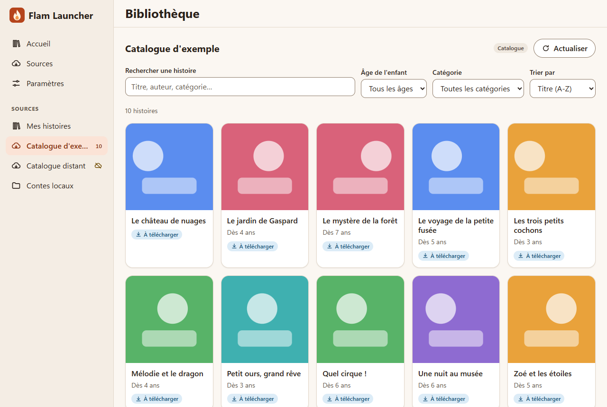
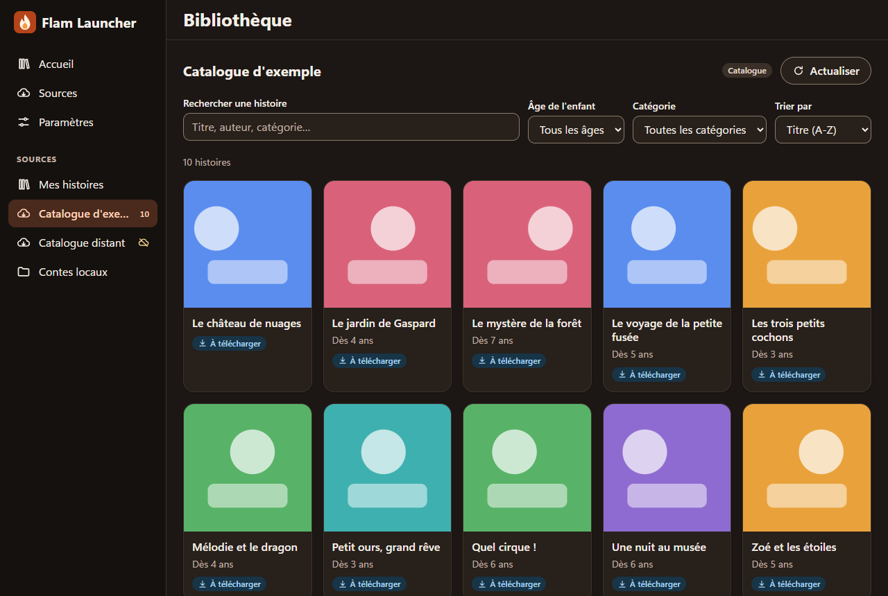
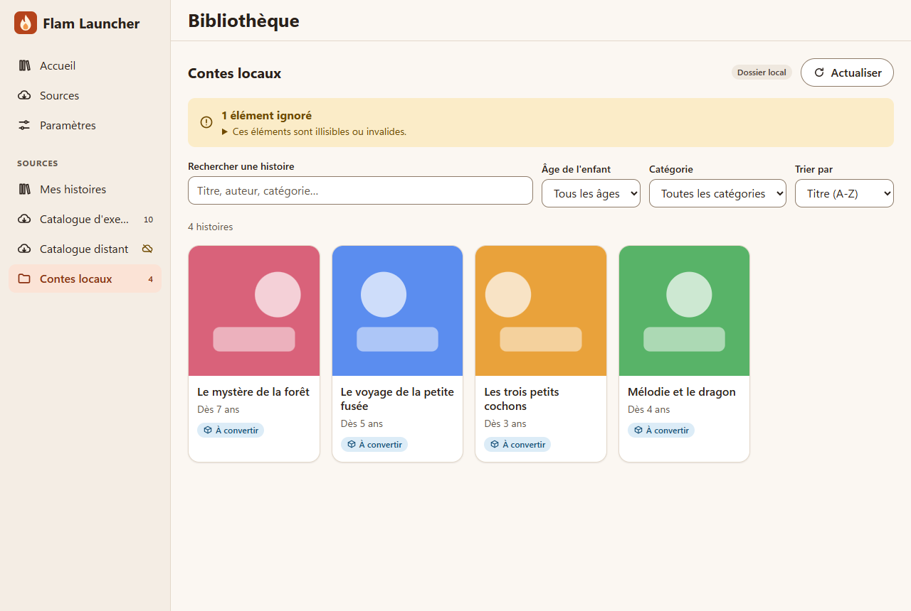
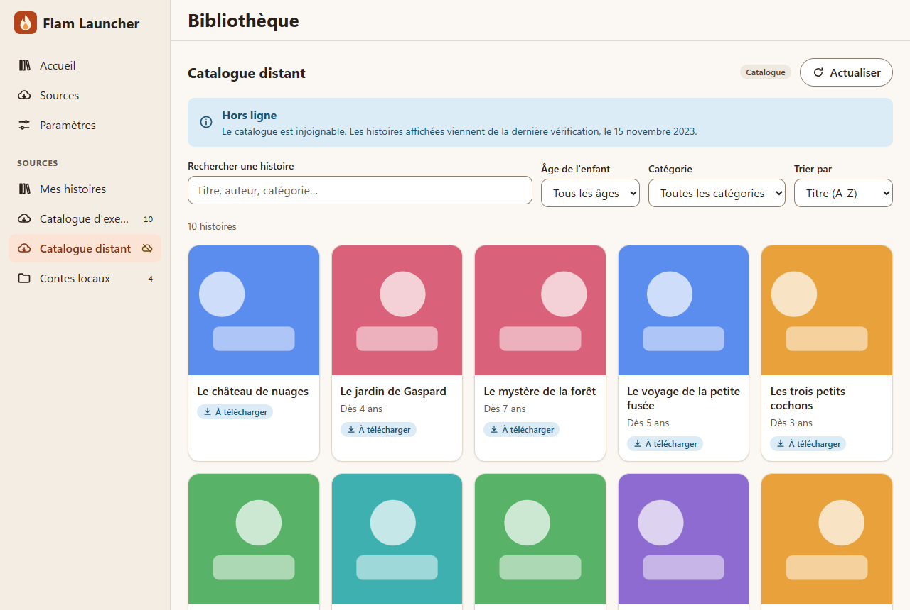
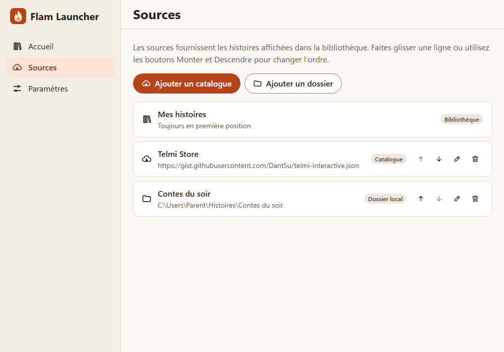
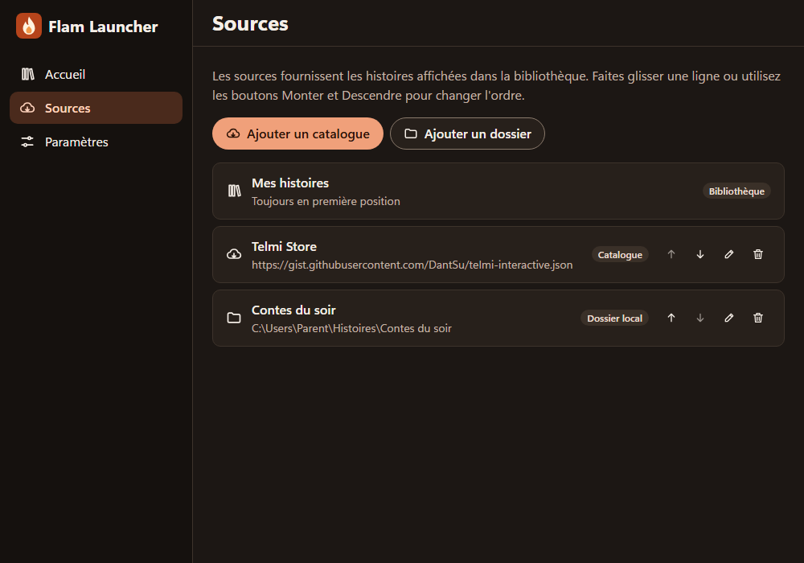
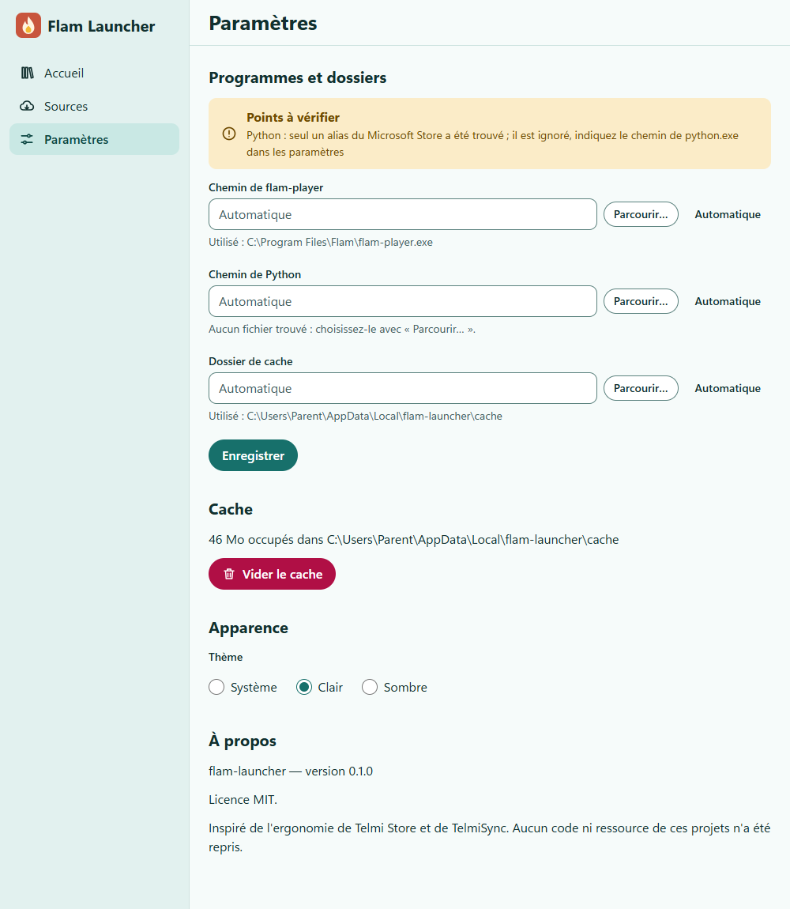
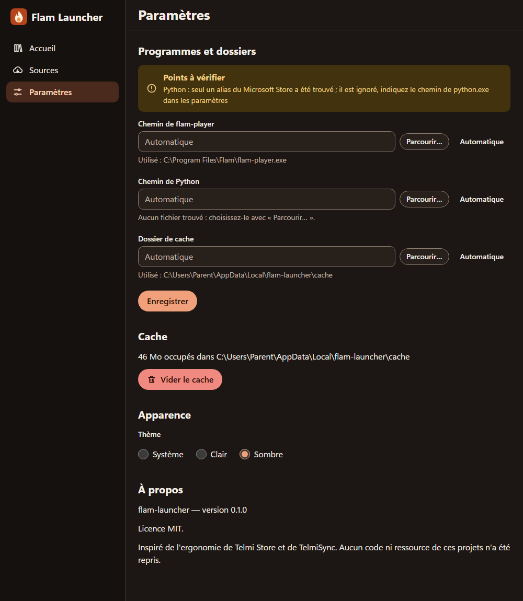

# flam-launcher

Surcouche de bureau (Windows d'abord) pour parcourir des sources d'histoires, les convertir
avec `telmi2flam` et les lancer dans `flam-player`. Application Tauri 2 : backend Rust,
interface React + TypeScript (strict). Licence **GPL v3** ou ulterieure (voir [LICENSE](../../LICENSE)).

Suivi : issue « Suivi : surcouche flam-launcher ».

Ce document décrit l'installation, l'utilisation, le dépannage puis l'architecture visée. Les éléments marqués _prévu_ n'existent pas encore
et arrivent avec les issues du jalon M3.

## Installation (Windows)

1. Télécharger l'installateur : `Flam-Launcher_<version>_x64-setup.exe` pour une pré-version publiée
   (page des releases), ou `Flam Launcher_<version>_x64-setup.exe` (avec une espace) pour l'artefact
   de la CI.
2. Le lancer : l'installation se fait **pour l'utilisateur courant**, sans droits
   d'administrateur (dossier par défaut `%LOCALAPPDATA%\Flam Launcher`).
3. **SmartScreen** : l'installateur n'est **pas signé**. Windows affiche « Windows a protégé
   votre ordinateur » : cliquer sur « Informations complémentaires » puis « Exécuter quand
   même ». Ce message disparaîtra si l'éditeur est un jour signé.
4. Lancer « Flam Launcher » depuis le menu Démarrer. WebView2 est requis (présent sur Windows
   11 et sur Windows 10 à jour).

L'installation contient tout : `flam-launcher.exe`, `flam-player.exe` et `SDL2.dll` (le
player), le convertisseur `telmi2flam/` (binaire Rust, aucun Python à installer : le moteur et le
runtime Lua du projet y sont inclus), ainsi que `LICENSES.md` et `licenses/`. Désinstaller : « Applications
installées » de Windows, ou `uninstall.exe` du dossier d'installation. Les données vivent hors
de ce dossier et survivent à une mise à jour ou une désinstallation : sources, paramètres et
sauvegardes de progression sous `%APPDATA%`, cache (catalogues, téléchargements et histoires
installées de « Mes histoires ») sous `%LOCALAPPDATA%` (« Paramètres » → « Cache » indique son
emplacement).

**Désinstallation et données** : la désinstallation retire le dossier d'installation seulement.
Les données (`%APPDATA%\flam-launcher` : sources, paramètres, sauvegardes ; et
`%LOCALAPPDATA%\flam-launcher` : cache et histoires installées) sont **conservées**, y compris si
l'on coche « supprimer les données de l'application » du désinstallateur, qui ne les connaît pas :
pour tout effacer, supprimer ces deux dossiers à la main.

## Ajouter des sources

Écran **Sources** (« Ajouter une source », puis « Ajouter un catalogue » ou « Ajouter un dossier ») :

- **Catalogue** : l'adresse (`https://…`) d'un catalogue au format Telmi Store (un JSON
  `{ "data": [ { uuid, title, download, … } ] }`). Les archives `.zip` Telmi qu'il liste sont
  téléchargées puis converties à l'installation. Le catalogue est gardé en cache : il reste
  consultable hors ligne.
- **Dossier local** : un dossier contenant des archives Telmi `.zip` (converties à
  l'installation) ou des histoires déjà converties `.plain` / `.plain.pk` (copiées telles
  quelles). Les archives STUdio `.zip` (`story.json`) sont installables et portent le badge
  « Format STUdio » : elles ne s'envoient que sur une Flam en firmware 2.x (version visible dans
  « Ma Flam ») et ne se lisent pas sur l'ordinateur. Les `.7z` STUdio et les packs Lunii du
  commerce sont refusés ([note de conception](../../docs/studio-lunii.md), § 4). Le dossier
  n'est jamais modifié.

Dans la bibliothèque d'une source, « Installer » télécharge et convertit (progression et
annulation possibles), puis « Jouer » lance l'histoire dans `flam-player` ; la fermeture du
player ramène à la surcouche. Les histoires installées sont sous « Mes histoires ».

## Podcasts : créer un pack

Disponible dans la prochaine version. Une source **podcast** (adresse d'un flux RSS) fournit des
épisodes ; l'écran **Podcasts** les liste (raccourci « Cocher les 10 derniers épisodes »,
les épisodes explicites ne sont jamais cochés d'office), puis **Composer le pack** les range dans un menu
(catégories, 3 niveaux, 50 options par menu), avec titre, âge, description et couverture. Chaque
catégorie peut prendre l'image d'un de ses épisodes (« Automatique » : celle du premier). Le
brouillon est enregistré automatiquement.

**Créer l'histoire** vérifie le pack, puis ajoute sa création à la file d'installation
(téléchargement, conversion audio, archive, conversion, bibliothèque ; progression et
annulation dans le panneau des tâches). Les épisodes qui échouent sont retirés du pack et listés
à la fin. Plafonds : 50 épisodes, 200 Mo par épisode, 1 Gio par pack.

**Lire les titres à voix haute** (case de l'éditeur, décochée par défaut) fait dire à la Flam le
titre du pack, de chaque catégorie et de chaque épisode quand on le choisit dans le carrousel,
avec une voix française de Windows, sur le PC seulement (rien n'est envoyé en ligne). « Écouter »
fait entendre le titre du pack ; la voix se choisit dans **Paramètres** → « Titres lus à voix
haute » (bouton « Essayer la voix »). Sans voix française, la case est grisée : en ajouter une
dans Windows (Paramètres → Heure et langue → Voix). Un titre qui ne peut pas être lu reste muet
et est signalé à la fin de la création ; si le premier titre ou plus de la moitié échouent, le
pack n'est pas créé.

Chaque pack créé garde sa composition sous un nom (**Compositions enregistrées**, écran
Podcasts, 50 au plus) : « Ouvrir » la recopie dans le brouillon pour refaire le pack ou en
dériver un autre (chaque création donne une nouvelle histoire) ; elle se renomme et se supprime.

À la première création, un message rappelle les droits (usage personnel et familial, pas de
partage, publicité comprise) ; « J'ai compris » le ferme et il n'est plus affiché. Détails et
décisions : [docs/podcasts.md](docs/podcasts.md).

## Flam : envoyer des histoires (expérimental)

> **Fonction expérimentale et non officielle**, ni prévue ni garantie par le fabricant de la
> Flam. À utiliser à vos risques, après avoir copié le contenu de votre Flam sur le PC.

L'écran **Ma Flam** détecte une Flam branchée en USB (« mode connexion USB » activé, la Flam
apparaît comme un disque), liste ses histoires avec leurs titres et vignettes, et permet d'en
envoyer depuis « Mes histoires », d'en retirer, de changer leur ordre et d'éjecter la Flam.

- **Firmware 1.x** : validé sur un appareil réel (1.15.14), via le mode carrier (clé `bt`
  d'une histoire officielle de votre compte, saisie ou choisie par vous).
- **Firmware 2.x** : pris en charge mais **jamais testé sur un appareil** ; c'est l'objet de la
  bêta.
- Pendant un envoi : l'application écrit dans un dossier temporaire, vérifie la copie, puis
  renomme ; l'index est réécrit de façon sûre (copie vérifiée, reprise après coupure) ; une
  copie du `.mdf` est gardée sur le PC.
  Elle ne sauvegarde **pas** les histoires de la Flam.

Détails (prérequis, limites, lenteur, redémarrage et éjection, risques, synchronisation avec
l'application officielle, dépannage) : [docs/flam-transfert.md](docs/flam-transfert.md).
Testeurs de la bêta : [docs/guide-testeur.md](docs/guide-testeur.md). Formats et procédures :
[docs/flam-device-format.md](../../docs/flam-device-format.md) et
[docs/flam-carrier.md](../../docs/flam-carrier.md).

## Dépannage

| Symptôme                                                | Piste                                                                                                                                                                                                                                                                                                |
| ------------------------------------------------------- | ---------------------------------------------------------------------------------------------------------------------------------------------------------------------------------------------------------------------------------------------------------------------------------------------------- |
| Windows « a protégé votre ordinateur »                  | Installateur non signé : « Informations complémentaires » → « Exécuter quand même »                                                                                                                                                                                                                  |
| La fenêtre reste blanche au démarrage                   | Installer ou réparer WebView2 (Microsoft Edge WebView2 Runtime)                                                                                                                                                                                                                                      |
| « flam-player est introuvable »                         | Réinstaller ; sinon indiquer `flam-player.exe` dans « Paramètres ». Un antivirus peut avoir mis le fichier en quarantaine                                                                                                                                                                            |
| « Convertisseur introuvable » (`converter_unavailable`) | Réinstaller : `telmi2flam/telmi2flam.exe` manque (antivirus ?). En développement : `cargo build -p telmi2flam`. Python n'est plus utilisé                                                                                                                                                            |
| Une conversion échoue                                   | Le message cite le code de `telmi2flam` ; l'histoire peut être incompatible (badge sur la fiche). « Cette histoire utilise un format que le launcher ne sait pas encore convertir » : format d'image non pris en charge (BMP, JPEG arithmétique ou sans perte...)                                    |
| Catalogue « hors ligne »                                | Réseau ou serveur indisponible : le cache est affiché. « Actualiser » réessaie                                                                                                                                                                                                                       |
| Disque plein                                            | « Paramètres » → « Cache » → « Vider le cache » : supprime aussi les histoires installées (à réinstaller depuis leur source) ; la progression sauvegardée et les sources sont conservées. Seuls les sous-dossiers reconnus comme ceux de l'application sont vidés (voir « Marqueur d'appartenance ») |
| Paramètres ou sources réinitialisés                     | Un fichier de configuration corrompu a été sauvegardé en `*.bak` et remplacé ; un bandeau l'indique                                                                                                                                                                                                  |

## Développement

### Prérequis

Rust stable (MSVC), Visual Studio 2022 avec les outils C++ x64, WebView2, Node 24+ et npm.

Python 3 n'est **pas** nécessaire pour utiliser, construire ou tester le launcher : l'installation
n'en contient plus (#138). Il ne sert qu'aux outils de campagne et de parité de
`tools/telmi2flam/` (bibliothèque standard et `lupa`, sans Pillow) et au faux convertisseur des
tests de pack. Le convertisseur se développe dans `crates/telmi2flam` ; l'ancien convertisseur
Python est supprimé, ses sorties sont figées comme références de test (#140).

Le launcher est membre d'un **workspace Cargo** dont le `Cargo.toml` est à la racine du dépôt (avec
`crates/telmi2flam`) : `Cargo.lock` et `target/` sont à la racine, pas dans `src-tauri/`. Les commandes
`cargo` se lancent toujours depuis `src-tauri/` (ou avec `-p flam-launcher`) ; le profil `release` est
défini dans le `Cargo.toml` racine.

## Commandes

Depuis `apps/flam-launcher/` :

| Commande                             | Effet                                                                                |
| ------------------------------------ | ------------------------------------------------------------------------------------ |
| `npm install`                        | Installe les dépendances front et la CLI Tauri                                       |
| `npm run tauri dev`                  | Lance l'application en développement                                                 |
| `npm run dev` / `npm run build`      | Front seul (Vite) / build du front                                                   |
| `npm run lint` / `npm run typecheck` | ESLint / TypeScript strict                                                           |
| `npm test`                           | Vitest + Testing Library (API Tauri simulée)                                         |
| `npm run tauri build`                | Exécutable seul avec installeurs MSI et NSIS (sans player ni convertisseur)          |
| `npm run build:notices`              | Génère `build/THIRD-PARTY-NOTICES.txt` (licences Rust et npm, installé)              |
| `npm run build:converter`            | Construit le convertisseur embarqué (réseau)                                         |
| `npm run build:player`               | Compile `flam-player.exe` (Release) et rassemble `SDL2.dll` et les licences          |
| `npm run build:installer`            | Enchaîne notices, converter, ffmpeg, player puis produit l'installateur NSIS complet |
| `npm run test:e2e`                   | Test de bout en bout (voir « Test de bout en bout »)                                 |
| `npm run screenshots`                | Captures du README racine dans `docs/assets/` (Edge, ffmpeg pour le GIF ; hors CI)   |

Dans `src-tauri/` : `cargo fmt --check`, `cargo clippy -- -D warnings`, `cargo test`.

## Convertisseur embarqué

Le launcher passe son ffmpeg embarqué au convertisseur par la variable `FLAM_FFMPEG` (vide s'il n'y en a pas) : les MP3 hors 44 100 Hz sont ainsi rééchantillonnés (#46, voir `tools/telmi2flam/README.md`).

L'application installée ne suppose aucun Python sur la machine et n'en livre aucun (#138) : le
convertisseur est le binaire Rust `telmi2flam.exe` (crate `crates/telmi2flam`, moteur Lua et
runtime du projet inclus dans le binaire), sous `<exe>/telmi2flam/` avec `LICENSES.md` et
`BUILD.txt`. Pas de Python, de Pillow, de script Python du convertisseur ni de `runtime/` à côté. Le launcher
le lance sans fenêtre, avec `--progress-json` et `--cancel-on-stdin-eof` (annulation par
fermeture de stdin). Environ 1,5 Mo sur disque.

1. **Construire l'artefact** (PowerShell et `cargo` avec la chaîne MSVC, aucun téléchargement) :
   `npm run build:converter`. Le script construit `telmi2flam.exe` (`cargo build --release
--locked`, CRT statique, cible `x86_64-pc-windows-msvc`), écrit `build/telmi2flam/` (ignoré
   par Git) puis le contrôle avec un `PATH` réduit à `System32` (ni DLL VC++ ni Python requis).
2. **L'embarquer** : `src-tauri/tauri.bundle.conf.json` déclare la ressource
   `../build/telmi2flam/` vers `telmi2flam/` (voir « Installateur Windows » plus bas pour le
   reste). Il est passé explicitement, car l'ajouter à `tauri.conf.json` ferait échouer tout
   build sans les artefacts :

   ```
   npm run build:converter
   npm run tauri build -- --config src-tauri/tauri.bundle.conf.json                 # installateur NSIS
   npm run tauri build -- --no-bundle --config src-tauri/tauri.bundle.conf.json     # exe seul
   ```

   **ffmpeg** (conversion audio des podcasts, #209) : `npm run build:ffmpeg` prépare
   `build/ffmpeg/` (ffmpeg et ffprobe LGPL minimaux, statiques, 6 Mo, avec licences et
   `BUILD.txt`). Le binaire est construit depuis des sources épinglées (`tools/ffmpeg/`) : sans
   argument le script le construit avec **Docker** ; sinon `-ArtifactDir <dossier>` reprend la
   sortie de `tools/ffmpeg/build.sh` (la CI la produit dans le job `ffmpeg`).

   Même avec `--no-bundle`, Tauri copie `telmi2flam/` à côté de l'exe dans
   `target/release/` à la racine du dépôt (workspace Cargo ; vérifié : copie identique à l'artefact). Sans
   `--config`, le build reste valable mais sans convertisseur : une conversion donne alors
   `converter_unavailable` (en développement, le launcher cherche `telmi2flam.exe` à côté de
   son exe : `cargo build -p telmi2flam`).

3. **Vérifier en réel** : deux tests Rust ignorés par défaut
   (`install::convert::tests::embarque`) pilotent le convertisseur embarqué, conversion puis
   annulation :

   ```powershell
   # depuis src-tauri/ ; `cargo test --lib --no-run` affiche le binaire de test
   $env:FLAM_TEST_RUST_CONVERTER = "<...>\target\release\telmi2flam\telmi2flam.exe"
   $env:FLAM_TEST_ARCHIVE = "<histoire de test>.zip"   # synthétique, hors dépôt
   $env:PATH = "C:\Windows\System32"
   & <binaire-de-test>.exe --ignored --nocapture embarque
   ```

   L'annulation du test exige un binaire de debug ou la feature `test-hooks`
   (`TELMI2FLAM_TEST_FAULT=wait:zip:end`). L'archive de test est synthétique, à fabriquer
   localement (issue #46) ; ne jamais committer de contenu sous licence.

**Plus de Python dans l'installation** : le réglage `python_path` n'existe plus (#139) et
l'écran Paramètres ne propose plus de chemin de Python. Un ancien `settings.json` qui porte
`python_path` ou `converter_engine: "python"` reste lisible : ces champs sont ignorés (et
disparaissent à la prochaine écriture), les autres réglages sont conservés et Rust est utilisé. Une mise à jour depuis une version qui livrait Python supprime l'ancien
dossier `telmi2flam/python/` : le désinstallateur de la version précédente retire exactement
les fichiers qu'elle avait installés (voir « Mise à jour »).

**Formats non pris en charge** : le convertisseur Rust refuse (`unsupported_format`, code 7) une
histoire dont une image est dans un format rare (ni PNG, ni GIF, ni JPEG ; ou JPEG arithmétique ou
sans perte). Les ZIP deflate, bzip2, LZMA et Zstandard sont lus. Il n'y a plus de repli :
l'installation échoue avec le message « Cette histoire utilise un format que le launcher ne sait
pas encore convertir (format d'image non pris en charge, par exemple BMP). » (texte fixe : le
message du convertisseur, qui peut citer un fichier de l'histoire, n'est ni affiché ni
journalisé). La campagne de parité sur 30 archives réelles (#135) n'en a trouvé aucune.

**Licences redistribuées** : `telmi2flam/LICENSES.md` (produit par `build-converter.ps1`) liste
le binaire (GPL v3, et HPND pour le code dérivé de Pillow : `resample.rs`, `blur.rs`, `gif.rs`), le
runtime C Microsoft lié statiquement et `vcruntime140.dll`. Python et Pillow ne sont plus livrés ;
seule la mention du code de Pillow porté en Rust reste (`THIRD-PARTY-NOTICES.txt`, texte intégral
MIT-CMU). `LICENSES.md` à la racine de
l'installation couvre le reste (flam-launcher et flam-player GPL v3, SDL2 zlib, Lua MIT, LVGL MIT,
minimp3 CC0, polices Nunito et Montserrat OFL) ; les textes sont copiés des sous-modules dans
`licenses/` par `build-player.ps1`.

## Installateur Windows

Installateur **NSIS**, par utilisateur (`installMode: currentUser`, sans droits
d'administrateur), **non signé** (SmartScreen avertit). Prérequis de build : Rust, Node 24+,
Visual Studio **2022** avec les outils C++ x64 (le build Rust doit se faire depuis
« x64 Native Tools » ou après `vcvars64.bat`), CMake et Ninja (`pip install cmake ninja` si
absents), sous-modules initialisés (`git submodule update --init --recursive`), réseau (NSIS).

**Signature.** Ni l'installateur ni `telmi2flam.exe` (embarqué) ne sont signés (SmartScreen,
antivirus) : la signature Authenticode attend un certificat de code à fournir par le mainteneur
(suivi : #443).

**Mise à jour** : avant la copie, le hook NSIS `src-tauri/windows/installer-hooks.nsh`
(`NSIS_HOOK_PREINSTALL`) lance le désinstallateur de la version précédente (`/S /UPDATE`, sur
place). Il ne supprime que les fichiers que cette version avait installés : un fichier retiré
entre deux versions disparaît (#180), un fichier étranger du dossier d'installation est
conservé, aucun `RMDir /r` aveugle. Raccourcis et données utilisateur sont conservés. Si le
désinstallateur échoue, la mise à jour continue par-dessus (comportement précédent).

Limites connues de la mise à jour (#186) :

- **Application ouverte** : en mode silencieux (`/S`), l'installateur Tauri ferme
  `flam-launcher.exe` de lui-même (`CheckIfAppIsRunning`) ; la CI le vérifie (N-1 lancé, mise à
  jour silencieuse bornée à 180 s, N-1 arrêté, arborescence identique à une installation propre).
  En mode interactif, l'installateur demande de fermer l'application.
- **Échec de N après le nettoyage** : le désinstallateur de N-1 passe avant la copie de N. L'archive
  de N est vérifiée par le CRC de NSIS au démarrage de l'installateur (avant toute action, donc avant
  le hook ; l'option `/NCRC` n'est pas utilisée), ce qui écarte un installateur tronqué ou corrompu, y
  compris en mode silencieux `/S` (code de sortie 2, rien n'est exécuté ; la CI le vérifie). En
  revanche, un échec en cours de copie (disque plein, fichier verrouillé) laisse une installation
  incomplète : relancer l'installateur de N la répare, y compris sans entrée « Programmes et
  fonctionnalités ». Il n'y a pas de sauvegarde de N-1.
- **N-1 trop ancienne** : la conservation des raccourcis et du démarrage automatique repose sur le
  drapeau `/UPDATE` du désinstallateur de N-1, présent dans les installateurs générés par Tauri 2
  (le launcher utilise Tauri 2.12). Un installateur N-1 d'une génération qui l'ignore (hors Tauri 2) perd
  raccourcis et démarrage automatique : les recréer en relançant l'application ou l'installateur de N.
  **Version minimale de N-1 : 0.1.0**, le premier installateur du launcher (Tauri 2, `/UPDATE` géré) :
  toute version publiée est compatible. Le nettoyage des fichiers retirés ne dépend que du hook de N.

```
npm run build:installer      # = build:notices + build:converter + build:ffmpeg + build:player + tauri build --config …
```

**Runtime Visual C++** : `flam-player.exe` importe `VCRUNTIME140.dll`, absente d'un Windows
propre. Choix : livrer `vcruntime140.dll` (fichier redistribuable de Visual Studio, copié depuis
son dossier `VC\Redist` par `build-player.ps1`) à côté du player plutôt que passer en runtime
statique, qui changerait les options de compilation de tout le player, de SDL2, de Lua et de LVGL
sans changer le résultat pour l'utilisateur. Le launcher (Rust) et `SDL2.dll` n'importent que
des DLL Windows (UCRT, Windows 10 et plus). `scripts/check-imports.ps1 <dossier>` (étape de la CI,
sur l'installation) liste les imports des trois binaires avec `dumpbin /dependents` et échoue si
une DLL du runtime VC++ est importée sans être à côté du binaire, ou si une autre DLL est
introuvable.

soit, en détail :

1. `npm run build:converter` : `build/telmi2flam/` (voir plus haut) ;
2. `npm run build:player` : compile `flam-player.exe` en Release (`<dépôt>/build/release`,
   `do_build.bat` et son Debug ne sont pas touchés) et dépose `flam-player.exe`, `SDL2.dll` et
   `licenses/` dans `build/player/` ;
3. `npm run tauri build -- --config src-tauri/tauri.bundle.conf.json` : produit
   `target/release/bundle/nsis/Flam Launcher_<version>_x64-setup.exe` (environ 11 Mo)
   et dépose les mêmes ressources à côté de `flam-launcher.exe`.

`tauri.bundle.conf.json` (fusionné avec `tauri.conf.json`) restreint les cibles à `nsis` et
déclare les ressources : `telmi2flam/` (`telmi2flam.exe`, licences), `flam-player.exe` et
`SDL2.dll` **à côté de l'exécutable** (c'est là que `settings::detect_player` les cherche),
`vcruntime140.dll`, `licenses/` et `LICENSES.md`. Le launcher lance le player avec pour dossier courant celui de
`flam-player.exe` : `SDL2.dll` est ainsi trouvée. Installation sans interaction :
`"Flam Launcher_<version>_x64-setup.exe" /S /D=<dossier>` (`/D=` en dernier, sans guillemets) ;
désinstallation : `<dossier>\uninstall.exe /S _?=<dossier>`.

### Test de bout en bout

`src-tauri/tests/e2e.rs` pilote les **services réels** du backend, sans WebView :
`CatalogService` lit un catalogue servi par un serveur HTTP local factice, `InstallService`
télécharge l'archive et la convertit avec le vrai `telmi2flam.exe`, `Library`
la liste, `PlayerService` lance le vrai `flam-player.exe` (`SDL_VIDEODRIVER=dummy`,
`SDL_AUDIODRIVER=dummy`, `SDL_RENDER_DRIVER=software`), puis le player est fermé et
l'événement `exited` est reçu. Le player ne se termine pas seul : sa fin est obtenue par
`taskkill /F` (garde RAII qui le ferme aussi si le test échoue). Une sortie volontaire n'est pas
simple à obtenir : avec `SDL_VIDEODRIVER=dummy` il n'y a aucune fenêtre à qui envoyer `WM_CLOSE`
(`taskkill` sans `/F`), et le player n'a ni commande de sortie ni entrée console ; en ajouter une
toucherait le code du player pour les besoins d'un test (suivi laissé ouvert). Le test vérifie
qu'il charge l'histoire et reste actif avant cela. L'archive est synthétique (images unies, MP3 muets), générée par
le test : aucun contenu sous licence. Choix : tester le backend Rust plutôt que piloter
l'interface par WebDriver, qui exigerait `tauri-driver` et `msedgedriver` appariés à la version
de WebView2 (fragile, lent) alors que la logique à risque est dans le backend ; l'interface a
ses tests Vitest et la liaison front/backend repose sur des types miroirs.

```
npm run build:installer
npm run test:e2e             # sur target/release (racine du dépôt) ; ou FLAM_E2E_INSTALL_DIR=<installation>
```

Sans `FLAM_E2E_REQUIRE=1` et sans `flam-player.exe`, `cargo test` **saute** ce test : il passe au
vert sans rien vérifier, et le message n'apparaît qu'avec `-- --nocapture` ; `npm run test:e2e` et
la CI posent `FLAM_E2E_REQUIRE=1` (le test échoue alors si un prérequis manque) ;
variables : `FLAM_E2E_INSTALL_DIR`, ou `FLAM_E2E_PLAYER` + `FLAM_E2E_RUST_CONVERTER`. La CI
(`.github/workflows/launcher.yml`) compile le player, construit l'installateur, l'installe en
silence, y exécute ce test puis le désinstalle en vérifiant qu'il ne reste aucun fichier.

Sur une PR, l'installateur N-1 et le test de mise à jour N-1 vers N (≈ 5 min de build, plus le
scénario) ne tournent que si la PR modifie l'empaquetage : `tauri*.json`, `Cargo.toml`, `build.rs`,
`icons/`, `windows/` (hooks NSIS) de `src-tauri/`, `package*.json`, `LICENSES.md`, `third-party/` et
les scripts `build-*`, `notices-lib`, `Get-InstallTree`, `check-imports` du launcher, `tools/ffmpeg/`,
`Cargo.toml`/`Cargo.lock` racine, ou `.github/workflows/launcher.yml`. Le label de PR
`ci-installeur` force l'exécution (poser le label relance la CI). L'installateur N, son installation,
l'e2e et l'artefact tournent toujours ; sur `push` vers main, tout tourne.

### À vérifier sur une session Windows propre

Non couvert par la CI ni par le poste de développement (où Visual Studio et WebView2
sont déjà présents) : à cocher par le mainteneur avant publication.

- [ ] L'installateur s'exécute sans droits d'administrateur ; SmartScreen propose
      « Exécuter quand même ».
- [ ] Aucun Python ni Visual Studio sur la machine : une histoire Telmi s'installe
      (convertisseur embarqué) et se joue dans `flam-player`.
- [ ] Windows 10 et Windows 11 ; WebView2 absent : comportement et message.
- [ ] Raccourci du menu Démarrer, icône, entrée dans « Applications installées ».
- [ ] Fenêtre du player (carte graphique réelle, audio réel) : image et son.
- [ ] Mise à jour par-dessus une version installée ; désinstallation (données utilisateur
      conservées, dossier d'installation vide).
- [ ] Antivirus : pas de quarantaine de `flam-player.exe` ni de `telmi2flam.exe`.

## Publier une pré-version

Workflow `.github/workflows/release-launcher.yml` (#319) : une étiquette `launcher-v<version>`
poussée sur un commit de `main` construit l'installateur NSIS (mêmes étapes que `launcher.yml`),
calcule `SHA256SUMS.txt` et crée une **pré-version** GitHub « Flam Launcher <version> » avec
l'installateur, `SHA256SUMS.txt` et les notes de `release-notes/<version>.md`. Les releases `v0.x`
du dépôt concernent le player : elles ne sont pas touchées.

Procédure (exemple : `0.1.0-beta.1`) :

1. Repérer le commit visé : le **commit de fusion de la montée de version** (étape 2). Il touche
   `apps/flam-launcher/**`, donc la CI `launcher` y tourne ; attendre qu'elle soit verte (le workflow
   de publication ne rejoue ni lint, ni tests, ni test de mise à jour, et refuse sans cette CI verte).
2. Dans une PR : passer `0.1.0-beta.1` dans `src-tauri/Cargo.toml`, `src-tauri/tauri.conf.json`,
   `package.json`, `package-lock.json` (`npm version 0.1.0-beta.1 --no-git-tag-version`) et
   `Cargo.lock` (`cargo check` depuis `src-tauri/`). Relire `release-notes/0.1.0-beta.1.md` et en
   **retirer la ligne « BROUILLON »** : la publication refuse des notes qui la contiennent. Vérifier que
   `docs/guide-testeur.md` (#235) et le modèle d'issue `.github/ISSUE_TEMPLATE` (#318), cités par les
   notes, sont fusionnés. Fusionner.
3. Facultatif : Actions, « release-launcher », « Run workflow » depuis `main`, étiquette
   `launcher-v0.1.0-beta.1`, `dry_run` coché (valeur par défaut) : construit tout depuis `main` sans
   rien publier ; les contrôles propres à la publication (brouillon, commit dans `main`, release
   existante, CI `launcher` verte) ne sont alors que des avertissements.
4. Poser et pousser l'étiquette sur le commit de fusion :
   `git tag launcher-v0.1.0-beta.1 <commit> && git push origin launcher-v0.1.0-beta.1`.
5. Le workflow publie. En cas d'échec : le rejeu (« Run workflow » depuis `main`, même étiquette,
   `dry_run` décoché) reconstruit le commit de l'étiquette ; il convient à une panne passagère ou à
   une correction du workflow lui-même. Une correction du code, des versions ou des notes impose de
   supprimer l'étiquette (`git push origin :refs/tags/launcher-v0.1.0-beta.1`), de la reposer sur le
   nouveau commit de `main`, ou de passer à une nouvelle version. Si une release du même nom existe,
   le workflow refuse d'y toucher : la supprimer à la main d'abord.

Contrôles automatiques avant le build : forme de l'étiquette (`launcher-v` + SemVer, pré-version
admise), les fichiers de version (dont `packages[""]` de `package-lock.json`) égaux à la version de l'étiquette, notes présentes et sans
« BROUILLON » (casse indifférente), commit de l'étiquette contenu dans `main`, aucune release
existante (brouillon compris, revérifié avant la création), rejeu lancé depuis `main`, et **CI
`launcher` verte sur ce commit exact** : le workflow `launcher` doit y avoir un run `push` terminé en
succès (en cas de relances, le plus récent compte). Sans run (commit qui ne touche aucun chemin filtré
de `launcher.yml`, par ex. un commit de documentation seule), en cours, échoué ou annulé, la
publication est refusée : il n'y a volontairement pas de repli sur un commit ancêtre, des commits non
testés pouvant s'être intercalés. Poser alors l'étiquette sur le commit de fusion de la montée de
version, ou attendre / relancer la CI `launcher` (Actions, « Re-run »). La CI de `main` annule le run
précédent quand un autre commit arrive : un run annulé sur le commit visé est à relancer avant la publication. Un dry_run et la répétition
générale affichent ce contrôle en avertissement. Le commit contrôlé est celui qui est construit et publié (l'étiquette ne doit pas
avoir bougé). La forme de l'étiquette n'admet pas de tiret dans un identifiant de pré-version
(`beta.1`, pas `beta-1`). L'installateur
porte le nom `Flam-Launcher_<version>_x64-setup.exe` (sans espace, comme dans `SHA256SUMS.txt`) et
la version enregistrée par l'installateur est comparée à celle de l'étiquette. Sur une PR qui modifie
le workflow ou les notes, une répétition générale construit l'installateur avec la version d'exemple
`0.1.0-beta.1` forcée (sans publier) : elle valide que Tauri et NSIS acceptent le suffixe de
pré-version.

## Architecture

```
apps/flam-launcher/
  src/                     Front React/TypeScript
    api/                   Couche typée au-dessus de `invoke` / événements Tauri
    router.ts              Routage par hash (`#/`, `#/sources`, `#/settings`, `#/library[/<id>]`, `#/demo` en dev)
    features/<domaine>/    Écrans et logique par fonctionnalité (app, welcome, sources, settings,
                           library, compat, stories, recovery, demo en dev)
    components/            Composants partagés sans logique métier (design system)
    theme/                 Jetons CSS (clair/sombre) et choix du thème
    i18n/                  Textes de l'interface (français)
  docs/DESIGN.md           Design system : principes, palette, composants
  docs/podcasts.md         Spécification produit des podcasts (#208)
  src-tauri/
    src/
      lib.rs               Initialisation (traces, builder Tauri)
      app.rs               Commandes générales (`app_info`)
      external.rs          Ouverture d'une page du dépôt dans le navigateur (`open_external`, #323)
      error.rs             `AppError` (thiserror), sérialisée en `{ kind, message }`
      storage.rs           Persistance JSON : écriture atomique, `*.bak`, migration de schéma
      settings.rs          `settings.json`, détection du player, commandes `settings_*`
      cache.rs             Taille du cache et vidage (sous-dossiers de l'application seulement)
      sources.rs           `sources.json`, source par défaut et implicite, commandes `sources_*`
      story.rs             `StoryEntry` / `StoryKind` : type commun des histoires de toutes les sources
      catalog.rs           Source catalogue : téléchargement, lecture tolérante, cache, vignettes
      folder.rs            Source dossier local (`.zip` Telmi, `.plain`, `.plain.pk`), commandes `folder_*`
      thumbnail.rs         Vignettes : PNG, LIF (décodeur de `crates/telmi2flam`), réduction, cache `thumbs/`, URL `data:`
      watch.rs             Surveillance optionnelle d'un dossier local (`notify`), `folder_watch`
      install/             Pipeline d'installation : file, téléchargement, conversion (`mod.rs`,
                           `download.rs`, `convert.rs`, `pack.rs`), commandes `install_*`
      library.rs           Bibliothèque `<cache>/library/` et `library.json`, commandes `library_*`
      library_thumb.rs     Vignettes des histoires installées (`library/thumbs/`), `library_thumbnail`
      compat.rs            Statut de compatibilité (`status.json` de la campagne + conversions locales), commande `compat_statuses`
      device/              Flam branchée en USB : `detect.rs` (détection, `.mdf`), `crypto.rs` (AES-128-CBC,
                           clés d'appareil, fichier `key`),
                           `prepare.rs` (dossier `str/<uuid>/` préparé hors appareil depuis un `.plain.pk`)
      podcast/rss.rs       Lecture d'un flux RSS 2.0 + iTunes (logique pure, DOCTYPE refusé, bornes), `parse_feed` (#210)
```

### Modules Rust

Présents : `app` (commandes générales), `error`, `storage`, `settings`, `cache`, `sources`, `story`, `catalog`, `folder`, `lif`, `thumbnail`, `install`, `library`, `library_thumb`, `library_source` (empreinte de la source dossier d'une histoire installée, #288), `compat`, `player`, `device` (Flam branchée en USB : détection #225, `device::detect` ; index #226, `device::index` ; chiffrement et préparation #228, `device::crypto`, `device::prepare` ; état et histoires en lecture seule pour l'écran « Ma Flam » #227, `device::status` ; titres déchiffrés et vignettes des histoires #276, `device::details` ; transfert sûr #229, `device::transfer`, commandes `device_send_story`, `device_cancel_transfer` et `device_recover_transfers` (reprise au branchement), événement `device://transfer-progress` ; retrait de « Mes histoires » après l'envoi #609, `device::after_send`, commande `library_remove_sent` ; retrait #231, `device::remove` ; ordre des histoires #233, `device::reorder`, commande `device_reorder_stories` ; éjection #232, `device::eject` ; verrou des opérations, `device::lock`), `podcast` (`rss`).

### Commandes Tauri

Chaque module Rust porte ses propres commandes (`#[tauri::command]` dans le module concerné,
enregistrées dans `generate_handler!` de `lib.rs`) : pas de fichier `commands.rs` fourre-tout.

Les commandes sont asynchrones (`tokio`), renvoient `AppResult<T>` et sont enregistrées dans
`generate_handler!` (`lib.rs`). Chacune a un wrapper typé dans `src/api/`.

| Commande                      | Arguments                        | Retour                                                     | Module               |
| ----------------------------- | -------------------------------- | ---------------------------------------------------------- | -------------------- |
| `app_info`                    |                                  | `{ name, version }`                                        | `app`                |
| `settings_get`                |                                  | `SettingsView`                                             | `settings`           |
| `settings_set`                | `settings: Settings`             | `SettingsView`                                             | `settings`           |
| `sources_list`                |                                  | `SourcesView`                                              | `sources`            |
| `sources_add`                 | `input: SourceInput`             | `Source`                                                   | `sources`            |
| `sources_update`              | `id`, `input: SourceInput`       | `Source`                                                   | `sources`            |
| `sources_remove`              | `id`                             | rien                                                       | `sources`            |
| `sources_reorder`             | `ids: string[]`                  | `Source[]` (liste complète)                                | `sources`            |
| `config_ack_recovery`         | `file?: string`                  | rien                                                       | `storage`            |
| `cache_usage`                 |                                  | `{ path, bytes }`                                          | `cache`              |
| `podcast_mp3_cache_size`      |                                  | `{ bytes }` (part des MP3, comprise dans `cache_usage`)    | `podcast::mp3size`   |
| `cache_clear`                 |                                  | `{ freed_bytes }`                                          | `cache`              |
| `open_external`               | `url: string`                    | rien                                                       | `external`           |
| `catalog_refresh`             | `source_id`                      | `CatalogView`                                              | `catalog`            |
| `catalog_entries`             | `source_id`                      | `CatalogView`                                              | `catalog`            |
| `catalog_thumbnail`           | `source_id`, `thumb_url`         | URL `data:` (string)                                       | `catalog`            |
| `podcast_add`                 | `url`, `name?`                   | `{ source, view: PodcastView }`                            | `podcast::source`    |
| `podcast_feed`                | `source_id`                      | `PodcastView` (cache, sans réseau)                         | `podcast::source`    |
| `podcast_refresh`             | `source_id`                      | `PodcastView`                                              | `podcast::source`    |
| `folder_scan`                 | `source_id`, `recursive?`        | `FolderScan`                                               | `folder`             |
| `folder_thumbnail`            | `source_id`, `entry_id`          | URL `data:` (chaîne)                                       | `folder`             |
| `folder_watch`                | `source_id`, `enabled`           | rien                                                       | `watch`              |
| `install_start`               | `source_id`, `entry_id`, `uuid?` | `InstallTask`                                              | `install`            |
| `install_cancel`              | `task_id`                        | rien                                                       | `install`            |
| `install_list`                |                                  | `InstallTask[]`                                            | `install`            |
| `library_list`                |                                  | `LibraryEntry[]`                                           | `library`            |
| `library_remove`              | `uuid`, `purge_saves?`           | rien                                                       | `library`            |
| `library_remove_sent`         | `root`, `uuid`                   | rien (voir « Retrait du PC après l'envoi »)                | `device::after_send` |
| `library_thumbnail`           | `uuid`                           | URL `data:` (`not_found` sans vignette)                    | `library_thumb`      |
| `library_source_status`       |                                  | `SourceCheck[]` (`{ uuid, state }`)                        | `library_source`     |
| `player_launch`               | `uuid`                           | `PlayerSession`                                            | `player`             |
| `player_launch_folder`        | `source_id`, `entry_id`          | `PlayerSession`                                            | `player`             |
| `player_status`               |                                  | `PlayerSession \| null`                                    | `player`             |
| `player_stop`                 |                                  | `bool` (faux : aucun player)                               | `player`             |
| `player_embed_layout`         | `rect \| null` (px CSS)          | rien                                                       | `player`             |
| `player_embed_focus`          |                                  | rien                                                       | `player`             |
| `device_status`               |                                  | `DeviceStatus`                                             | `device::status`     |
| `device_list_stories`         |                                  | `DeviceStories \| null` (`null` : aucune Flam)             | `device::status`     |
| `device_story_titles`         | `root`, `uuids` (≤ 100)          | `{ titles: { uuid, title \| null }[], interrupted, keys }` | `device::details`    |
| `device_story_thumbnail`      | `root`, `uuid`                   | `{ thumb: URL data: \| null, busy }`                       | `device::details`    |
| `device_story_details_cancel` |                                  | rien                                                       | `device::details`    |
| `device_official_titles`      | `uuids` (≤ 1000)                 | `{ titles: { uuid, title, has_image }[] }`                 | `device::official`   |
| `device_official_thumbnail`   | `uuid`                           | URL data: \| null                                          | `device::official`   |
| `device_reorder_stories`      | `root`, `order: string[]`        | `{ changed, cache_removed, count }`                        | `device::reorder`    |
| `device_diagnostic`           |                                  | `string` (Markdown)                                        | `device::diagnostic` |

`device_status` et `device_list_stories` sont **en lecture seule** sur la Flam : ni reprise
d'index (`recover`), ni création de dossier. La seule écriture est la copie personnelle de
`.mdf` (`backup_mdf`) dans le dossier de données du launcher, faite par `device_status`
(idempotente). Le titre renvoyé par `device_list_stories` est celui de la bibliothèque du
launcher, associé à l'histoire de la Flam par l'UUID de `uuid.bin` de son `.plain.pk` (une source
dossier ou Telmi a un identifiant de bibliothèque différent du nom de `str/<uuid>/`, #276).
`device_diagnostic` (#318, bouton « Copier le diagnostic » de « Ma Flam ») est aussi en lecture
seule, sans accès réseau et sans sauvegarde de `.mdf` : texte Markdown pour le modèle d'issue
« Retour testeur Flam » (version du launcher et de Windows, état du firmware, index, fichiers de
travail, espace, nombre d'histoires, dernières erreurs d'envoi et de reprise de la session, gardées
en mémoire). Ni clé, ni `bt`, ni numéro de série, ni empreinte de `.mdf`, ni nom de volume, ni
titre ou UUID d'histoire ; profil Windows remplacé par `%USERPROFILE%` et dossier de cache par
`%CACHE%`, puis tout UUID, toute suite hexadécimale d'au moins 14 caractères (ou d'au moins 8 paires
séparées par une espace ou `:`) et tout mot de type base64 masqués. Pendant une écriture, index,
dossiers et fichiers de travail ne sont pas parcourus. Le diagnostic n'écrit rien sur la Flam,
ni aucune donnée de confiance sur le PC.
Titres et vignettes de la Flam (#276, `device::details`, lecture seule stricte) sont chargés
**après** l'affichage de la liste : titres par lots de 100 (première ligne de `info` déchiffré,
lecture bornée à 4 Kio ; fw 2.x : clés de `.mdf` ; fw 1.x : clé carrier **déjà conservée** pour
cette Flam, consentement à jour, jamais demandée depuis cet écran), vignettes à l'approche de la
zone visible, deux à la fois (`img/thumbnail.lif` non chiffré, 1 Mio au plus, décodé en PNG de
96 px au plus et mis en cache dans `<cache>/thumbs/`, clé : empreinte de l'UUID, de la taille et
de la date du fichier). Repli du titre : bibliothèque, puis UUID court ; vignette absente ou
invalide : illustration par défaut. Ces lectures ne prennent pas le verrou d'appareil : elles
s'arrêtent dès qu'une opération est en cours (`interrupted`, `busy`) et l'écran les redemande
2 s plus tard ; l'envoi ou le retrait en cours côté interface les suspend, et quitter l'écran ou
changer de Flam interrompt le lot en cours (`device_story_details_cancel`). Sans clé de titre
(`keys` faux), les réponses ne sont pas retenues : l'écran redemande après un envoi ou une
nouvelle liste. Un `.mdf` momentanément illisible donne `interrupted`. Aucune clé dans les
réponses ni les journaux.
Le numéro de série et le firmware ne sont pas affichés : `parse_mdf` ne lit encore aucun champ
(format de `.mdf` non spécifié, #224). L'écran « Ma Flam » (`#/device`, `src/features/device/`) est
alimenté par `DeviceProvider` : scrutation de `device_status` (2 s sur l'écran, 6 s ailleurs,
arrêtée pendant la lecture incrustée), `device_recover_transfers` une fois par branchement avant
la lecture des histoires, file d'envoi séquentielle (`device_send_story`, progression par
`device://transfer-progress`, annulation par `device_cancel_transfer`), retrait confirmé
(`device_remove_story`), ordre des histoires (`device_reorder_stories`) et éjection
(`device_eject`). Le bouton « Envoyer sur la Flam » (cartes,
fiche, « Ma Flam ») reste focalisable quand il est refusé et affiche sa raison (Flam non
détectée, déjà présente, espace insuffisant, firmware non pris en charge, déjà en file) ; une
histoire déjà sur la Flam (non masquée ; reconnue par l'UUID de `uuid.bin` de son archive, exposé
dans `library_uuids` de `device_list_stories`, y compris pour une source dossier ou Telmi) propose
en plus « Remplacer sur la Flam » (`device_send_story` avec `replace` = UUID de l'histoire sur la
Flam, refusé si l'archive en désigne une autre ; même à version égale : l'ancienne version n'est
retirée qu'une fois la nouvelle en place, #288, #309), et une histoire dont la source dossier a changé depuis
l'installation affiche « Source modifiée depuis l'installation : mettez l'histoire à jour avant de
l'envoyer… » (sans bloquer) ;
seuls un envoi en attente ou en cours bloque un nouvel envoi (« déjà en file ») : une tâche terminée
(réussie, échouée, annulée) ne bloque jamais, et les envois réussis d'une histoire supprimée de la
bibliothèque sont retirés de la file (`libraryUuids`, #299) ;
l'avertissement « fonction expérimentale, non officielle » est mémorisé dans le stockage local
(`preferences.ts`). Le firmware n'étant pas exposé par `device_status`, « non pris en charge »
n'est connu qu'après un refus du backend.

**Retrait du PC après l'envoi** (#609, `device::after_send`) : une histoire envoyée garde sa copie
dans « Mes histoires » (dossier de cache). Après un envoi **réussi**, le rapport de
`device_send_story` porte `library_copy` : `kept` (la ligne de la file propose « Retirer du PC » ;
`unconfirmed` : écriture non confirmée sur le support, voir plus bas ; `auto` : retrait
automatique demandé), `removed`
(réglage `remove_after_send` actif : retirée aussitôt), `remove_failed` (`message` : retrait
impossible, l'envoi reste réussi, le bouton est reproposé), ou rien (aucune proposition). Le
texte dit que l'histoire reste sur la Flam, que la renvoyer plus tard demandera de la
réinstaller, et qu'il faut « Éjecter la Flam » avant de la débrancher ; une notification annonce
le retrait, son échec, ou (réglage actif seulement) une copie gardée par prudence. Écriture non
confirmée, réglage actif ou non : la ligne dit que l'histoire est bien sur la Flam, que sa copie
est gardée par prudence, et qu'après l'avoir retirée il faut éjecter la Flam avant de la
débrancher. Un refus **définitif** de « Retirer du PC » (`not_removable` : autre Flam, histoire
plus sur la Flam ou changée ; `not_found` : envoi inconnu) retire le bouton et laisse le message
sur la ligne ; un refus **passager** (`player_busy`, installation en cours ou Flam occupée en
`validation`, `io`) garde le bouton avec le message. Le bouton disparaît aussi quand l'histoire
est retirée de la Flam (« Ma Flam ») ou quand la Flam détectée change.

- Succès = `send_from_library` rend `Ok` (copie, relecture de chaque fichier sur la Flam avec
  taille et SHA-256, renommage en `str/<uuid>/`, index à jour) **et** la relecture carrier n'est
  pas illisible (`carrier_readback` différent de `false`). Échec, annulation, Flam débranchée,
  « déjà sur la Flam » : rien n'est retiré ni proposé.
- **Retrait automatique seulement si l'écriture est confirmée sur le support** : la relecture a
  lieu dans `.flam-transfer/<uuid>.in/` avant le renommage en `str/<uuid>/`, renommage forcé sur
  le support au mieux (`sync_dir`). Le rapport interne porte `dir_synced` (les trois `sync_dir`
  ont réussi ; toujours faux hors Windows) et `verified_uncached` (aucune relecture n'est retombée
  sur le cache du système ; toujours faux hors Windows). Le retrait automatique exige les deux,
  sous Windows ; sinon `kept` avec `unconfirmed` (aussi quand le réglage est désactivé, pour la
  consigne d'éjection). Chaque envoi réussi journalise, au niveau
  `info`, la ligne `durabilité de l'envoi renommage_force="oui|non" relecture_sans_cache="oui|non"`
  (cible `flam_launcher_lib::device::transfer`, sur la sortie standard du processus : pas de
  fichier de journal, voir `lib.rs`).
- Le retrait automatique a lieu dans `device_send_story`, verrou de la Flam toujours tenu (aucun
  autre envoi ne s'intercale) ; il peut attendre le créneau du player (lancement en préparation),
  et l'annulation de l'envoi est sans effet pendant cette phase ; « Retirer du PC » (`library_remove_sent`) prend ce verrou (refus
  `busy` pendant un envoi). Les deux passent par le chemin de « Supprimer » (`remove_story` :
  créneau du player, verrou de la bibliothèque, purge de la copie de travail), **sans** purger la
  progression de l'enfant.
- Même génération : l'empreinte de l'entrée (fichier, taille, `installed_at`, taille et date du
  fichier) est prise avant la préparation, revérifiée après l'envoi, puis sous le verrou de la
  bibliothèque juste avant le retrait (`Library::remove_checked`). Une histoire réinstallée ou mise
  à jour entre-temps n'est pas retirée (`not_removable`). Refus aussi pendant sa lecture
  (`player_busy`) ou son installation (`validation`).
- `library_remove_sent(root, uuid)` ne retire que ce qu'un envoi réussi de la session a enregistré
  (registre en mémoire) ; sinon `not_found`. Avant tout retrait (manuel ou automatique), verrou
  de la Flam tenu, la Flam est relue (lecture seule) : même racine et même `.mdf` (empreinte
  SHA-256), histoire (identifiant sur la Flam, `report.id`) listée dans l'index visible, chaque
  fichier de l'envoi présent dans `str/<id>/` avec sa taille. Sinon refus (`not_removable`) et
  l'entrée est oubliée. L'entrée est aussi oubliée au début de tout nouvel envoi de l'histoire
  (même s'il échoue), dès qu'un envoi réussi réécrit la même histoire de la Flam (même relu
  illisible en mode carrier), et par
  `device_remove_story`. Jamais le fichier source de l'utilisateur ni l'archive d'origine :
  seul le fichier de `library/` de l'entrée envoyée.

**Installer et envoyer** (#609, `useInstallAndSend.ts`, `DeviceProvider`) : à côté de
« Installer » / « Télécharger » (carte et fiche d'une histoire non installée), l'action
« Installer et envoyer » / « Télécharger et envoyer » enchaîne les étapes existantes, sans
nouveau chemin de conversion ni de transfert : installation habituelle (`install_start`), puis
envoi par la file d'envoi (`device_send_story`), puis retrait de « Mes histoires » si le réglage
`remove_after_send` est actif (par `device::after_send`, inchangé). Aucune commande ni aucun
réglage n'est ajouté.

- **Proposée seulement si l'envoi est possible maintenant** : mêmes règles que « Envoyer sur la
  Flam » (`sendBlock`), d'après la taille annoncée de l'histoire : Flam détectée et lue, firmware
  accepté, histoire STUdio seulement sur une Flam 2.x, histoire absente de la Flam, espace
  suffisant. Sinon seul « Installer » est affiché. Une histoire déjà installée garde « Envoyer
  sur la Flam » : rien n'est réinstallé.
- **Au clic** : l'avertissement « fonction expérimentale » est demandé d'abord s'il n'a jamais
  été accepté (bouton « J'ai compris, installer et envoyer » ; refusé : rien n'est installé),
  puis l'envoi est **prévu** (`plannedSends`, `planSend`) et l'installation est demandée. L'envoi
  prévu n'est affiché qu'une fois l'installation réellement démarrée (`onStarted`, après les
  dialogues « incompatible » et « changement de format »). Le panneau d'envoi liste les envois
  prévus (« Installation… », « Installée, envoi en attente », « Installée, envoi à confirmer »,
  « Ne sera pas envoyée ») avec, pour chacun, « Ne pas envoyer … après l'installation »
  (l'installation continue) ; la fiche le rappelle.
- **À la fin de l'installation** (`InstallOptions.onSettled`, appelé une seule fois) : réussie,
  l'envoi part par `requestSend` (mêmes dialogues, mode carrier compris, même file, mêmes refus
  du backend) ; en échec, annulée (même si elle se termine avant d'avoir vu l'annulation),
  refusée à un dialogue de confirmation ou dont le dialogue est remplacé par celui d'une autre
  demande, l'envoi prévu est oublié et l'échec s'affiche comme d'habitude. « Réessayer » relance
  une installation simple, sans envoi.
- **Même Flam qu'au clic** : l'envoi prévu retient la clé d'appareil du clic (`deviceKey.ts`) :
  lettre du lecteur, libellé de volume (le même sur toutes les Flam) et **empreinte opaque de
  l'appareil** rendue par `device_status` (voir « Empreinte de l'appareil » ci-dessous). Il est
  abandonné pour de bon, même si la même Flam revient (même clé), dès que : la scrutation voit
  une autre lettre, **une autre empreinte sous la même lettre**, ou plus de Flam ; ou le backend
  signale que la Flam a changé avant, pendant ou juste après un envoi (erreur `device_changed`
  ou champ `device_changed` du rapport, #577). L'histoire reste installée et une ligne en échec
  de la file le dit (« … n'a pas été envoyée : la Flam a été débranchée ou a changé pendant
  l'installation… ») ; l'envoi reste possible à la main.
- **Scrutation suspendue : envoi à confirmer.** La Flam n'est pas scrutée fenêtre masquée
  (`document.hidden`, `visibilitychange`) ni pendant la lecture incrustée (`paused`). Si l'un de
  ces états a eu lieu entre le clic et la fin de l'installation, ou si la demande est faite à la
  reprise avant qu'un relevé neuf soit revenu (lecture `device_status` lancée après la
  suspension, celle de la reprise : `fetched` de `useDeviceStatus`), rien ne prouve que la
  Flam branchée est celle du clic : l'envoi ne part **pas** seul. Une fois l'histoire installée,
  la ligne passe à « Installée, envoi à confirmer », avec le bouton « Envoyer sur la Flam »
  habituel (mêmes raisons de refus) et « Ne pas envoyer ». Aucun envoi prévu n'est lancé tant
  que la scrutation est suspendue ou qu'un relevé neuf n'est pas revenu ; un envoi à confirmer
  ne retient pas les demandes suivantes.
- **Envoi ou retrait fait à la main** : « Envoyer sur la Flam » (ou « Remplacer ») sur une
  histoire oublie son envoi prévu dès que l'envoi entre réellement dans la file (dialogue d'envoi
  annulé : l'envoi prévu reste, ligne « à confirmer » comprise) ; il ne repart donc pas seul si
  elle est ensuite retirée de la Flam ; un retrait de l'histoire depuis « Ma Flam » ou sa suppression de « Mes histoires »
  pendant l'attente l'oublie aussi. Une ligne « Envoyée » n'est jamais remplacée par un refus.
- **Règles d'envoi revérifiées** à la fin de l'installation, avec la taille installée : déjà sur
  la Flam, espace insuffisant, écriture bloquée, STUdio sur une Flam 1.x donnent une ligne en
  échec avec la raison du bouton « Envoyer » ; lecture de la Flam ou retrait en cours : l'envoi
  attend.
- **Plusieurs demandes** : les envois partent dans l'ordre des clics (une histoire installée
  attend celles demandées avant elle), une demande à la fois quand un dialogue d'envoi est
  affiché. Un envoi prévu qui démarre sur une file terminée, sans action de
  l'utilisateur, n'en retire que les lignes « Envoyée » sans suite à proposer : échecs,
  annulations, « Retirer du PC » et « Retirée de Mes histoires » restent affichés.
  « Annuler l'envoi » oublie aussi les envois prévus (les installations continuent).
- **Rien n'est conservé** hors de la mémoire de la fenêtre : après une fermeture ou un
  rechargement, une installation reprise par le backend n'envoie rien.
- **Autre Flam reprenant la même lettre entre deux relevés** (2 s sur « Ma Flam », 6 s
  ailleurs), fenêtre visible, sans absence vue : le front ne la voit pas à temps, mais l'envoi
  prévu part avec l'**empreinte de la Flam du clic** ; le backend la compare à celle de la Flam
  branchée et refuse (`device_changed`) avant toute écriture. La ligne passe en échec avec son
  message (« la Flam branchée n'est plus celle affichée au moment de la demande… rien n'a été
  écrit »), la file s'arrête, les autres envois prévus sont perdus.
- **Limites restantes** : l'empreinte repose sur l'hypothèse que deux Flam différentes ont des
  `.mdf` différents, **non confirmée sur deux appareils réels** ; si elle était fausse, deux Flam
  de même `.mdf` ne seraient pas distinguées (comme avant l'empreinte, sans dégât de plus). Un
  `.mdf` qui ne s'ouvre pas ou ne se lit pas à un relevé rend la Flam **non détectée**
  (`detect.rs`, comme avant ce lot) : l'absence est vue, les envois prévus sont perdus et la
  file s'arrête par la voie « Flam absente », sans rapport avec l'empreinte. L'empreinte n'est
  absente d'une Flam détectée que si son `.mdf` dépasse 64 Kio (il n'est alors pas lu, et
  l'écriture est refusée). Le comportement de WebView2 pour une fenêtre réduite (`document.hidden` vrai ou non) n'a pas été vérifié sur
  l'application réelle : si la fenêtre réduite n'est pas déclarée masquée, la scrutation
  continue et une absence reste vue ; fiche M13, étape 10.

**Empreinte de l'appareil** (#609, `device/guard.rs`, `features/device/deviceKey.ts`) : pour
qu'aucune écriture n'atteigne une autre Flam que celle affichée au moment du clic.

- **Ce que c'est** : `device_status` rend, dans le résumé de la Flam, `fingerprint` : SHA-256
  d'un préfixe, d'un **sel tiré au hasard à chaque lancement** du launcher et du SHA-256 de
  `.mdf`, en hexadécimal. Elle ne révèle ni le numéro de série ni les clés, change à chaque
  lancement (rien à rapprocher d'une session ou d'un PC à l'autre), n'est ni affichée, ni
  journalisée, ni écrite sur disque, ni reprise dans un message d'erreur ou dans le diagnostic
  copiable. `null` si `.mdf` n'a pas été lu (plus de 64 Kio ; aucune écriture n'est alors
  possible). Le SHA-256 **nu** de `.mdf` n'est transmis à l'interface par aucune réponse (il
  permettrait de reconnaître une Flam malgré le sel) : `mdf_sha256` de la détection n'est plus
  sérialisé et la commande `device_detect`, sans appelant, est retirée. Il en reste une trace,
  antérieure et conservée : le nom de la sauvegarde personnelle de `.mdf`
  (`<volume>-<16 chiffres du SHA-256>.mdf`, dossier de données du launcher), sur le disque de
  l'utilisateur seulement.
- **Côté interface** : l'empreinte entre dans la clé d'appareil (`deviceKeyOf`). Une autre Flam
  sous la même lettre est donc une autre clé : reprise au branchement refaite, liste relue,
  dialogue des clés carrier fermé, choix carrier de session oublié, « Retirer du PC » retiré,
  envois prévus perdus, file en attente annulée, confirmation de retrait et édition de l'ordre
  refusées. L'empreinte transmise à une commande est celle de la clé **relevée au clic** : clic
  « Envoyer » ou « Remplacer » (avant l'avertissement « expérimentale » et le choix des clés
  carrier, qui peuvent rester ouverts), clic « Installer et envoyer » pour un envoi prévu,
  ouverture de la confirmation pour un retrait, ouverture de l'édition pour l'ordre. Dans une
  file de plusieurs histoires, chaque ligne garde l'empreinte de son clic.
- **Côté backend** : `device_send_story`, `device_recover_transfers`, `device_remove_story` et
  `device_reorder_stories` acceptent `expected` (facultatif), la Flam affichée au moment de la
  demande : `{ fingerprint }`. Trois états (`ExpectedDevice`) : `expected` absent, aucune
  comparaison (appels d'avant l'empreinte ; l'interface ne s'en sert que pour la reprise qui
  suit un changement de Flam) ; empreinte fournie, la garde commune (`check_write`) la compare à
  celle du `.mdf` qu'elle vient de lire, celui que retient le permis d'écriture ; `fingerprint`
  `null` (Flam affichée sans empreinte, ou aucune Flam affichée), toujours refusé : une autre
  Flam, lisible, qui reprendrait la lettre ne reçoit donc jamais l'écriture. Refus
  `device_changed` **avant toute écriture** (ni nettoyage du dossier de travail, ni préparation,
  ni reprise, ni corbeille).
- **Commandes sans empreinte** : `device_eject` (n'écrit aucun fichier, doit rester possible
  quand `.mdf` est illisible) ; `library_remove_sent` (n'écrit rien sur la Flam et compare déjà
  le `.mdf` branché à celui de l'envoi) ; `device_carrier_forget` et `device_carrier_accept`
  (écrivent sur le PC seulement) ; la reprise relancée après un envoi interrompu par un
  changement de Flam (elle vaut pour la Flam branchée, quelle qu'elle soit) ; les lectures.
- **Cas particuliers** : même Flam débranchée puis rebranchée : même empreinte, mais une absence
  vue perd toujours les envois prévus (garde-fou inchangé) ; un envoi demandé à la main la vise
  normalement. Redémarrage du launcher : nouveau sel, aucune empreinte n'est gardée d'une
  session à l'autre (les envois prévus ne le sont pas non plus). Une seule fenêtre et un seul
  processus (instance unique) : sel et verrou d'appareil communs. Flam 1.x en mode carrier : même
  empreinte, tirée de `.mdf` ; elle est vérifiée avant que les clés carrier soient consultées.
- **Hypothèse** : deux Flam différentes ont des `.mdf` différents (numéro de série, clés). Elle
  n'est pas confirmée sur deux appareils réels (fiche M13, étape 13).

**Ordre des histoires** (#233, `device::reorder`, `DeviceStoryOrder.tsx`) : « Modifier l'ordre »
(proposé quand `list` est valide, `list.hidden` valide ou absent, la liste non tronquée et au
moins deux histoires visibles) ouvre l'édition des histoires visibles : glisser-déposer, ou
boutons « Tout en haut » / « Monter » / « Descendre » / « Tout en bas » (touches Début et Fin sur la
ligne sélectionnée ; désactivés aux extrémités ; focus gardé sur l'histoire déplacée, position
annoncée). Le glisser-déposer HTML5 exige `dragDropEnabled: false` sur la fenêtre
(`tauri.conf.json`, verrouillé par `src/tauriConfig.test.ts`) : sinon Tauri intercepte le
glisser-déposer pour le dépôt de fichiers natif (#300). Rien n'est écrit avant « Enregistrer l'ordre », qui envoie **l'ordre complet** en une
seule écriture ; « Annuler » abandonne les déplacements. Pendant l'enregistrement, déplacements
et boutons sont bloqués (« Enregistrement de l'ordre… ») ; pendant un envoi, l'édition est
indisponible, raison à l'appui. Après l'écriture, un message rappelle de redémarrer la Flam. Le
backend refuse sans rien écrire un ordre qui ne contient pas exactement les UUID de `list`
(vide, invalide, doublon, inconnu, masqué, manquant : la liste a changé entre-temps), un index
non sûr ou une Flam occupée (verrou `Reorder`) ; il réécrit `list` par `write_index` (ancien ou
nouvel ordre après une coupure, reprise par `recover`), supprime `usr/0/library.cache` et ne
touche à rien d'autre (`list.hidden`, `str/`, sauvegardes). Après un succès ou un refus, la liste
est relue ; si ses histoires ont changé, l'édition repart de l'ordre de la Flam. Si la liste relue n'est plus modifiable (index non sûr, liste tronquée, moins de deux histoires visibles), l'édition se ferme et les déplacements non enregistrés sont perdus. Tests :
`device/reorder/tests.rs` (validation, relecture, refus sans écriture, verrou, coupure à chaque
étape puis reprise) et `DeviceStoryOrder.test.tsx`.

`sources_list` renvoie `SourcesView { sources, recovery }` ; `settings_get` / `settings_set`
renvoient `SettingsView { settings, resolved, issues, recovery }` (voir « Données »).
`settings_set` **remplace l'objet complet** (pas de fusion partielle).

Wrappers front : `src/api/settings.ts` (`getSettings`, `setSettings`), `src/api/sources.ts`
(`listSources`, `addSource`, `updateSource`, `removeSource`, `reorderSources`) et
`src/api/recovery.ts` (`ackRecovery`) et `src/api/catalog.ts` (`refreshCatalog`,
`getCatalogEntries`, `getCatalogThumbnail`, types `StoryEntry`, `CatalogView`). La logique
`src/api/cache.ts` (`getCacheUsage`, `clearCache`) et `src/api/dialog.ts` (`pickFolder`,
`pickExecutable` : sélecteurs natifs du plugin `tauri-plugin-dialog`), `src/api/external.ts`
(`openExternal`), `src/api/install.ts`
(`startInstall`, `cancelInstall`, `listInstalls`, `onInstallProgress`, `onInstallDone`,
`onInstallError`) et `src/api/library.ts` (`listLibrary`, `removeFromLibrary`, `hasUpdate`,
`librarySourceStatus`). La logique
(`SettingsStore`, `SourcesStore`, détection) ne dépend pas de Tauri et reçoit son dossier de
configuration en paramètre : elle est testée sur des dossiers temporaires ; les commandes
ne sont que de fines enveloppes qui prennent un verrou (`ConfigState`) autour de chaque opération.

### Source dossier local (`folder_scan`, `folder_thumbnail`)

`folder_scan(source_id, recursive?)` analyse une source de type `folder` (autre type :
`validation` ; dossier absent : `folder_unavailable`) et renvoie
`FolderScan { entries: StoryEntry[], warnings: { path, message }[] }`. Le parcours est
non récursif par défaut (récursif : 8 niveaux, 5000 histoires au plus, liens symboliques et
jonctions ignorés) ; un fichier invalide est **ignoré et signalé** dans `warnings`, jamais une
erreur. Le verrou de configuration n'est pas tenu pendant l'analyse (thread dédié).

| Entrée            | `kind`       | Lu                                                                                                                                     |
| ----------------- | ------------ | -------------------------------------------------------------------------------------------------------------------------------------- |
| `*.zip`           | `telmi_zip`  | `metadata.json` (UTF-8, BOM toléré) du dossier racine (`find_root` de `telmi2flam`), vignette `title.png` ou `cover.png` selon `image` |
| dossier `*.plain` | `flam_plain` | 1re ligne d'`info.plain` (titre), `uuid.bin` (16 octets, uuid en hexadécimal), `img/thumbnail.lif`                                     |
| `*.plain.pk`      | `flam_pk`    | idem, dans l'archive (zip « stored »)                                                                                                  |

`StoryEntry` (`src-tauri/src/story.rs`, partagé avec la source catalogue ; miroir
`src/api/story.ts`) : `source_id, uuid, version, title, description, age, category, author,
voice, license, thumb_url, download_url, size, updated_at, kind`. Pour un dossier,
`download_url` est le **chemin local absolu** de l'archive ou du dossier `.plain`, `size` est
absente pour un `.plain`, `updated_at` est la date de modification (ISO 8601 UTC) ; les champs
inconnus valent `null`.

**Doublons** : dans une même source, les histoires FLAM (`.plain` et `.plain.pk`) de même `uuid`
(comparaison insensible à la casse) ne donnent **qu'une entrée**, y compris dans deux sous-dossiers
d'un scan récursif. Choix de la copie retenue : version la plus élevée (fichier `version` de
l'histoire ; inconnue < connue), puis `.plain.pk` avant `.plain`, puis modification la plus récente
(`updated_at`), puis `entry_id` le plus petit (choix indépendant de l'ordre du parcours). La vignette
(`folder_thumbnail`), la lecture et l'envoi sur la Flam portent sur cette entrée ; l'autre copie
n'apparaît pas et n'a plus d'`entry_id` valide. Les archives Telmi (`.zip`) ne sont pas regroupées, et
deux sources différentes gardent chacune leur entrée. Chaque entrée porte un `entry_id` (stable d'un scan
à l'autre tant que le fichier retenu ne change pas de chemin : supprimer le `.plain.pk` fait passer
l'entrée sur le `.plain`, donc un autre `entry_id` ; unique dans la source) à utiliser comme clé
d'affichage et pour `folder_thumbnail`. Format `"<source_id>:<hash>"`, comme le catalogue
(`"<source_id>:<uuid>"`) ; le hash est un FNV-1a 64 bits du chemin relatif au dossier de la source
(séparateurs `/`).

**Identifiants non fiables** : l'`uuid` d'un zip Telmi (et `version` si c'est une chaîne) doit
respecter `^[0-9A-Za-z][0-9A-Za-z._-]{0,63}$`, sans `..` ni nom réservé Windows (`CON`, `PRN`,
`AUX`, `NUL`, `COM1-9`, `LPT1-9`) ; sinon l'histoire est ignorée avec un avertissement.

**Archives non fiables** : rien n'est extrait sur disque ; `metadata.json` et `info.plain` sont
limités à 1 Mio, les vignettes à 8 Mio (lecture bornée même si la taille déclarée est fausse ; PNG
décodé : 8192 px et 64 Mio au plus) ; les entrées aux noms dangereux (`..`, absolu, lecteur,
`__MACOSX`, `._*`) sont écartées ; les `\` des noms de zip sont lus comme des `/` ; 100 000 entrées
au plus par archive.

**Surveillance du dossier (`folder_watch`, événement `folder://changed`)** : `folder_watch(source_id,
enabled)` démarre ou arrête la surveillance (crate `notify`, non récursive comme le scan par défaut)
du dossier d'une source ; dossier absent : `folder_unavailable`. Une rafale de changements (ajout,
suppression, renommage, modification) produit **un seul** événement `folder://changed`
`{ source_id }`, 400 ms après le dernier changement (3 s au plus après le premier, même si le
dossier ne se calme jamais). L'événement ne porte aucune histoire : le front relance `folder_scan`
(`onFolderChanged` / `watchFolder` dans `src/api/folder.ts`). Les accès en lecture et les
changements dans le dossier de cache sont ignorés. La surveillance est un confort : si elle ne
démarre pas, la liste reste utilisable avec le bouton _Rafraîchir_. L'écran d'une source dossier
l'active à l'ouverture et l'arrête en la quittant.

**Vignettes à la demande** : `folder_scan` ne renvoie aucune image (5000 entrées feraient des
centaines de Mio d'IPC). `thumb_url` est une **référence à résoudre par `folder_thumbnail`** (égale à
`entry_id`) ou `null` sans vignette : ce n'est pas une URL affichable. `folder_thumbnail(source_id, entry_id)` renvoie
l'URL `data:image/png;base64,…` d'une seule histoire (compatible CSP `img-src data:`), uniquement
pour une entrée du **dernier scan** de cette source (sinon `not_found`, jamais un chemin libre).
L'image (PNG, ou LIF via `telmi2flam::lif`) est réduite à 160 px et gardée dans `<cache>/thumbs/<clé>.png`
(clé = chemin, taille et date de l'archive, plus taille et date de `img/thumbnail.lif` pour un
`.plain`) ; le cache est consulté **avant** d'ouvrir l'archive.

**Cache de métadonnées** : en mémoire, par archive (chemin, taille, date de modification), pour ne
pas rouvrir chaque zip à chaque scan ; les dossiers `.plain` sont relus à chaque scan.

`thumbs/` est enregistré dans `APP_CACHE_SUBDIRS` (`cache.rs`) : « Vider le cache » le nettoie
(s'il porte le marqueur de l'application, voir « Marqueur d'appartenance »).

**Purge de `thumbs/`** : au démarrage, en arrière-plan et sans jamais bloquer ni échouer le lancement, `thumbnail::purge_thumbs` supprime les vignettes de plus de 30 jours (clé périmée : archive modifiée ou disparue), les restes d'écriture `*.tmp-<pid>` de plus d'une heure, puis les plus anciennes vignettes tant que le total dépasse 128 Mio. Seuls les fichiers réguliers nommés exactement comme ceux de `ThumbCache` (`<16 chiffres hexadécimaux minuscules>.png` ou `.tmp-<pid>`) sont touchés : `thumbs/` lien ou jonction refusé (jamais parcouru), liens, sous-dossiers et fichiers étrangers ignorés. Une suppression refusée (fichier ouvert, droits) est journalisée et la purge continue ; le fichier est réessayé au démarrage suivant.

### Erreurs

`AppError` (`src-tauri/src/error.rs`, `thiserror`) est sérialisée en objet stable
`{ "kind": "<code_stable>", "message": "<texte lisible en français>" }` (ex. `kind: "io"`).
Le miroir front est `src/api/error.ts` (type `AppError`, garde `isAppError`) ; le helper
`invokeCommand<T>(cmd, args?)` appelle `invoke` et normalise toute erreur en `AppError`
(`kind: "unknown"` si la forme est inattendue). Convention : chaque module ajoute ses variantes
à `AppError` avec un `kind` stable ; le front teste le `kind`, jamais le `message`.

| `kind`                  | Sens                                                                                                |
| ----------------------- | --------------------------------------------------------------------------------------------------- |
| `io`                    | Erreur d'entrée/sortie                                                                              |
| `validation`            | Valeur refusée (URL, chemin, extension, nom, ordre) ou opération interdite                          |
| `not_found`             | Élément introuvable (identifiant de source inconnu)                                                 |
| `config_version`        | Fichier de configuration écrit par une version plus récente (laissé intact)                         |
| `config_dir`            | Dossier de configuration introuvable                                                                |
| `serialization`         | Échec de sérialisation JSON                                                                         |
| `network`               | Réseau indisponible, délai dépassé, réponse HTTP en échec, réponse trop grosse                      |
| `catalog_invalid`       | Catalogue (ou vignette) reçu inexploitable : JSON invalide, pas de liste `data`, image non reconnue |
| `feed_invalid`          | Flux podcast inexploitable : XML invalide, DTD, encodage inconnu, trop grand, sans épisode audio    |
| `folder_unavailable`    | Dossier d'une source locale absent ou inaccessible (disque débranché…)                              |
| `cancelled`             | Tâche d'installation annulée                                                                        |
| `download_invalid`      | Téléchargement incomplet, trop gros (4 Gio), ou qui n'est pas l'archive attendue                    |
| `converter_unavailable` | `telmi2flam.exe` introuvable                                                                        |
| `conversion`            | Échec de `telmi2flam` ; le code du convertisseur (`missing_asset`…) est dans `TaskError.code`       |
| `player_unavailable`    | `flam-player.exe` introuvable (ni configuré ni détecté) ou impossible à lancer                      |
| `player_busy`           | Un player tourne déjà (un seul à la fois)                                                           |
| `cache_busy`            | « Vider le cache » refusé : le cache est utilisé (installation, envoi, lancement)                   |
| `story_file_missing`    | Le fichier de l'histoire à lancer a disparu                                                         |
| `tts_unavailable`       | Synthèse vocale indisponible (système non Windows, service de voix absent)                          |
| `tts_no_voice`          | Aucune voix française installée dans Windows, ou voix choisie disparue                              |
| `tts_failed`            | Synthèse ou conversion d'un titre en échec (voix muette, délai, audio inexploitable)                |
| `not_removable`         | « Retirer du PC » refusé pour de bon : autre Flam, histoire plus sur la Flam ou changée (#609)      |
| `unknown`               | Côté front uniquement : erreur de forme inattendue                                                  |

Un fichier de configuration **corrompu** n'est pas une erreur : il est renommé en
`<fichier>.<AAAAMMJJ-HHMMSS>.bak`, un avertissement est tracé et les valeurs par défaut sont utilisées.
Cette restauration est mémorisée dans `recovery.json` et renvoyée dans le champ `recovery`
(`{ file, backup }`) de `settings_get` / `sources_list` **jusqu'à** `config_ack_recovery`
(même après un redémarrage) : l'interface avertit l'utilisateur puis acquitte.

### Source catalogue (`catalog`)

Un catalogue est un JSON au format Telmi Store : `{ banner, data: [ { uuid, version?, title,
description, age, category, author, voice, license, thumbs: { small, medium }, download,
updated_at, … } ] }`. Il est normalisé en `StoryEntry` (module partagé `story.rs` / `src/api/story.ts`,
aussi utilisé par la source dossier local) :
`source_id, entry_id, uuid, version?, title, description?, age?, category?, author?, voice?,
license?, thumb_url?, download_url, size?, updated_at?, kind (telmi_zip | flam_plain | flam_pk)`.

- **Identifiants** : `entry_id` est unique et stable dans une source ; c'est la clé de grille de
  l'interface et la clé de cache des vignettes côté front. Catalogue : `"<source_id>:<uuid>"`.
  `story::validate_story_id` (`^[0-9A-Za-z][0-9A-Za-z._-]{0,63}$`, sans `..`, sans point final,
  hors noms réservés Windows `CON`, `PRN`, `AUX`, `NUL`, `COM1-9`, `LPT1-9`) valide tout
  identifiant destiné à devenir un nom de fichier ; une entrée dont l'`uuid` ne passe pas est
  ignorée avec un avertissement.
- **`thumb_url`** n'est **pas** une URL affichable : la CSP bloque les images distantes. C'est une
  référence que le front résout avec `getCatalogThumbnail` (voir « Vignettes »).
- **`download_url`** est une URL absolue http **ou https**, telle que publiée par le catalogue.
  Le pipeline d'installation (#15) accepte le http clair : l'archive est de toute façon traitée
  comme non fiable (lectures bornées, conversion par `telmi2flam`), et les redirections de https
  vers http restent refusées.
- **`size`** est toujours absente pour le Telmi Store (le format ne la fournit pas) : #15 doit
  s'appuyer sur le `Content-Length` du téléchargement.
- **Lecture tolérante** : champs inconnus ignorés ; champ absent ou de mauvais type = valeur par
  défaut (`null` pour les champs optionnels, y compris les textes vides ; titre vide si absent) ;
  entrée sans `uuid` valide ou sans lien `download` http(s) valide ignorée avec un avertissement
  (`warnings`, 50 maximum puis résumé) ; `uuid` en double ignoré (premier conservé, détection en
  temps constant). Au-delà de 10 000 entrées, les suivantes sont ignorées (avertissement). URL
  relatives résolues par rapport à l'URL du catalogue ; vignette `small` (grille) sinon `medium`.
  Une racine qui est directement une liste, ou un BOM UTF-8, sont acceptés. Sans liste
  d'histoires : erreur `catalog_invalid`. La lecture se fait hors du fil asynchrone
  (`spawn_blocking`).
- **Réseau** : `reqwest` avec rustls (pas d'OpenSSL), délai de connexion 10 s, délai total 30 s,
  corps limité à 16 Mio (contrôlé sur `Content-Length` puis sur le flux reçu),
  `User-Agent` `flam-launcher/<version> (+https://github.com/scarlaty/flam-player)`.
  Redirections : 5 sauts au plus, jamais de https vers http. Requête conditionnelle
  `If-None-Match` / `If-Modified-Since` quand un cache de confiance existe.
- **Risque SSRF** : le launcher fait des GET « à l'aveugle » vers des adresses publiées par le
  catalogue (catalogue, vignettes, plus tard téléchargements). Un catalogue hostile peut donc
  faire joindre une adresse locale ou privée ; la réponse n'est jamais exposée telle quelle
  (JSON analysé, images reconnues par leurs premiers octets), mais la requête part. Le front ne
  peut demander que des vignettes présentes dans le catalogue en cache. N'ajouter que des
  catalogues de confiance.
- **Cache hors ligne** sous `<cache>/catalogs/<source_id>/` : `catalog.json` (dernier catalogue
  valide, tel que reçu), `meta.json` (`url`, `etag`, `last_modified`, `sha256`, `fetched_at`),
  `thumbs/<sha256 de l'URL>.img`. L'identifiant de source doit être un nom de dossier sûr
  (`[A-Za-z0-9_-]`, 64 max).
  - Un cache dont l'URL diffère de celle de la source est ignoré.
  - `meta.json` contient le SHA-256 de `catalog.json` : s'il ne correspond pas au chargement
    (écriture interrompue, fichier modifié), le catalogue reste lisible mais l'ETag est ignoré
    (téléchargement complet).
  - Un seul `catalog_refresh` à la fois par source (verrou par source) ; les suivants attendent.
  - Un catalogue **valide mais sans aucune entrée exploitable** (`data: []`) ne remplace pas un
    cache non vide : le cache est conservé et `status.error` (`catalog_invalid`) l'indique.
- **`catalog_refresh`** renvoie `CatalogView { source_id, entries, warnings, status }` avec
  `status { offline, updated_at, error }` :

  | Réponse du serveur                        | Résultat                                                                                |
  | ----------------------------------------- | --------------------------------------------------------------------------------------- |
  | 200 valide                                | nouveau cache, `offline: false`                                                         |
  | 304                                       | cache conservé, `updated_at` = maintenant                                               |
  | échec réseau, délai, redirection, 4xx/5xx | cache servi, `offline: true`, `error.kind = "network"` (ou erreur `network` sans cache) |
  | 200 mais catalogue invalide               | cache servi, `offline: false`, `error.kind = "catalog_invalid"` (ou erreur sans cache)  |
  | 200 valide mais vide, cache non vide      | cache conservé, `offline: false`, `error.kind = "catalog_invalid"`                      |

  `status.updated_at` (secondes Unix) alimente l'indicateur « hors ligne / dernière mise à jour ».

- **`catalog_entries`** lit uniquement le cache (aucun réseau) : à appeler d'abord pour afficher
  immédiatement, puis `catalog_refresh`.
- **Vignettes** : `catalog_thumbnail(source_id, thumb_url)` télécharge la vignette à la première
  demande (2 Mio max, PNG / JPEG / GIF / WebP reconnus à leurs premiers octets, SVG refusé, 6
  téléchargements simultanés au plus) puis la lit sur le disque, et la renvoie en URL `data:`
  utilisable dans ``. `thumb_url` doit appartenir à une entrée du catalogue en cache :
  l'ensemble des `thumb_url` connues est gardé en mémoire par source (remplacé à chaque
  rafraîchissement), le catalogue n'est donc pas relu à chaque vignette. Le protocole d'asset de
  Tauri n'est **pas** activé : le dossier de cache est configurable, un scope d'asset statique
  serait faux ou trop large, et la CSP (`img-src … data:`) reste inchangée.
- **Nettoyage du cache** : `sources_remove` d'une source catalogue, et `sources_update` qui
  change son URL, suppriment `<cache>/catalogs/<source_id>/` et l'état en mémoire de la source
  (`CatalogService::purge_source`). Seul ce sous-dossier est supprimé : identifiant validé
  (`[A-Za-z0-9_-]`, 64 caractères au plus), jamais le dossier de cache ni `catalogs/`, aucun
  lien suivi. Un échec de purge est journalisé (la source est déjà modifiée ; le cache
  orphelin n'est jamais relu).
- **Revalidation des vignettes** : chaque `thumbs/<hash>.img` a un suivi `<hash>.meta.json`
  (`etag`, `last_modified`, `fetched_at`). Au-delà de 7 jours, la vignette est redemandée avec
  `If-None-Match` / `If-Modified-Since` (304 : copie conservée) ; en cas d'échec, la copie locale
  reste servie ; après un échec réseau (connexion, délai, 5xx) la source n'est pas recontactée pendant 10 minutes (copies locales servies sans réseau). Une vignette sans suivi (cache antérieur) est redemandée une fois. Une URL
  de vignette modifiée a un autre nom de fichier, donc est téléchargée à nouveau. À chaque
  rafraîchissement réussi (ni hors ligne ni en erreur), les vignettes qui ne correspondent plus
  à aucune entrée sont supprimées. L'écriture d'une vignette prend le portillon du cache en
  lecture : un vidage du cache (`cache_clear`) l'attend.
- **Limite connue** : une vignette téléchargée pendant qu'un rafraîchissement remplace le
  catalogue peut rester jusqu'au rafraîchissement suivant.

### Événements

Convention : événements émis par le backend, nommés `domaine://action` (ex. `install://progress`),
avec une charge utile sérialisable typée côté `src/api/`.

| Événement             | Charge                                                                                                                                                          |
| --------------------- | --------------------------------------------------------------------------------------------------------------------------------------------------------------- |
| `install://progress`  | `{ task_id, state, percent, received, total, phase }` (au plus toutes les 200 ms par tâche, plus chaque changement d'état)                                      |
| `install://done`      | `{ task_id, entry: LibraryEntry, warnings, pack }` (`pack` : `PackStatus` d'un pack de podcasts, sinon nul)                                                     |
| `install://error`     | `{ task_id, state: "failed" \| "cancelled", error: TaskError }`                                                                                                 |
| `player://started`    | `PlayerSession { origin, uuid, title, pid, started_at, embedded }`                                                                                              |
| `player://exited`     | `{ session, code, success, duration_ms, stderr, saves_error }` (`code` nul : processus tué ; `saves_error` : progression non conservée telle quelle, sinon nul) |
| `player://updated`    | `PlayerSession` (le player s'est replié en fenêtre séparée : `embedded` faux)                                                                                   |
| `player://focus-host` | aucune (F6 dans le player incrusté : le clavier revient au launcher)                                                                                            |

### Lancement du player (`player`)

`player_launch(uuid)` lance une histoire de la bibliothèque, `player_launch_folder(source_id,
entry_id)` une histoire `.plain` / `.plain.pk` du dernier scan d'une source dossier (sans
installation ; un zip Telmi est refusé). **Le front ne fournit jamais de chemin** : le fichier est
relu de `library.json` ou du scan, le player vient de `settings::resolve` (configuré valide, sinon
détecté) et est revérifié juste avant l'exécution. Commande :
`flam-player.exe --stdin-control [--parent-hwnd <n>] "<fichier>"` sans shell, le chemin en **un
seul argument** (dernier), dossier courant = dossier du player.

- **Incrustation (#201, Windows)** : le player s'affiche dans l'écran **Lecture** du launcher.
  Avant le lancement, `embed::TauriEmbed` crée dans la fenêtre `main` une fenêtre enfant native
  (`STATIC`, `WS_CHILD | WS_CLIPSIBLINGS`, cachée) dont le HWND est passé par `--parent-hwnd` ; le
  player remplit sa zone cliente et suit sa taille. Toutes les opérations Win32 ont lieu sur le
  thread principal (`run_on_main_thread`) ; la fenêtre d'accueil est détruite à la fin du player.
  `PlayerSession.embedded` dit si le lancement est incrusté.
- **Placement** : l'écran Lecture (`src/features/player/PlayerScreen.tsx`) mesure sa zone
  (`getBoundingClientRect`, `ResizeObserver`, redimensionnement de la fenêtre) et appelle
  `player_embed_layout(rect)` (px CSS) ; le backend convertit en px physiques avec le DPI de la
  fenêtre (`GetDpiForWindow`, `embed::to_physical`) puis `SetWindowPos`. `null` cache la fenêtre
  d'accueil (démontage de l'écran). Sans effet si aucun player incrusté ne tourne.
- **Écran modal** : tant qu'un player incrusté tourne, l'écran Lecture remplace toute
  l'application (pas de navigation : la fenêtre native resterait au-dessus des autres écrans, des
  dialogues et des notifications). La fenêtre n'est jamais réduite pour un player incrusté
  (le paramètre « Réduire la fenêtre pendant la lecture » ne vaut que pour la fenêtre séparée).
- **Repli** : hors Windows, si la fenêtre d'accueil ne peut pas être créée, ou avec
  `FLAM_LAUNCHER_NO_EMBED=1`, le player est lancé sans `--parent-hwnd`, dans sa propre fenêtre,
  comme avant. Si c'est le player qui ne parvient pas à s'incruster, il trace `[EMBED] repli : …`
  sur stderr et ouvre sa fenêtre séparée : le lecteur de stderr repère cette trace, la fenêtre
  d'accueil est détruite, la session passe à `embedded = false` et `player://updated` (charge :
  `PlayerSession`) l'annonce ; l'interface quitte alors l'écran Lecture (affichage sans
  incrustation, comme une fenêtre séparée). Si la création de la fenêtre d'accueil ne répond pas
  en 3 s, elle est abandonnée (et détruite si elle a eu lieu entre-temps).
- **Clavier** : à l'ouverture de l'écran Lecture, le focus va au titre ; « Clavier au lecteur »
  (`player_embed_focus`) donne le clavier à la fenêtre du player (sinon un clic dans la zone) ;
  à la fin, le focus revient au contenu principal. Les erreurs d'arrêt s'affichent en alerte
  dans l'en-tête, hors de la zone (une notification pourrait passer sous la fenêtre native).
  `player_stop` qui renvoie faux (aucun player : fin manquée) ferme l'écran ; sans fin de
  partie 10 s après « Arrêter », le bouton redevient disponible avec une alerte.
  **Retour du clavier (F6)** : Tab reste dans la fenêtre native du player et Échap est le
  retour du player ; la touche **F6**, active dans le player incrusté seulement, rend le
  clavier au launcher. Le player donne le focus à la fenêtre racine du launcher et écrit la
  trace `[EMBED] focus-host` sur stderr ; le lecteur de stderr la relaie par l'événement
  `player://focus-host` (sans charge), le backend donne alors le focus système à la WebView et
  l'écran Lecture place le focus sur « Clavier au lecteur ». Pas de piège clavier : F6 ressort,
  « Clavier au lecteur » rentre. L'aide sous la zone le rappelle. Un ancien `flam-player.exe`
  sans F6 oblige à cliquer hors de la zone. Les placements `player_embed_layout` sont envoyés
  l'un après l'autre (le dernier rectangle l'emporte).
- **Arrêt (`player_stop`, bouton « Arrêter »)** : le player est lancé avec `--stdin-control` et
  son entrée standard est un tube gardé par le service pendant la session. `player_stop` y écrit
  `quit` : le player sauvegarde et sort avec le code 0 (`player://exited`, `success`). S'il tourne
  encore 5 s plus tard (même session), il est arrêté de force (`TerminateProcess`, code 1) ; le
  pid ne peut pas avoir été réutilisé, le processus étant détenu (non attendu) par le thread
  d'attente, et la vérification se fait sous le verrou que ce thread prend à la fin. Si le
  launcher s'arrête, le tube se ferme : le player (fin de stdin) s'arrête proprement lui aussi.
  Un ancien `flam-player.exe` qui ne connaît pas ces options les prend pour des chemins et
  retient le dernier argument, l'histoire : il reste lançable (sans arrêt par stdin).

- **Un seul player à la fois** : un second lancement est refusé (`player_busy`) ; le créneau est
  libéré avant `player://exited`, on peut relancer dès réception. `player_status` restitue l'état
  après un rechargement de l'interface.
- **Fin** : `player://exited` porte le code, la durée et les 20 dernières lignes de stderr
  (8 Kio) ; `success = false` (code non nul ou processus tué) : afficher `stderr`, c'est la
  raison d'un échec au démarrage (« Erreur de chargement… »).
- **Copie de travail** : le player extrait un `.plain.pk` et écrit ses sauvegardes (`saves/<nom>`)
  à côté de l'histoire (le code C n'offre aucune option pour le changer en mode histoire). Il
  n'est donc **jamais lancé sur l'original** (dossier de l'utilisateur ni `library/`) : l'histoire
  est copiée dans `<cache>/play/<empreinte de la clé>/<nom>` (`Workspace::stage`, sous le portillon
  du cache en lecture), vidée avant chaque lancement, puis lancée. Clé : `library:<uuid>` ou
  `folder:<source>:<entrée>`. La source doit être, sans suivre de lien, un fichier ordinaire
  (`.plain.pk`) ou un dossier (`.plain`) conforme au `kind` de l'entrée.
  Le refus d'une **jonction** est testé en CI ; celui d'un **lien symbolique** ne l'est pas (test
  `#[ignore]` : sa création demande le mode développeur ou l'élévation) : à lancer à la main avec
  `cargo test check_source_refuse_les_liens_symboliques -- --ignored`.
- **Sauvegardes hors cache** : la progression vit dans `<config>/saves/<empreinte>/` (données
  de l'application, **jamais effacées par « Vider le cache »**). Avant le lancement elle est
  recopiée vers `<copie>/saves/` ; à la fin du player, succès ou échec (avant la libération du
  créneau), `<copie>/saves/` est rapatrié (copie vers un dossier `.tmp` voisin puis échange par
  renommage, l'ancienne version étant gardée en `.old` jusqu'au succès et reprise au lancement
  suivant si l'application s'arrête entre les deux). Liens ignorés, au plus 5000 fichiers et
  64 Mio, 16 niveaux ; au-delà, voir « Limites des sauvegardes ». Le nom du sous-dossier
  suit le fichier lancé : une nouvelle version d'une histoire de la bibliothèque
  (`<uuid>-<version>.plain.pk`) repart donc d'une progression vierge.
- **Limites des sauvegardes** : au-delà des limites (5000 fichiers, 64 Mio, 16 niveaux), la
  progression n'est plus un motif de blocage. Le `saves/` trop gros est mis de côté en
  `<config>/saves/<empreinte>.rejected` (**une seule génération** : un nouveau rejet remplace
  le précédent, remplacé seulement une fois le nouveau contenu en sécurité dans
  `<empreinte>.rejected.new` ; si le renommage échoue (autre volume), copie sans aucune limite
  (profondeur comprise ; parcours de copie itératif, sans récursion) puis suppression de la
  source seulement après réussite : jamais de suppression sans copie ; la copie se fait dans
  `<empreinte>.rejected.new.part` (partiel si l'on s'arrête en route), puis un renommage atomique
  en `.rejected.new`, toujours complet, avant la suppression de la source ; le repli par copie **ignore** les liens de la source, qui
  disparaissent avec elle, sans toucher à leur cible). Si le remplacement de `.rejected` échoue
  **après** ce déplacement, ce n'est **pas une erreur** : la progression est intacte dans
  `.rejected.new`, la note le dit à l'utilisateur (`saves_error`) et l'état est réparé au
  lancement ou rapatriement suivant (`.rejected.new` promu en `.rejected`, `.rejected.new.part` partiel
  supprimé). La version précédente est
  conservée, un avertissement est tracé et le message est renvoyé dans
  `player://exited.saves_error` (`string | null` côté TS) : l'interface doit l'afficher. Même
  traitement d'une sauvegarde conservée devenue trop grosse au moment de la restaurer (le
  lancement a lieu sans progression, l'information est portée par la fin de cette partie).
  Au-delà de 16 niveaux, c'est une erreur explicite (« arborescence trop profonde »), plus
  jamais une copie tronquée en silence. Les autres échecs (disque plein, fichier verrouillé)
  restent des erreurs : au rapatriement de fin de partie ils sont aussi dans `saves_error`, au
  lancement ils refusent le lancement sans rien supprimer. Quand le lancement échoue **après**
  la préparation de la copie de travail (`story_file_missing`, `player_unavailable` au spawn),
  les mises de côté déjà faites n'iront à aucun `player://exited` : leur texte est ajouté au
  message de l'erreur de la commande (« … Information sur la progression : … », `kind`
  inchangé) pour que l'interface l'affiche (`AppError::with_note`).
- **Compromis sur un plantage du player** : le rapatriement a lieu aussi quand le player
  échoue ; un `saves/` partiel (écriture interrompue) remplace donc la version précédente, qui
  n'est pas gardée au-delà de l'échange (`.old` supprimé après succès). Choix assumé : sans lui,
  une partie jouée longtemps avant un plantage serait perdue. Si cela pose problème, garder
  `.old` jusqu'au rapatriement suivant est une évolution simple.
- **Progression supprimée à la main** : effacer `<config>/saves/<empreinte>` à la main ne remet
  pas la progression à zéro tant que `<cache>/play/<empreinte>/saves` existe : elle est
  rapatriée depuis la copie de travail au lancement suivant (et ainsi « revient »). Pour une
  vraie remise à zéro, supprimer aussi la copie de travail (« Vider le cache » le fait) ou
  désinstaller avec `purge_saves`. Si l'interface ajoute une remise à zéro, elle devra purger
  les deux.
- **Désinstallation et mise à jour** : `library_remove(uuid, purge_saves?)` supprime la copie de
  travail `<cache>/play/<empreinte>/` ; la progression (`<config>/saves/<empreinte>/` et ses
  `.tmp`, `.old`, `.rejected`, `.rejected.new`, `.rejected.new.part`) n'est supprimée que
  si `purge_saves` est vrai (défaut : faux,
  une progression d'enfant ne se perd jamais par défaut ; réinstaller l'histoire la retrouve).
  Refusé avec `player_busy` si le player lit cette histoire. Tout se passe sous le créneau du player (un lancement ne peut pas s'intercaler ; un lancement
  qui attendait relit l'index sous le créneau et reçoit `not_found`) : verrou de la
  bibliothèque (attente de **2 s au plus** : si une autre instance le tient, erreur `io`
  « bibliothèque utilisée par une autre instance… réessayer » sans rien purger, pour ne pas
  retarder `player_launch` ni la sortie du player), vérification de l'installation (`not_found`
  avant toute suppression), puis purge, puis retrait, le tout sous ce verrou. La purge est
  faite **avant** le retrait de la bibliothèque : un échec laisse
  l'histoire installée (désinstallation à retenter). Les `.rejected` ne sont libérés qu'avec
  `purge_saves` (une génération par histoire au plus). Aucun composant n'affiche encore
  `saves_error` ni n'appelle `purge_saves` (suite : #18). Mettre à jour une histoire
  (nouvelle version du même `uuid`) ne supprime rien : la progression de l'ancienne version
  reste dans `saves/<empreinte>/<uuid>-<ancienne version>.plain.pk/…` (le player relit
  `saves/<nom du fichier lancé>`, voir ci-dessus : la nouvelle version repart de zéro) et n'est
  libérée qu'à la désinstallation avec `purge_saves`. Sans UI pour l'instant (suite : #18).
- **Statut sans blocage** : `player_status` (commande `async`) utilise `try_lock` : le créneau
  est tenu pendant la préparation d'un lancement, un vidage du cache (`while_idle`) et une
  désinstallation (`while_not_playing`, possible pendant qu'un player lit une autre histoire), et
  ne doit pas bloquer un worker tokio. Créneau tenu : réponse `null` **même si un player
  tourne** (pas une preuve d'absence) ; fiez-vous à `player://started` / `player://exited`. La
  règle du player unique reste garantie par `launch` (`player_busy`).
- **Partie non rapatriée** : si le launcher a été fermé ou tué pendant la partie, ou si le
  rapatriement a échoué, `<copie>/saves/` existe encore au lancement suivant. `stage` le
  rapatrie (même fonction, idempotente) **avant** de vider la copie de travail ; en cas
  d'échec, le lancement est refusé (erreur explicite) et rien n'est supprimé.
- **Robustesse** : le créneau est tenu par une garde libérée même en cas de panique ou d'échec de
  thread ; la fin du player ne dépend pas de la fermeture de stderr (attente bornée à 500 ms).
- Tests : l'exemple `src-tauri/examples/fake_player.rs` (scénario lu dans le fichier d'histoire)
  sert de faux player ; `cargo test` le construit. Wrappers : `src/api/player.ts`
  (`launchPlayer`, `launchFolderStory`, `getPlayerStatus`, `onPlayerStarted`, `onPlayerExited`).
- **Instance unique du launcher** : plugin officiel `tauri-plugin-single-instance` (2.4.5,
  MIT ou Apache-2.0, enregistré en premier dans `lib.rs`). Un second lancement se termine
  aussitôt et ramène la fenêtre de la première instance au premier plan (restaurée, focus).
  Deux launchers ne se disputent donc ni le cache, ni `<config>/saves/`, ni la file
  d'installation.

### Pipeline d'installation (`install`, `library`)

`install_start(source_id, entry_id, uuid?)` crée une tâche pour une entrée **retrouvée par le backend**
(catalogue : cache, sans réseau ; dossier : dernier `folder_scan`, et si l'entrée n'y est pas, le
dossier est analysé, sous-dossiers compris, puis `not_found` si elle reste introuvable) : le front
ne transmet jamais d'URL ni de chemin. `uuid` : histoire attendue ; une entrée qui en propose une
autre (fichier remplacé au même chemin) donne `not_found` sans rien installer. Une tâche active pour le même `uuid` est renvoyée telle quelle.
`InstallTask { id, entry, state, percent, error, created_at }`, `state` parmi `queued`,
`downloading`, `converting`, `installing`, `done`, `failed`, `cancelled` ;
`TaskError { kind, message, code }` (`code` : code `telmi2flam` pour `kind = "conversion"`).

1. **Téléchargement** (lien http(s) seulement) vers `<cache>/archives/<uuid>-<version>.<zip|plain.pk>`
   via `<…>.part` : flux, progression, taille vérifiée sur `Content-Length` / `Content-Range`
   (4 Gio au plus), archive zip vérifiée en entier (répertoire central lisible : sans
   `Content-Length`, une coupure ne passe pas pour un succès), reprise par `Range` + `If-Range` (ETag fort ou
   `Last-Modified`, mémorisé dans la file) ; un `416` ou une réponse `200` repart de zéro. Délai
   de connexion 15 s, 60 s au plus sans données, pas de délai total. Annulation : `.part` supprimé.
2. **Conversion** (zip Telmi) : `telmi2flam.exe <archive> -o <cache>/library/.staging/<tâche>.plain.pk
--progress-json --thumb-fit <mode> --cancel-on-stdin-eof`, processus sans console
   (`CREATE_NO_WINDOW` + `CREATE_NEW_PROCESS_GROUP`), lancé depuis `library/.staging/`, stdin en
   tube gardé ouvert. stdout est lu ligne par ligne (ligne non JSON ou événement inconnu
   ignoré) ; stderr est lu et jeté (jamais gardé, affiché ni journalisé : il peut citer un nom
   de fichier de l'histoire) ; sans événement `error`, le code est `exit_<n>` et le message
   est fixe. Le convertisseur est lancé **suspendu** (`CREATE_SUSPENDED`), rattaché
   à un Job Object Windows (`KILL_ON_JOB_CLOSE`), puis son thread principal est repris : aucun
   sous-processus ne peut échapper au job, et l'arrêt forcé les termine tous. Si le job ne peut pas
   être créé (avertissement tracé), la conversion continue sans lui : l'arrêt forcé se limite alors
   au processus direct. La création du job et la reprise (appels Win32 bloquants) s'exécutent
   hors du runtime (`spawn_blocking`).
   **Aucun repli** (#138) : un échec du convertisseur est rendu tel quel, y compris
   `unsupported_format` (code 7 : format d'image non pris en charge), erreur finale
   dont le message est fixe et non technique (voir « Convertisseur embarqué »).
   **Annulation** : fermeture de stdin (`--cancel-on-stdin-eof` : le convertisseur nettoie et sort
   avec 130, sans console ni Python) ; arrêt forcé après 5 s de grâce ; puis suppression de
   `<sortie>.<pid>.part`.
   Un `.plain.pk` est vérifié (`info.plain`, `uuid.bin`, `main.lua`) et copié ; un dossier `.plain`
   est empaqueté en zip « stored » : racine, fichiers requis ou entrées qui sont des liens
   symboliques ou jonctions sont **refusés** (fichiers ouverts sans suivre les liens), taille
   cumulée bornée à 4 Gio. Les fichiers **OneDrive « à la demande »** (non téléchargés) sont des
   points de réanalyse : ils sont refusés de même, sans téléchargement silencieux ; copier le
   dossier hors du dossier synchronisé, puis réanalyser (« toujours conserver sur cet appareil »
   n'est pas garanti de lever le refus).
3. **Installation** : `uuid` et `version` **revalidés** (`story::validate_story_id`), renommage
   vers `<cache>/library/<uuid>-<version>.plain.pk` (version inconnue : `0`), chemin vérifié sous
   `library/`, index `library.json` mis à jour, archive téléchargée supprimée. Ordre sûr : un marqueur d'intention `.staging/<fichier>.pending` est écrit, l'ancien fichier de
   même nom passe en `.staging/*.bak` (**unique par fichier** : une installation est refusée tant
   qu'un `.bak` ou un marqueur du même fichier subsiste, un `.bak` n'est donc jamais écrasé ; il
   n'est jamais jugé à sa taille, seul le marqueur fait foi), le nouveau est renommé, l'index est écrit, puis le
   marqueur est effacé (échec : retour à l'état précédent). Au chargement, seules les
   publications **qui ont un marqueur** sont défaites ; un `.plain.pk` non indexé sans marqueur
   n'est jamais supprimé. Le marqueur n'est effacé que si la restauration a réussi ; sinon
   marqueur et `.bak` sont conservés (avertissement) et la réconciliation suivante réessaie (publication terminée : le `.bak` est supprimé avant le marqueur, qui reste si la suppression échoue ; marqueur illisible avec un `.bak` : rien n'est supprimé) ; tant qu'ils subsistent, une nouvelle installation du même fichier est refusée (erreur de validation), sans rien toucher.
   Le marqueur identifie la publication par `installed_at` **et la taille attendue** du fichier
   publié (deux publications du même fichier dans la même seconde restent distinguées), et liste
   les **anciennes versions du même `uuid`** : leur suppression se fait avant celle du marqueur, qui
   reste (avertissement) si l'une échoue, donc rien ne fuit après un arrêt. Un index **corrompu**
   (mis de côté) ne défait ni ne nettoie rien, et tant qu'un `library.json.*.bak` existe, un index
   absent est traité de même. Le marqueur porte l'entrée d'index de la publication : avant de
   réécrire l'index, `install` **réintègre** les publications terminées (fichier présent à la
   taille attendue), de la plus ancienne à la plus récente (la plus récente d'un même `uuid`
   l'emporte, les fichiers évincés sont supprimés avec les anciennes versions). Un marqueur
   **non jugeable** (ancien format, illisible, fichier absent ou de taille différente) qui
   concerne le fichier ou l'`uuid` installé fait refuser l'installation, sans rien toucher :
   « installation de `<fichier>` refusée : le marqueur `.staging/<x>.pending` ne peut pas être
   jugé (index perdu, sauvegardé en `library.json.*.bak`). Vérifier `library/<x>`, puis
   supprimer ce marqueur (et `.staging/<x>.bak` s'il existe) ou restaurer l'index depuis la
   sauvegarde, et réessayer ». Ce refus est **précontrôlé avant le téléchargement** (au début de la
   tâche) quand l'index est perdu. Les marqueurs non jugeables des **autres** histoires ne
   bloquent pas l'installation, mais ils sont **neutralisés** au moment où l'index est réécrit :
   `.staging/<x>.pending` devient `.staging/<x>.pending.unjudged` (avertissement tracé). Sans
   cela, la réconciliation suivante les jugerait inachevés et supprimerait leur fichier (ou
   restaurerait son `.bak`). La réconciliation ne lit pas les `*.pending.unjudged` et ne touche
   jamais à leur fichier ni à leur `.bak` : à traiter à la main (vérifier `library/<x>`, puis
   supprimer le `.pending.unjudged` **et** `.staging/<x>.bak` s'il existe : tant que ce `.bak`
   subsiste, réinstaller le même fichier est refusé « restauration ou nettoyage précédent non
   terminé »).
   **Fuite ponctuelle** : un marqueur écrit par une version antérieure de l'application ne
   liste pas les anciennes versions du même `uuid` (`old_files`) ; s'il est terminé après la
   mise à jour de l'application, ces anciens `.plain.pk` restent dans `library/`, non indexés et
   sans marqueur, donc jamais supprimés (choix sûr) : à supprimer à la main, une seule fois.
   Aucun `.plain.pk` réintégré n'est perdu. L'attente du verrou de la bibliothèque est unique
   (30 s) : au-delà, erreur « bibliothèque utilisée par une autre instance… réessayer » et le
   fichier préparé est supprimé.
   Publication et réconciliation tiennent un verrou inter-processus
   (`library/.lock`, aussi entre threads, sans autre verrou devant lui) ; `library_list` ne fait
   que l'essayer, donc ne se fige jamais derrière une installation ou une autre instance ;
   `install` et `remove` l'attendent au plus 30 s (2 s pour `library_remove`, voir plus haut)
   (erreur `io` explicite « bibliothèque occupée… réessayer plus tard » au-delà) ; si une autre instance le tient, ou si le verrou ne peut pas être ouvert,
   la liste lit simplement l'index sans réconcilier (l'installation et la suppression, elles,
   échouent). Les avertissements répétés à chaque `list` (verrou indisponible, restauration ou
   nettoyage bloqué) ne sont émis qu'une fois par site d'appel et par processus, puis en `debug`.
4. **Vignette** (#80, `library_thumb`) : préparée avant la publication, sans réseau — vignette
   déjà téléchargée dans le cache du catalogue d'origine (`catalogs/<id>/thumbs/`), sinon
   `img/thumbnail.lif` du `.plain.pk` produit, réencodée en PNG ≤ 192 px ; image reconnue à sa
   signature (PNG, JPEG, GIF, WebP), **256 Kio au plus**. Écrite sous le verrou, après les refus
   et avant l'index, dans `library/thumbs/<uuid>-<version>.<installed_at>.<ext>` (nom unique par
   publication : la vignette d'une installation précédente n'est jamais écrasée), référencée par
   `LibraryEntry.thumb` (absent des index antérieurs : `null`). Une vignette ne fait **jamais**
   échouer l'installation : préparation ou écriture en échec → `thumb: null`. Après chaque
   écriture réussie de l'index (installation avec un index qui faisait foi, désinstallation),
   les fichiers de `thumbs/` que l'index ne référence pas sont supprimés (publication défaite,
   ancienne version, histoire désinstallée, temporaires) ; index perdu, ou mis de côté
   (`library.json.*.bak` présent, restaurable à la main) : rien n'est supprimé (#97), et un
   avertissement unique par processus le signale ; `library/` illisible : rien non plus (#108).
   « Vider le cache » supprime `library/`, donc histoires et vignettes ensemble ; vider les seules
   vignettes de catalogue ne touche pas celles de la bibliothèque. Le front (« Mes histoires » et la
   fiche) demande `library_thumbnail(uuid)`, puis la source d'origine (installation antérieure),
   puis affiche l'illustration par défaut.

- **Concurrence** : `max_downloads` téléchargements simultanés (`settings.json`, 1 à 4, 2 par
  défaut, relu à chaque tâche), **une** conversion à la fois.
- **Cache** : chaque tâche tient le portillon du cache (`CatalogService::cache_gate`) en lecture :
  « Vider le cache » n'attend que 3 s puis est refusé (`cache_busy`), sans bloquer les nouvelles.
- **File persistée** : `<config>/install_queue.json` (`schema_version`, tâches non terminées avec
  leur validateur HTTP). Au démarrage, le fichier est relu comme une donnée non fiable : une tâche
  dont l'identifiant n'est pas un UUID canonique est ignorée, et l'entrée est **ré-résolue depuis
  sa source** (`source_id`, `entry_id` : cache du catalogue, ou analyse récursive du dossier)
  au lieu d'être reprise du fichier ; introuvable, la tâche est abandonnée (journal). Une tâche
  relue dont l'`uuid` a déjà une tâche connue, quel que soit son état (demandée pendant la
  ré-résolution, même terminée ou annulée), est écartée, et seules les tâches relues sont
  lancées : une exécution par tâche, et la demande la plus récente l'emporte (#569). Entre
  tâches relues de même `uuid` (doublons du fichier), la plus récente (`created_at` maximal ; à
  égalité, la dernière du fichier) est gardée (#578). Les
  téléchargements reprennent si le lien et la version n'ont pas changé. Tout chemin dérivé
  (`.staging/<tâche>.plain.pk`, `archives/<uuid>-<version>.<ext>`) est vérifié directement sous
  son dossier. Une tâche annulée (y compris en attente du créneau de conversion) supprime son
  archive téléchargée, de même qu'un échec de conversion qui met l'archive en cause (#578 :
  codes `archive_unreadable`, `not_telmi`, `invalid_content`, `missing_asset` de `telmi2flam` ;
  `invalid_archive`, `invalid_story`, `missing_asset`, `too_large`, `unreadable_image`,
  `unreadable_audio` de la conversion STUdio ; `.plain.pk` refusé, `download_invalid`) : la
  tentative suivante la retélécharge. Toute autre panne (`unsupported_format`, sortie, erreur
  interne, convertisseur absent, E/S) la garde, et une archive locale (source dossier) n'est
  jamais supprimée. Une lecture de l'archive refusée par le système (antivirus, volume retiré)
  rend `io` et garde l'archive pour la conversion STUdio et le `.plain.pk` (si l'erreur persiste,
  « Vider le cache » la supprime, une fois `archives/` marqué : voir « Marqueur
  d'appartenance ») ; sous Windows, un contenu stocké illisible (`ERROR_CRC`,
  `ERROR_FILE_CORRUPT`, `ERROR_DISK_CORRUPT`) la met en cause, elle est retéléchargée ; sous
  Unix, `EIO` (secteur défectueux ou volume retiré, indiscernables) la garde. `telmi2flam`
  la distingue d'une archive corrompue : code `archive_io` (archive gardée, message fixe « la
  lecture de l'archive a été refusée par le système… »), alors qu'`archive_unreadable` met
  l'archive en cause (retéléchargée). La règle est la même que pour les conversions faites dans
  le processus (une seule fonction, `telmi2flam::error::system_io`).
  Les tâches terminées ne sont gardées qu'en mémoire (100 au plus). Le lien et le validateur
  d'une archive sont mémorisés dans `archives/<archive>.meta.json` (4 Kio au plus, validateur revalidé) : une nouvelle demande après
  une coupure reprend le `.part`, et une archive complète n'est réutilisée que si son lien et
  sa taille correspondent (sinon elle est retéléchargée). L'écriture de `install_queue.json` se
  fait hors des verrous, sur un thread bloquant, avec des écritures ordonnées. Versions de
  schéma : comme l'index de la bibliothèque (ci-dessous), lue en v0 à v2, écrite en v1.
- **Convertisseur** : `<exe>/telmi2flam/telmi2flam.exe` (application installée ; construit par `npm run build:converter`, voir « Convertisseur embarqué »), sinon en
  développement `telmi2flam.exe` à côté de l'exécutable (même `target/` Cargo, `cargo build -p telmi2flam`). Absent : `converter_unavailable`. Plus de Python ni de script Python du convertisseur (#138 ; supprimé du dépôt, #140).
- **Bibliothèque** : `library.json` = `{ schema_version, stories: LibraryEntry[] }` avec
  `LibraryEntry { uuid, version, title, file, size, installed_at, converter, source: StoryEntry,
thumb, source_stamp }`.
  `converter` est la version de `telmi2flam` lue dans le champ `version` de l'événement `start`
  (#60), avec en repli l'empreinte `sha256:<12 hex>` de `telmi2flam.exe` (`telmi2flam.py` pour une entrée enregistrée avant #138). **Une installation par `uuid`** : la dernière installée remplace la précédente (autre
  version, ou `.plain` / `.plain.pk` de même `uuid` d'un dossier source). Un index corrompu est
  sauvegardé en `*.bak` et repart vide. `library_list` ignore les entrées dont le fichier a
  disparu. Versions de schéma (#578) : les versions 0 à 2 sont lues sans migration ;
  l'index est écrit à la plus basse version qui décrit son contenu, **v1 aujourd'hui**, histoires
  STUdio (`source.kind = "studio_zip"`) comprises, car la bêta.4, dernière version publiée, les
  lit. La v2 est réservée à la première variante que la dernière version publiée ne saura pas
  lire : cette version refusera alors l'index intact (`config_version`) au lieu de le mettre en
  quarantaine. On ne monte jamais la version pour une variante déjà lue par la dernière version
  publiée (règle et énumérations concernées : `StoryKind::min_schema`,
  `src-tauri/src/story.rs`). Limite connue : revenir à la bêta.3, qui ne connaît pas
  `studio_zip`, met de côté (`*.bak`) un index qui contient une histoire STUdio (inchangé).
- **Mises à jour** : `hasUpdate(installed, entry)` (front) et `LibraryEntry::is_outdated_by`
  (Rust) : même `uuid`, versions connues et différentes.
- **Source dossier modifiée à version égale** (#288, `library_source`) : une histoire d'une source
  dossier est une **copie** ; reconstruite avec le même `uuid` et la même version, sa source change
  sans que le nom de la copie change. L'installation enregistre donc `source_stamp
{ quick, sha256 }` : `sha256` est l'empreinte de ce qui a été copié (octets du `.plain.pk` ou du
  `.zip` ; pour un dossier `.plain`, manifeste nom, taille et SHA-256 de chaque fichier, identique
  sur le dossier et sur le `.plain.pk` empaqueté), `quick` un pré-filtre relevé avant la copie
  (taille et date du fichier ; pour un `.plain`, empreinte de la liste nom, taille, date). Une
  empreinte impossible à calculer ne fait jamais échouer l'installation (`null`).
  `library_source_status` (lecture seule) compare chaque histoire d'une source dossier encore
  déclarée : pré-filtre égal, `unchanged` sans rien relire ; sinon l'empreinte de la source est
  recalculée (mémorisée en mémoire par chemin et pré-filtre) : `unchanged` ou `changed`. Source
  disparue : `missing`, la copie est conservée. Source dossier retirée, chemin hors de son
  dossier ou avec `..`, lien refusé, lecture impossible : `unknown`. Entrée **sans empreinte**
  (installée avant #288) : un `.plain.pk` de taille différente de la copie est `changed` ; une
  source dont aucun fichier n'est plus récent que l'installation est `unchanged` ; sinon les
  empreintes de la source et de la copie sont comparées (un `.zip` converti n'est pas comparable :
  `changed`). `changed` affiche « Mise à jour disponible » sur l'entrée d'origine (dans sa source
  et dans « Mes histoires ») et « Mettre à jour » réinstalle depuis la source par `install_start`
  (jamais de remplacement silencieux ; badge et bouton portent une info-bulle et un texte accessible
  qui expliquent l'action, #299) ; le front revérifie à chaque changement d'écran ou de
  source, après chaque relecture de la bibliothèque et à chaque `folder://changed`. La
  progression de l'enfant n'est pas touchée : même fichier `<uuid>-<version>.plain.pk`, donc
  mêmes sauvegardes, retrouvées par la copie mise à jour.
- **Suivis de revue** (stderr borné, Job Object, reprise après erreur réseau, réconciliation de
  l'index…) : #62.
- **Test réel** (hors CI) : `FLAM_TELMI_ZIP=<archive.zip> cargo test installation_reelle -- --ignored --nocapture`.

### Données

- Configuration : `%APPDATA%/flam-launcher` (`settings.json`, `sources.json`), détaillée ci-dessous.
- Cache (catalogues, vignettes, téléchargements, histoires converties) : dossier configurable, par défaut sous les
  données locales de l'application. Jamais dans le dépôt.

#### `settings.json`

```json
{
  "schema_version": 1,
  "player_path": null,
  "cache_dir": null,
  "default_catalog_url": "https://gist.githubusercontent.com/DantSu/49ed776755f3a01c995e78e3fd1cb79f/raw/telmi-interactive.json",
  "theme": "system",
  "max_downloads": 2,
  "thumb_fit": "flou",
  "remove_after_send": false
}
```

`remove_after_send` (#609, `false` par défaut) : retirer l'histoire de « Mes histoires » après son
envoi réussi sur la Flam (voir « Retrait du PC après l'envoi »). Absent d'un fichier ancien :
`false`, sans migration de schéma (`schema_version` reste 1) ; une valeur qui n'est pas un booléen
est lue `false`. La bêta.4 (`Settings` sans `deny_unknown_fields`) ignore ce champ à la lecture et
l'efface en réécrivant le fichier : après un retour à la bêta.4, le réglage revient à désactivé.

`thumb_fit` (`flou`, `rogner` ou `bandes`, `flou` par défaut) est le remplissage des vignettes
104×136 des histoires converties (#279) : le launcher le transmet au convertisseur par
`--thumb-fit` (valeur issue d'un ensemble fermé côté Rust, `ThumbFit::as_arg`, jamais d'un texte
libre). Absent d'un fichier ancien : `flou` ; une valeur inconnue retombe aussi sur `flou`. Il ne
s'applique qu'aux prochaines conversions : les histoires déjà converties gardent leur vignette.

`converter_engine` (`python` ou `rust`, réglage caché de #136 et #137) **n'existe plus** (#138) :
Rust est le seul convertisseur. Un `settings.json` ancien qui le porte, avec n'importe quelle
valeur (`python` compris), reste lisible : le champ est ignoré, Rust est utilisé, et il disparaît
du fichier à la prochaine écriture. `telmi2flam.exe` absent : `converter_unavailable`, sans
repli (l'installateur le livre toujours ; en développement : `cargo build -p telmi2flam`).

Le repli sur Python de #137 est supprimé : tout échec du convertisseur est rendu tel quel, y
compris `unsupported_format` (code 7, erreur finale au message fixe, voir « Convertisseur
embarqué »). Le résultat de compatibilité (#20) de la conversion locale porte `engine` (`rust`
désormais). Les résultats enregistrés avant #138 restent lisibles avec leur `engine` (`python`,
`python_fallback`) et leur `fallback` (`unsupported_format`, `internal_error`, `crash`) ; ils sont
remplacés par la prochaine conversion de l'histoire. Les journaux n'ont jamais le message du
convertisseur. Le Rust annonce la version `2.0.0` (décision D6) : les résultats de compatibilité
enregistrés avec `1.0.0` (Python) ou `1.1.0` (repli Python, dont `telmi2flam.py` annonçait cette
version) passent à « obtenus avec une version antérieure ».

`max_downloads` (1 à 4, 2 par défaut) borne les téléchargements simultanés du pipeline
d'installation ; absent d'un fichier ancien, il prend sa valeur par défaut (`#[serde(default)]`).

`theme` (`system`, `light` ou `dark`) est le thème de l'interface. Le champ est lu avec
`#[serde(default)]` : un fichier écrit avant son ajout prend `system`, sans migration de schéma
(`schema_version` reste 1) ; une valeur inconnue retombe aussi sur `system` au lieu de faire
rejeter le fichier. Au démarrage, l'interface applique le thème enregistré.

Un chemin à `null` signifie « automatique » ; `settings_get` renvoie aussi les valeurs effectives
(`resolved`) :

- `player_path` : `flam-player.exe` à côté de l'exécutable de l'appli, sinon (build de
  développement) `build/flam-player.exe` dans un dossier ancêtre (racine du dépôt) ;
- `cache_dir` : `%LOCALAPPDATA%/flam-launcher/cache`.

`settings_set` normalise (espaces, chaîne vide = automatique) puis valide :

- `player_path` : chemin **absolu**, **local** (UNC `\\serveur\…`, `\\?\UNC\…`
  et lecteurs réseau refusés), extension `.exe` (insensible à la casse), fichier existant ;
- `cache_dir` : chemin absolu qui n'est pas un fichier, ni racine de disque, ni dossier
  utilisateur, ni dossier Windows. Un **nouveau** dossier qui contient déjà, sous un nom de
  `APP_CACHE_SUBDIRS`, un élément sans le marqueur de l'application est refusé
  (`cache_dir_in_use`). L'application ne supprime **jamais** que les sous-dossiers
  qu'elle a elle-même créés dans le cache, jamais le dossier configuré lui-même (voir
  « Cache » ci-dessous) ;
- `default_catalog_url` : URL http(s) avec hôte, 2048 caractères max, sans identifiants
  (`user:pass@`).

Le fichier existant est relu avant d'écrire : version de schéma future refusée sans toucher au
fichier, fichier corrompu sauvegardé en `*.bak`.

**Revalidation à la lecture** : à chaque `settings_get`, une valeur configurée devenue invalide
ou disparue est écartée au profit de la détection automatique dans `resolved`, et signalée dans
`issues` (`[{ field, kind, message }]`, `kind` = `invalid_path` ou `not_found`).
La valeur enregistrée dans `settings` n'est pas modifiée. `resolved.*` n'est **pas une
garantie** : le fichier peut disparaître ensuite, le lancement (#16) revérifie juste avant
d'exécuter. Accesseurs Rust pour les issues suivantes : `SourcesStore::get(id)` et
`SettingsStore::resolved_cache_dir` (dossier créé si absent).

#### Cache

`cache_usage` renvoie le dossier de cache effectif et les octets occupés ; `cache_clear`
vide et renvoie les octets libérés. Le dossier de cache pouvant être choisi par
l'utilisateur, ces deux commandes ne comptent et ne vident **que** les sous-dossiers créés
par l'application, listés dans `APP_CACHE_SUBDIRS` (`cache.rs`) : `archives`, `catalogs`, `compat-local`,
`flam-transfer`, `library`, `official`, `play`, `podcast-work`, `podcasts`, `thumbs`. Le reste du dossier et le dossier lui-même ne sont jamais touchés ; les
liens symboliques et jonctions ne sont pas suivis.

**Marqueur d'appartenance (#570)** : l'application prouve qu'elle a créé un sous-dossier par un
fichier vide `.flam-launcher` à sa racine. `SettingsStore::resolved_cache_dir` crée les
sous-dossiers de la liste absents, marqués (`cache::ensure_subdir` : dossier temporaire, marqueur,
puis renommage) ; un élément déjà présent sous ce nom n'est jamais marqué. Le comptage, le vidage
et le balayage des vignettes de la bibliothèque (`library_thumb::sweep`) ignorent un homonyme sans
marqueur (journalisé ; une fois par session pour le balayage). Le vidage supprime le contenu et garde chaque sous-dossier avec son
marqueur. Migration : au premier démarrage de la version qui introduit le marqueur, les
sous-dossiers déjà présents dans le dossier de cache configuré (et dans le dossier par défaut)
sont marqués, une seule fois (témoin `cache-markers.done` dans le dossier de configuration), s'ils
prouvent leur usage par l'application (#591) : `library/` seulement s'il contient l'index reconnu
(voir ci-dessous) ou si tous ses éléments ont une forme que l'application y écrit (`.lock`,
`.staging/`, `thumbs/`, `library.json`, `library.json.*.bak`, `.library.json.*.tmp`,
`*.plain.pk`, `*.lunii.pk`) ; `flam-transfer/` (travail de préparation d'un envoi vers la Flam)
seulement si chaque élément est `str/` (dont chaque enfant est un dossier nommé par un UUID
d'histoire en minuscules avec tirets, vide, contenant le fichier `key`, ou reste d'une suppression
interrompue dont tous les éléments de premier niveau ont un nom écrit par la préparation : fichiers
`key`, `info`, `main.lsf`, `version`, `ni`, `nm`, `li`, `ri`, `si`, dossiers `img`, `sounds`, `script`,
`rf`, `sf`, casse et type exacts) ou un chantier
`.partiel-<uuid>-<32 chiffres hexadécimaux>` (éventuellement `.partiel-ancien-…`), le contenu d'un
chantier n'étant pas examiné ; un fichier, un lien ou tout autre nom suffit à refuser ;
`podcasts/`, `podcast-work/` et `play/` seulement si tous
leurs éléments sont des dossiers nommés comme ceux de l'application (identifiant de source,
identifiant de tâche, empreinte de 16 chiffres hexadécimaux), et pour `podcasts/` si chaque
dossier de source ne contient que ce que l'application y écrit (`feed.xml`, `meta.json`, leurs
temporaires `.feed.xml.*.tmp` et `.meta.json.*.tmp`, `mp3/`, `thumbs/` ; les fichiers
`desktop.ini`, `Thumbs.db` et `.DS_Store` de l'explorateur y sont ignorés, sans valoir preuve).
Les autres sous-dossiers exigent aussi une preuve par le contenu (#591) : `archives/` seulement
si chaque archive `<uuid>-<version>.zip` ou `<uuid>-<version>.plain.pk` (ou son téléchargement en
cours `.part`) est accompagnée de sa mémoire `<archive>.meta.json`, les mémoires seules et leurs
temporaires `.<archive>.meta.json.<pid>-<n>.tmp` étant acceptés (un `vacances-2019.zip` seul
n'est jamais une preuve ; une archive ou un `.part` resté sans mémoire après un arrêt brutal
non plus) ; `catalogs/` seulement si chaque élément est un dossier nommé comme un identifiant de
source ne contenant que `catalog.json`, `meta.json`, leurs temporaires et `thumbs/`
(`<32 chiffres hexadécimaux minuscules>.img`, `.meta.json` et leurs temporaires) ;
`compat-local/` seulement avec `launcher_results.json` et son temporaire ; `official/` seulement
avec `catalog.json` et son temporaire ; `thumbs/` seulement avec des vignettes `<16 chiffres
hexadécimaux minuscules>.png` et leurs temporaires `.tmp-<pid>` (même règle qu'à l'adoption).
Partout, la casse des noms est respectée et un sous-dossier vide est accepté. Limites connues :
pour `catalogs/`, `compat-local/` et `official/`, seuls les noms sont vérifiés (pas le contenu
des fichiers), et un dossier de source vide est accepté.
Ces trois fichiers de l'explorateur (fichiers ordinaires seulement, ni dossier ni lien) sont aussi
ignorés à la racine de chaque sous-dossier soumis à preuve (et à chaque niveau de `catalogs/`),
sans valoir preuve : un sous-dossier qui ne contient qu'eux est jugé comme un sous-dossier vide.
Un sous-dossier non prouvé n'est pas marqué (journalisé, la migration réussit quand même) :
utilisé comme avant, ni compté ni vidé tant qu'il n'est pas prouvé (fuite de place, jamais de
perte). **Rattrapage** : la migration inscrit chaque sous-dossier refusé faute de preuve (racine
et nom) dans le témoin `cache-markers.done` (JSON `{"pending":[{"root":…,"name":…}]}`, écrit de
façon atomique ; vide s'il n'y a rien en attente). À chaque démarrage suivant, sous la même porte
de démarrage, ces sous-dossiers sont réévalués avec la même preuve et marqués dès qu'ils sont
prouvés : par exemple, après une installation interrompue juste avant la mise à jour (`.part`
sans mémoire), `archives/` n'est compté et vidé qu'à partir du démarrage qui suit son retour à un
contenu reconnu (installation reprise et terminée). Seules les entrées dont la racine est le
dossier de cache effectif ou le dossier par défaut sont réévaluées (réglages lus sans effet de
bord, et seulement si la liste n'est pas vide) ; celles d'un dossier configuré mais non retenu
sont gardées sans évaluation ; celles d'un dossier de cache quitté sont retirées au démarrage
suivant, sans évaluation (le rattrapage ne tourne qu'au démarrage) : un retour sur ce dossier
passe par l'adoption, et elle seule. Une entrée sort aussi de la liste quand le sous-dossier est
marqué ou absent (il sera créé marqué) ; elle reste si sa racine est absente (disque débranché,
partage hors ligne) ; un contenu personnel reste en attente indéfiniment, jamais marqué.
Réglages illisibles : rien n'est évalué ni retiré. Seuls les sous-dossiers refusés par la
migration sont réévalués, jamais ceux d'un dossier choisi ensuite. Témoin illisible : rien en
attente. Échec d'écriture du témoin à la migration : elle est rejouée au démarrage suivant ;
échec de sa réécriture au rattrapage : journalisé, la liste précédente est relue au démarrage
suivant. Une version antérieure ignore ce témoin. Migration reportée : les refus du dossier par
défaut ne sont pas inscrits (pas encore de témoin), mais il est réévalué à chaque démarrage du
report et ses refus sont inscrits par la migration complète ; si un nouveau dossier est
enregistré pendant le report, le témoin écrit à cette occasion inscrit en attente les
sous-dossiers existants, non marqués, du dossier par défaut (rien n'est marqué à ce moment) : le
rattrapage les évalue au démarrage suivant avec la preuve par le contenu. Des réglages illisibles
(corrompus) au démarrage reportent aussi la migration, sans témoin (le dossier configuré est
inconnu) ; la migration elle-même ne touche pas au fichier, mais au même démarrage, le premier
`SettingsStore::load` (une commande qui lit les réglages ou le dossier de cache, comme
`settings_get`, ou au plus tard les tâches de démarrage, par le nettoyage des temporaires) le met
de côté en `settings.json.<horodatage>.bak` et écrit les réglages par défaut. Au démarrage suivant, la migration porte donc sur le dossier par défaut et
le témoin est écrit : le dossier configuré dans le fichier corrompu n'est jamais migré (fuite de
place, jamais de perte), sauf si l'utilisateur restaure à la main le `.bak` avant ce démarrage
suivant. Le rattrapage rattache une racine en attente aux racines courantes d'abord par les
chemins, sans accès au disque (une entrée du dossier par défaut est reconnue sans attendre un
dossier effectif sur un partage hors ligne) ; en dernier recours seulement, une racine désignée
par un autre chemin (jonction, lien, nom court) est reconnue par sa forme canonique, à condition
que cette forme ait été enregistrée dans le témoin à l'inscription et soit restée la même (un
lecteur réseau, une jonction ou un `subst` redirigé depuis n'étend pas le rattrapage à un dossier
choisi ensuite) ; un témoin écrit par une version antérieure, sans cette forme, ne vaut que par
les chemins. Une racine rattachée par le chemin dont la forme enregistrée a changé (alias
redirigé) ou est illisible n'est pas évaluée et reste en attente ; une racine rattachée par aucun
chemin dont la forme a changé ou est illisible est retirée. Limite connue : une entrée rattachée
par sa forme canonique et jamais prouvée fait lire, à chaque démarrage, la forme canonique de
toutes les racines courantes, dossier configuré non retenu compris ; si l'une est un partage
hors ligne, son délai s'ajoute au démarrage. `flam-transfer/` est réévalué après les autres
sous-dossiers. La racine du cache peut être une jonction ou un lien ; un sous-dossier en lien n'est jamais marqué. La migration est faite hors du fil de la
fenêtre : celle-ci s'affiche aussitôt, et toute commande (verrou de configuration) ainsi que la
reprise de la file d'installation attendent sa fin (`storage::StartupGate`) ; une fois le témoin
écrit, le démarrage ne lit plus le cache que pour les sous-dossiers en attente du rattrapage. Elle est reportée, sans témoin, si le dossier
configuré est absent ou si les réglages retombent sur le dossier par défaut (le dossier par défaut,
alors en usage, est migré quand même). Si `settings_set` enregistre un nouveau dossier alors
qu'elle est encore reportée, le témoin est écrit : seul le dossier configuré au moment de la mise
à jour est migré, jamais un dossier choisi ensuite. Les dossiers temporaires d'une création
interrompue (`.flam-launcher-new-…`, vides ou ne contenant que le marqueur) sont supprimés au
démarrage, après la migration, s'ils datent d'au moins une minute (une création en cours n'est
jamais cassée) ; il en va de même, dans le dossier de configuration, des fichiers temporaires
d'une écriture interrompue des témoins (`.cache-markers.done.<pid>-<n>.tmp` et
`.cache-markers-transfer.done.<pid>-<n>.tmp`, noms exacts,
fichiers ordinaires seulement). Un temporaire orphelin de même nom (numéro de processus réutilisé)
n'empêche pas la création : le numéro suivant est essayé, et l'échec de création d'un sous-dossier
n'est journalisé qu'une fois par session. Limite connue : le renommage final de la création
marquée peut remplacer un dossier **vide** créé par un tiers au même instant (rien n'est perdu) ;
un dossier non vide l'en empêche et reste intact. Le retour au dossier par défaut (`cache_dir`
absent) n'est pas contrôlé : ce dossier appartient à l'application. Un ancien cache du launcher choisi plus tard (`library/` contenant l'index
`library.json`, fichier réel d'au plus 4 Mio lisible au schéma de la bibliothèque ; le `.lock`
seul ne suffit pas) est accepté par `settings_set`, avant l'enregistrement des réglages :
`library/` y est marqué (par l'index) ; `podcasts/`, `podcast-work/`, `play/` et `flam-transfer/` le sont sur la
preuve d'usage de la migration, et `thumbs/` s'il ne contient que des fichiers nommés comme ceux
du cache des vignettes (`<16 chiffres hexadécimaux minuscules>.png` ou `.tmp-<pid>`, fichiers de
l'explorateur ignorés ; vide : accepté) ; `archives/`, `catalogs/`, `compat-local/` et `official/`
ne sont jamais marqués à l'adoption (la preuve par le contenu de la migration ne lui est pas
appliquée) : dans un ancien cache
réadopté, ils ne sont donc ni nettoyés, ni comptés, ni vidés (fuite de place, jamais de perte).
Un échec d'écriture du marqueur de `library/` fait échouer l'enregistrement ; celui d'un autre
sous-dossier est journalisé et ce sous-dossier reste non marqué. Les homonymes refusés ne sont ni
marqués ni bloquants (l'application les utilise comme avant, sans jamais les compter ni les
vider). Sans bibliothèque reconnue, rien n'est marqué et un homonyme sans marqueur fait refuser
le dossier.
Limites : un sous-dossier réellement écrit par l'application mais non prouvé à la migration
(archive ou `.part` sans mémoire laissé par un arrêt brutal, fichier ajouté à la main) n'est
nettoyé par « Vider le cache » qu'après son marquage par le rattrapage (sinon, à supprimer à la
main) ; l'usage du cache (`cache_usage.subdirs`) n'annonce que les sous-dossiers
marqués, ceux que le vidage videra ; après un retour à une version antérieure (qui ignore le marqueur), les
sous-dossiers qu'elle recrée ne sont plus comptés ni vidés par cette version : créer un fichier
vide `.flam-launcher` dans le sous-dossier concerné pour qu'il soit de nouveau reconnu (ne pas le
supprimer : `library/` contient les histoires installées). `flam-transfer/` est dans la liste (#591) : créé marqué, compté et vidé comme les autres. Pour un cache déjà migré
avant son ajout (témoin `cache-markers.done` présent), une migration tardive unique (témoin
`cache-markers-transfer.done` dans le dossier de configuration) évalue ce seul sous-dossier dans le dossier de cache
effectif et dans le dossier par défaut, avec la même preuve ; un refus est inscrit dans la liste en attente du témoin
principal et réévalué à chaque démarrage (un dossier personnel homonyme n'est jamais marqué ni vidé ; l'envoi l'utilise
comme avant, sans le nettoyer). Les restes d'un envoi interrompu par un arrêt brutal (chantiers `.partiel-*` et
préparations terminées de `str/`) sont supprimés au début du prochain envoi, seulement s'ils datent d'au moins
douze heures (`LEFTOVER_MIN_AGE` : un envoi de 432 Mio a pris 24 min, le plafond de 4 Gio en donnerait environ
4 h ; deux sessions Windows partageant le même dossier de cache ne se suppriment pas leur préparation en cours ;
limite : une copie de plus de douze heures n'est pas protégée) et seulement si `flam-transfer/` est marqué ;
« Vider le cache » les supprime aussi. `flam-transfer/` n'est jamais marqué (migration, rattrapage, adoption, choix d'un nouveau dossier) dans un dossier
qui ne porte aucune autre trace de l'application (aucun autre sous-dossier de la liste déjà marqué) : ses noms
(`str/<uuid>/` avec `key`, `info`, `main.lsf`, `img/`, `sounds/`) sont aussi ceux d'une copie des histoires de la Flam,
qu'un utilisateur peut avoir rangée sous ce nom ; un nouveau dossier de cache dans ce cas est refusé comme avant.
Un nouveau dossier de cache choisi dont `library.json` n'est pas reconnu mais qui porte une autre trace de
l'application et dont `flam-transfer/` est non vide et prouvé voit ce sous-dossier marqué, seulement une fois le
dossier accepté (sinon il serait refusé comme homonyme ; aucun marqueur n'est laissé dans un dossier refusé). Dans un
dossier qui sert réellement de cache, une copie de la Flam rangée sous `flam-transfer/` reste indiscernable de la
préparation de l'application (limite connue). Un reste récent (moins de douze heures) d'un envoi interrompu n'est plus
supprimé au début de l'envoi suivant : sur un disque presque plein, la nouvelle préparation peut manquer de place ;
« Vider le cache » le libère. Deux sessions Windows qui partagent le même dossier de cache : « Vider le cache » dans
l'une supprime la préparation en cours de l'autre, comme pour les autres sous-dossiers du cache. Limite : après un retour à une version
antérieure qui réécrit la liste en attente du témoin principal, une entrée `flam-transfer` en attente en disparaît
alors que le témoin tardif reste : ce dossier non prouvé ne sera plus réévalué (fuite de place, jamais de perte ;
créer un fichier vide `.flam-launcher` dedans pour le reconnaître). « Vider le cache » ne casse jamais un envoi : `device_send_story` tient le
portillon du cache en lecture pendant tout l'envoi, le vidage (écriture) n'attend que 3 s puis est refusé (`cache_busy`). `play/` ne contient que des copies de travail jetables ; les sauvegardes du player sont dans `<config>/saves/`, hors cache (voir « Lancement du player »). **Tout module qui crée un nouveau
sous-dossier de cache doit l'ajouter à cette liste** (il sera alors créé marqué). L'interface demande une confirmation
(boîte `alertdialog`, focus sur « Annuler ») qui rappelle les dossiers concernés et la taille
libérée. Les rafraîchissements de catalogue et les téléchargements de vignettes de catalogue
relâchent ce portillon pendant l'attente réseau (`CatalogService::cache_gate`, compteur de vidages) : « Vider le
cache » n'attend que leurs sections qui lisent ou écrivent le disque, et un vidage passé pendant le téléchargement
fait abandonner l'écriture finale (rien n'est recréé derrière le vidage). Une installation ou un envoi, eux, tiennent le portillon pendant toute l'opération : « Vider le cache » n'attend que 3 s (`CatalogService::pause_refreshes_within`) puis est refusé avec `cache_busy`, sans rester en file (un vidage en attente bloquerait lancement, désinstallation et nouvelles installations) ; l'utilisateur annule ou attend la fin des opérations, puis réessaie. `cache_clear` est refusé avec `player_busy` tant qu'un player tourne (sa copie de
travail est dans `play/`) ; le créneau du player est tenu pendant le vidage
(`PlayerService::while_idle`), aucun lancement ne peut démarrer entre-temps.

#### `sources.json`

```json
{
  "schema_version": 2,
  "sources": [
    {
      "type": "catalog",
      "id": "telmi-store",
      "name": "Telmi Store",
      "url": "https://…/telmi-interactive.json"
    },
    { "type": "folder", "id": "3f2c…", "name": "Mon dossier", "path": "C:\\Histoires" },
    {
      "type": "podcast",
      "id": "9a1b…",
      "name": "Mon podcast",
      "url": "https://…/flux.xml"
    }
  ]
}
```

- Liste ordonnée ; les identifiants sont des UUID v4 (« Telmi Store » : `telmi-store`).
- « Telmi Store » est créée avec le fichier ; une fois supprimée, elle ne revient pas.
- « Mes histoires » (`type: "library"`, id `library`) est **implicite** : jamais écrite dans le
  fichier, toujours renvoyée en premier par `sources_list`, ni modifiable, ni supprimable, ni
  réordonnable.
- Un fichier édité à la main avec des identifiants en double est dédoublonné au chargement
  (premier conservé, avertissement tracé).
- Validation : nom non vide sans caractère de contrôle (100 caractères max), URL http(s) avec
  hôte, 2048 caractères max, sans identifiants, dossier absolu existant,
  type immuable à la mise à jour ; `sources_reorder` exige une permutation exacte des identifiants
  enregistrés.
- Schéma v2 (#211) : ajout du type `podcast` ; un fichier v0 ou v1 est lu sans changement, et le
  fichier n'est écrit en v2 que s'il contient un podcast (retour à un launcher v1 possible sinon). L'URL
  d'un flux est affichée dans l'interface (avec un libellé court `feed_hint`, `https://hôte/…`),
  mais jamais journalisée ni recopiée dans les erreurs ou le diagnostic (D11, `docs/podcasts.md`) ;
  adresses privées refusées (D10, `podcast::net`) ; détails dans `src-tauri/src/podcast/source.rs`.

#### Écriture, corruption, migration

- Écritures atomiques : fichier temporaire voisin (nom unique : pid + compteur) puis renommage,
  avec quelques nouvelles tentatives si l'accès est refusé (antivirus).
- `schema_version` absent = version 0. Les migrations s'appliquent version par version
  (`MigrationStep` dans `storage.rs`) ; un fichier de version **supérieure** à celle de
  l'application est refusé (`config_version`) sans être modifié.

### Conventions front

- Tout appel au backend passe par `src/api/` (fonctions typées, miroir des structures Rust) ;
  les composants n'appellent jamais `invoke` directement.
- Un dossier par fonctionnalité dans `src/features/`, composants partagés dans `src/components/`
  (voir [docs/DESIGN.md](docs/DESIGN.md) ; démonstration en dev sur `http://localhost:1420/#/demo`).
- Aucun texte en dur dans les composants : tout passe par `src/i18n/`.
- Accessibilité vérifiée dans les tests avec axe-core (`src/test/axe.ts`).
- Tests à côté du code (`*.test.ts(x)`), API Tauri simulée avec `@tauri-apps/api/mocks`.
- TypeScript strict, formatage Prettier, ESLint sans avertissement.

## Outillage

- TypeScript est épinglé à 6.0.3 : `typescript-eslint` n'accepte pas encore TypeScript >= 6.1.
  À relever quand le plugin le permettra.
- Le premier `npm run tauri build` télécharge WiX (MSI) et NSIS (installeur) depuis GitHub ;
  les builds suivants les réutilisent. Cibles de bundle : `nsis` et `msi` (`tauri.conf.json`),
  `nsis` seul avec `tauri.bundle.conf.json` (installateur livré).
- Contrôles : `npm run lint` (sans avertissement), `npm run format:check`, `npm run typecheck`,
  `npm test`, puis dans `src-tauri/` `cargo fmt --check`, `cargo clippy -- -D warnings`, `cargo test`.

## Sécurité

- CSP stricte définie dans `src-tauri/tauri.conf.json` : scripts, objets, frames et formulaires
  verrouillés. `style-src` garde `'unsafe-inline'` : Tauri et React injectent des styles en ligne
  (attributs `style`), qu'une CSP à nonce ne couvre pas ; aucun script en ligne n'est autorisé.
- La capability `core:default` (`src-tauri/capabilities/default.json`) est volontairement large
  pour le squelette : elle sera restreinte permission par permission au fil des issues. Y
  s'ajoutent `core:window:allow-minimize`, `allow-unminimize` et `allow-set-focus` (réduire la
  fenêtre pendant la lecture, option _Réduire la fenêtre pendant la lecture_), appelées depuis
  `src/api/window.ts` par l'API de fenêtre de Tauri, sans code Rust.
- Plugin `tauri-plugin-dialog` (sélecteurs natifs de dossier et de fichier `.exe`) avec la seule
  permission **`dialog:allow-open`** : ni `dialog:default` (messages, confirmations, sauvegarde)
  ni accès au système de fichiers depuis le front. Le chemin choisi n'est qu'une proposition :
  il est revalidé par le backend (`sources_add`, `settings_set`).
- Plugin `tauri-plugin-opener` (2.7.2, MIT ou Apache-2.0) pour ouvrir une page dans le navigateur
  (bandeau « Fonction expérimentale » de « Ma Flam », futurs liens du guide, des pré-versions et du
  modèle d'issue). Il est enregistré dans `lib.rs` mais **aucune permission `opener:*` n'est
  donnée au front** (ni `allow-open-url`, ni `allow-open-path`, ni `allow-reveal-item-in-dir`) :
  le paquet JS du plugin n'est pas installé. Le front passe par la seule commande
  `open_external` (`src/api/external.ts`, `openExternal`), qui n'accepte que `https`, l'hôte
  `github.com` (sans identifiants, port par défaut seulement) et un chemin sous `/scarlaty/flam-player/`, après
  normalisation (les `..` et `%2e%2e` sont résolus avant le contrôle). Tout le reste (autre
  domaine ou dépôt, `http`, `javascript:`, `file:`, chemins locaux) est refusé. Le plugin et ses
  dépendances (`open`, `dunce` pour Windows) sont repris par `THIRD-PARTY-NOTICES.txt`
  (généré depuis `Cargo.lock`) et passent le contrôle de licences de `build:notices`.

### Accès réseau : titres du catalogue officiel de « Ma Flam » (#290)

Les titres de certaines histoires officielles ne peuvent pas être déchiffrés (clé d'un autre
compte). Pour celles-là seulement, le launcher retrouve titre et image dans le catalogue officiel
en ligne (`src-tauri/src/device/official.rs`). Cette API n'est pas documentée : elle peut changer
sans préavis, et le launcher s'y adapte en silence (voir ci-dessous).

- **Quand** : seulement si, après déchiffrement, il reste au moins une histoire de la Flam sans
  titre. Aucun appel si tous les titres sont connus. Un cache présent sert sans appel ; si une
  histoire sans titre n'y figure pas et que le cache date de plus d'un jour (ou n'existe pas), le
  catalogue est téléchargé de nouveau : au plus une fois par jour, et au plus une fois par
  session après un échec.
- **Vers où** (HTTPS uniquement, délai de connexion 10 s, délai total 30 s, aucune
  redirection suivie : le jeton ne peut pas partir vers un autre hôte) :
  1. `GET https://server-auth-prod.lunii.com/guest/create` : jeton invité (réponse limitée à
     64 Kio) ;
  2. `GET https://server-data-prod.lunii.com/v2/packs` avec les en-têtes `Application-Sender`,
     `Accept` et `X-AUTH-TOKEN` : catalogue complet (réponse limitée à 16 Mio) ;
  3. `GET https://storage.googleapis.com/lunii-data-prod/public/images/…` : image d'une histoire,
     seulement si la Flam n'a pas sa vignette (au plus 2 Mio, PNG uniquement, chemin pris dans le
     catalogue et revalidé).
- **Ce qui est envoyé** : rien de la Flam. Requêtes `GET` sans corps ni paramètre : ni numéro de
  série, ni clé, ni liste d'histoires (le filtrage par UUID se fait localement). Le jeton et les
  adresses ne sont jamais journalisés.
- **Cache** : `<cache>/official/catalog.json` (date du téléchargement, puis titre et chemin
  d'image par UUID, écriture atomique) ; les images réduites vont dans `<cache>/thumbs/`. « Vider
  le cache » supprime `official/`. Hors ligne, serveur injoignable, format inattendu ou réponse
  trop grosse : le cache existant sert, sinon le titre se replie (bibliothèque, puis UUID court),
  sans erreur affichée. Un catalogue sans aucune entrée exploitable ne remplace pas le cache.
- **Priorité du titre** : déchiffré, puis catalogue officiel, puis bibliothèque, puis UUID court.
  Vignette : celle de la Flam, sinon l'image du catalogue.
- Le chargement se fait en arrière-plan : la liste s'affiche d'abord, les titres arrivent ensuite.

## Écrans

Routage par hash (`src/router.ts`), sans bibliothèque : `#/` accueil, `#/sources`,
`#/settings`, `#/library` (première source) et `#/library/<id de source>`. Captures dans
`docs/screenshots/` :

- **Bibliothèque** (`src/features/library/`) : la barre latérale liste « Mes histoires » puis
  les sources dans l'ordre de `sources.json`, avec nombre d'histoires et indicateur hors ligne
  / erreur. La vue d'une source affiche une grille de `StoryCard` (vignettes chargées à la
  demande quand la carte approche de l'écran, 60 cartes puis « Afficher plus »), une
  recherche (titre, auteur, catégorie, description ; sans accents ni casse), les filtres âge
  (histoires recommandées dès cet âge ou avant ; sans âge connu : toujours visibles) et
  catégorie, le tri (titre, plus récentes, popularité : `download_count` décroissant, entrées sans
  valeur à la fin, départage par titre ; l'option n'apparaît que si au moins une entrée de la
  source publie `download_count`, donc pas pour un dossier ni « Mes histoires ») et « Actualiser ». Un catalogue est lu dans le cache, puis téléchargé s'il ne l'a
  jamais été (`catalog_entries` puis `catalog_refresh`) ; un dossier est réanalysé
  (`folder_scan`, éléments ignorés détaillés dans un bandeau). Chargement, erreur (bouton
  Réessayer), hors ligne, liste vide et « aucun résultat » ont chacun leur état. « Mes histoires »
  liste les histoires installées (`library_list`) ; chaque carte garde les métadonnées de sa
  source d'origine.
  État affiché par carte : _à télécharger_ (catalogue), _à convertir_ (`.zip` Telmi local),
  _à installer_ (`.plain`, `.plain.pk`), puis _installée_, _mise à jour disponible_,
  _en cours_, _incompatible_, _non testée_, fournis par les points d'accroche ci-dessous.
  
  
  
  

  **Points d'accroche** (`StoryHooks`, props de `LibraryScreen` / `SourceView`) :
  `renderDetail` (fiche ouverte au clic sur un titre ; remplace `onOpenStory` /
  `selectedEntryId`), `reloadKey` (relit « Mes histoires »), `resolveState(entry)` (installée, mise à jour, incompatible…), `progressFor(entry)`
  (barre de progression, état « En cours »), `renderActions(entry)` (Télécharger, Jouer),
  `compatFor(entry)` (badge de compatibilité), `onOpenStory(entry)` (fiche détaillée), `selectedEntryId`. Les données de l'écran

  **Compatibilité** (`compat.rs`, `src/features/compat/`) : commande `compat_statuses` (sans argument, aucun
  chemin ne vient du front) qui renvoie `{ entries, issue }`. Sources fusionnées :
  le `status.json` de la campagne `tools/telmi2flam` (lu en lecture seule ; `schema_version` doit valoir 1,
  sinon `issue = unsupported_version` et tout est « non testée » ; fichier absent : aucun problème ;
  corrompu : `unreadable` ; plus de 8 Mio : `too_large`) et `<cache>/compat-local/launcher_results.json` (dossier vidé avec le cache ; `<cache>/compat/` ne l'est jamais), où chaque
  conversion faite par la surcouche enregistre son résultat réel (succès, avertissements, ou échec avec le code
  du convertisseur). Chemin du `status.json` : variable `FLAM_COMPAT_STATUS_FILE` (absolu), sinon en
  développement `<dépôt>/.cache/telmi/compat/status.json`, sinon `<cache>/compat/status.json`.
  Niveaux : `OK` compatible ; `OK_AVERTISSEMENTS` avertissements ; chaque `ECHEC_*` connu (`TELECHARGEMENT`, `CONVERSION`, `VALIDATION`, `EXECUTION`)
  incompatible ; autre statut (y compris un `ECHEC_*` inconnu), fiche absente ou illisible : non testée. Une conversion locale remplace une
  fiche périmée (`stale`), sinon le pire niveau l'emporte. Chaque carte affiche un badge supplémentaire ;
  la raison (`summary`, sinon une phrase par statut) est visible pour les avertissements et incompatibilités.
  `IncompatibleInstallDialog` (avertissement non bloquant avant installation d'une histoire incompatible)
  est affiché par `StoriesProvider` ; `compatBadge` / `describeCompat` alimentent les cartes et la fiche.
  (`loadSourceData`) et l'état des sources (`LibraryProvider`) sont testés avec l'API simulée.

- **Fiche, installation et lecture** (`src/features/stories/`) : un clic sur le titre d'une carte
  ouvre la **fiche** (`StoryDetail`, dialogue) : grande vignette, titre, description, âge,
  catégorie, auteur, voix, licence, taille, source, état, badge de compatibilité avec sa raison et
  actions selon l'état : _Télécharger et jouer_ / _Télécharger_ (catalogue ; _Installer…_ pour un
  dossier), _Télécharger et envoyer_ / _Installer et envoyer_ (Flam branchée et prête, #609, voir
  « Installer et envoyer »), _Jouer_, _Mettre à jour_ (le catalogue propose une autre version que celle
  installée, ou la source dossier a changé depuis l'installation, même à version égale, #288),
  _Supprimer_ (avec confirmation), _Annuler_ (tâche active) ; un `.plain` /
  `.plain.pk` d'un dossier peut aussi être joué sans installation (_Jouer depuis le dossier_,
  `player_launch_folder`). Les cartes portent une action rapide (_Jouer_, _Télécharger_) et la barre
  de progression de leur tâche. Un seul modal à la fois : la fiche s'efface le temps d'une
  confirmation (suppression, installation d'une histoire incompatible).
  `StoriesProvider` (sous `CompatProvider`) tient les tâches (`install_list` + événements
  `install://progress|done|error`), la bibliothèque installée, le player en cours
  (`player_status`, `player://started|exited`) et les actions. « Télécharger et jouer » lance
  l'histoire (`player_launch`) à la fin de l'installation ; l'annulation ou le retrait de la tâche
  retire ce lancement, un échec le garde pour _Réessayer_. Un seul player à la fois : _Jouer_ est
  désactivé tant qu'il tourne. À la fin de la lecture, une notification donne l'issue (dernières
  lignes de stderr si le player s'est arrêté en erreur) et, si `saves_error` n'est pas vide, une
  seconde notification (erreur, à fermer à la main) dit que la progression n'a pas pu être
  conservée telle quelle. Quand la lecture a été demandée **depuis la fiche** (_Jouer_,
  _Jouer depuis le dossier_, _Télécharger et jouer_), l'application revient à la fin sur cette
  fiche (`#/library/<source>`, fiche rouverte) même si l'utilisateur a changé d'écran ou de
  source entre-temps ; une lecture lancée depuis la carte ne rouvre rien. Le retour est abandonné (sans erreur) si une fiche ou un dialogue est déjà ouvert à ce moment, si la source est en erreur ou supprimée, ou si l'histoire n'y est plus ; un lancement refusé n'efface que sa propre demande. Si l'option
  _Réduire la fenêtre pendant la lecture_ (Paramètres > Lecture, désactivée par défaut) est
  cochée, la fenêtre est réduite à `player://started` et rétablie, avec le focus, à
  `player://exited` ; c'est une préférence du poste, gardée dans le stockage local de la
  fenêtre (`localStorage`, pas dans `settings.json`), et un échec de réduction n'empêche jamais
  la lecture. À la fermeture de la fiche (bouton, Échap, après une confirmation) le focus revient
  à la carte d'origine (ou, pour une fiche rouverte automatiquement, à la carte de l'histoire).
  _Supprimer_ demande une confirmation avec la case _Supprimer aussi la progression_
  (décochée à chaque ouverture) : décochée, `library_remove(uuid)` conserve les sauvegardes de
  l'enfant ; cochée, `library_remove(uuid, true)` les efface aussi.
  Le **panneau des tâches** (`StoriesTaskPanel`, zone `aside`) montre téléchargement (octets,
  %), conversion par phase (images, audio, scripts, archive), installation, et pour les échecs
  le message du backend avec _Réessayer_ (relance `install_start` avec la même entrée ; si
  l'entrée n'est plus dans le cache du catalogue ou le dernier scan, `not_found` devient un
  message qui invite à rafraîchir la source, et la tâche en échec reste affichée) ; une
  installation réussie se retire d'elle-même du panneau après 8 s (`DONE_TASK_TTL_MS`), les
  échecs et annulations restent jusqu'à _Retirer_ ou _Réessayer_. L'installation recharge le rapport de compatibilité
  (la conversion y enregistre son résultat). Tests : `stories.test.tsx` (installer → progression →
  jouer, annulation, erreur de conversion, avertissement d'incompatibilité, mise à jour,
  suppression, player occupé).
- **Sources** : ajout d'un catalogue (nom + URL, validation en direct, erreurs du backend
  affichées), d'un dossier (sélecteur natif), renommage, réordonnancement (glisser-déposer ou
  boutons Monter/Descendre au clavier, annoncé aux lecteurs d'écran) et suppression avec
  confirmation. « Mes histoires » reste en tête, intouchable.
  
  
- **Paramètres** : chemins du player et du cache (sélecteur `.exe`, valeurs utilisées,
  problèmes signalés), taille du cache et vidage, thème Système/Clair/Sombre, « Vignettes :
  remplissage » (Flou/Rogner/Bandes, défaut Flou ; bloqué pendant l'enregistrement du thème, et
  inversement), lecture (réduire la fenêtre pendant la lecture), à propos.
  
  
- **Restauration** : si un fichier de configuration corrompu a été remplacé, un bandeau
  d'avertissement (nom de la sauvegarde `.bak`) reste affiché sur tous les écrans jusqu'à
  « J'ai compris » (`config_ack_recovery`).

Le réglage des téléchargements simultanés (`max_downloads`) existe dans `settings.json` mais
n'a pas encore de champ dans l'écran Paramètres.
