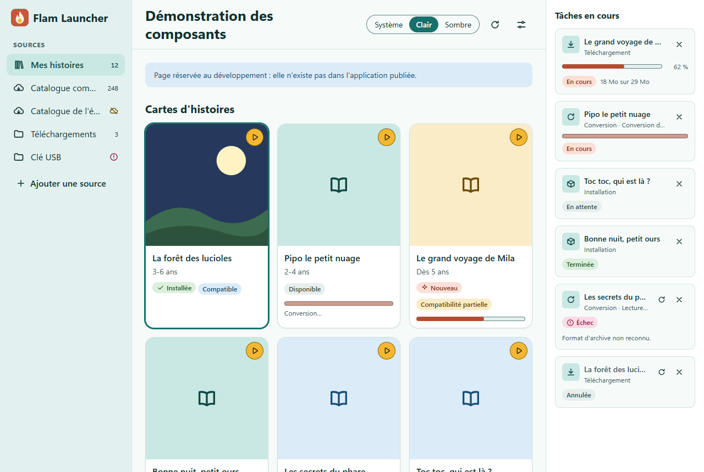
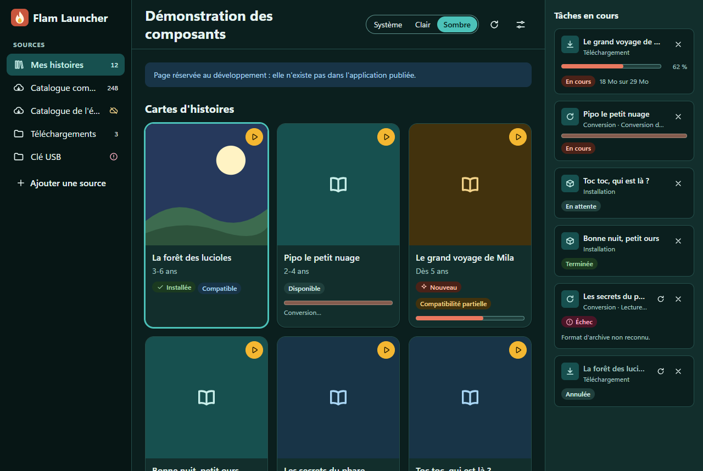
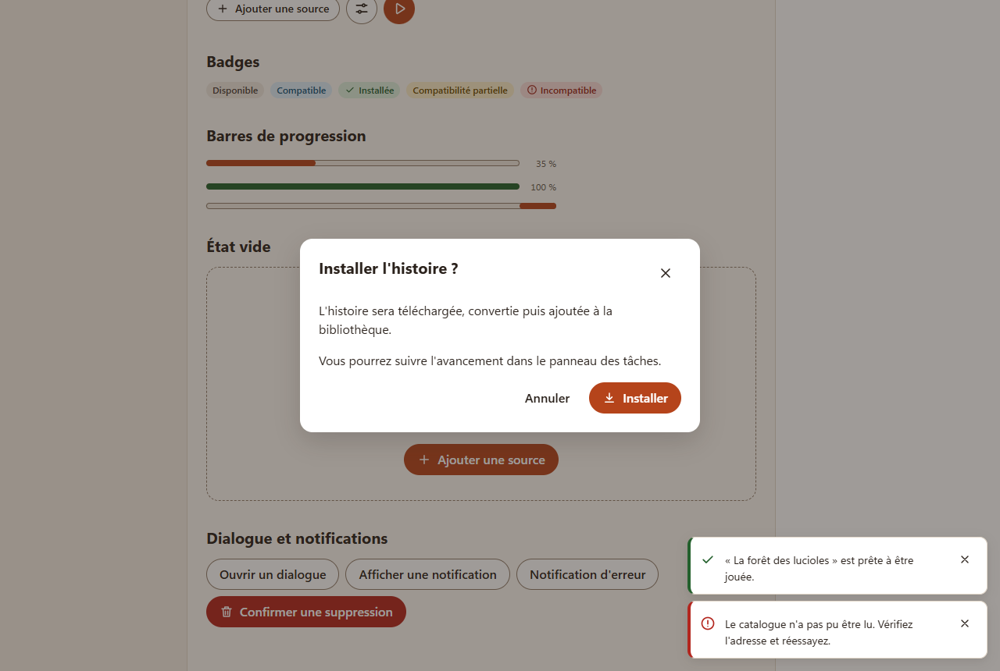
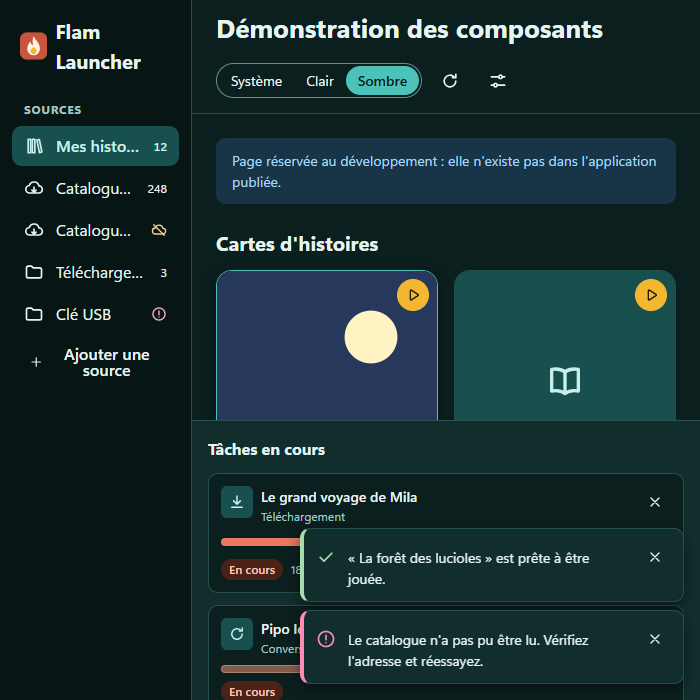

# Design system de flam-launcher

Interface de bureau pour choisir, installer et lancer des histoires audio pour enfants
(2-8 ans). Elle est utilisée par les **parents** (installation, sources, paramètres) et
parfois **à côté de l'enfant** (choisir une histoire, appuyer sur Jouer).

## Inspiration et originalité

L'organisation de l'écran reprend la **disposition générale** de TelmiSync : une barre de
sources à gauche, une grille de cartes avec vignettes, une fiche par histoire et un panneau
des tâches en cours. Ce sont des conventions courantes pour ce type d'application.
TelmiSync est sous GPL-3.0 et flam-launcher sous MIT : **aucun code, style, CSS, icône,
couleur ni ressource n'a été repris**. Les couleurs, icônes, l'icône d'application et
les composants ont été dessinés pour ce projet.

## Principes

1. **Chaleureux et sobre** : fond crème, accent brique, coins arrondis, peu d'ornements.
   L'attention va aux vignettes des histoires.
2. **Lisible** : texte de base en 16 px, contrastes AA vérifiés, libellés explicites en
   français (« Installer », « Jouer »), pas d'icône seule sans libellé accessible.
3. **Grandes cibles** : boutons d'au moins 40 px de haut (32 px pour la taille `sm`),
   carte cliquable sur toute sa surface.
4. **L'état ne dépend jamais de la seule couleur** : chaque badge ou état porte un texte
   (« Installée », « Échec »…), parfois complété d'une icône.
5. **Clavier d'abord** : tout se fait au clavier, avec un focus bleu bien visible, distinct
   de la couleur d'action.
6. **Calme** : animations courtes (120-200 ms), désactivées avec
   `prefers-reduced-motion`.

## Mise en page

```
┌──────────────┬──────────────────────────────────────┬──────────────┐
│ Logo         │ Titre de la vue        [actions]     │ Tâches en    │
│              ├──────────────────────────────────────┤ cours        │
│ Bibliothèque │                                      │              │
│  Mes hist.   │   Grille de cartes (auto-fill,       │ ▸ tâche      │
│ Catalogues   │   largeur min. 10,5 rem)             │   progression│
│  …           │                                      │ ▸ tâche      │
│ Dossiers     │                                      │              │
│  …           │                                      │              │
│ + Ajouter    │                                      │              │
└──────────────┴──────────────────────────────────────┴──────────────┘
  15 rem              souple                               18 rem
```

- `AppShell` fournit ces zones avec des repères ARIA : `nav` (sources), `header` (bannière
  avec le `h1`), `main`, `aside` (tâches), et un lien « Aller au contenu ».
- Sous 900 px de large (la fenêtre descend à 640 px), la barre latérale passe à 12 rem et le
  panneau de tâches se place sous le contenu (40 % de la hauteur au plus).

## Thèmes

Clair et sombre, avec choix **Système / Clair / Sombre**.

- Les jetons sont dans [`src/theme/tokens.css`](../src/theme/tokens.css). Chaque couleur est
  écrite **une seule fois** avec `light-dark(clair, sombre)`, résolu selon `color-scheme`.
- Sans attribut, `color-scheme: light dark` suit `prefers-color-scheme`. `applyTheme()`
  ([`src/theme/theme.ts`](../src/theme/theme.ts)) pose `data-theme="light"` ou `"dark"` sur
  `<html>` pour forcer un thème. La mémorisation du choix viendra avec l'écran des paramètres
  (#19).
- `light-dark()` demande Chromium 123 ou plus récent ; WebView2 (Evergreen) le fournit.

### Palette

| Jeton                     | Clair     | Sombre    | Usage                                            |
| ------------------------- | --------- | --------- | ------------------------------------------------ |
| `--color-bg`              | `#fbf7f2` | `#1c1714` | Fond de l'application                            |
| `--color-surface`         | `#ffffff` | `#27201b` | Cartes, dialogues, panneau                       |
| `--color-surface-sunken`  | `#f4ede4` | `#15110e` | Barre latérale                                   |
| `--color-surface-hover`   | `#efe5d8` | `#342b24` | Survol                                           |
| `--color-border`          | `#e3d8ca` | `#3d332b` | Séparateurs (décoratifs)                         |
| `--color-border-strong`   | `#8f7c6a` | `#8a7a6c` | Contours de contrôles (≥ 3:1)                    |
| `--color-text`            | `#2a211b` | `#f5eee7` | Texte                                            |
| `--color-text-muted`      | `#66574b` | `#c2b4a7` | Texte secondaire                                 |
| `--color-primary`         | `#b5441b` | `#f0a07a` | Action principale (brique)                       |
| `--color-on-primary`      | `#ffffff` | `#2a1206` | Texte sur l'action principale                    |
| `--color-primary-soft`    | `#fbe3d6` | `#4a2a1c` | Sélection, pastilles d'icônes                    |
| `--color-danger`          | `#b3261e` | `#f08a80` | Action destructrice                              |
| `--color-focus`           | `#1f5fc4` | `#8fb8ff` | Anneau de focus                                  |
| `--tone-{ton}-bg` / `-fg` | —         | —         | Badges : neutral, info, success, warning, danger |

Les couleurs du sombre sont éclaircies (et non inversées) pour garder la même chaleur.

### Contrastes

Vérifiés par axe-core (règle `color-contrast`, WCAG AA) dans Edge, sur la page de
démonstration, dans les deux thèmes, dialogue et notifications ouverts : **0 violation**.
Dans jsdom (tests Vitest), la règle est désactivée car les styles n'y sont pas calculés.

## Typographie

- Police système : `Segoe UI Variable Text`, `Segoe UI`, puis `system-ui`. Aucune police
  téléchargée (application hors ligne, CSP stricte).
- Échelle : 12 (`xs`), 14 (`sm`), 16 (`md`, base), 20 (`lg`), 26 px (`xl`, titre de vue).
- Graisses 400 / 600 / 700, interlignage 1,5 (1,25 pour les titres).
- Chiffres tabulaires pour les compteurs et pourcentages.

## Espacements, formes, ombres

- Échelle de 4 px : `--space-1` (4) à `--space-7` (48).
- Rayons : 6 (`sm`), 10 (`md`), 16 px (`lg`, cartes et dialogues), pilule pour boutons et badges.
- Trois ombres (`sm`, `md`, `lg`) teintées de brun en clair, noires en sombre.

## Composants

Dans [`src/components/`](../src/components/), un dossier par composant
(`Composant.tsx`, `Composant.css`, `Composant.test.tsx`), exportés par `index.ts`.

- **`AppShell`** : barre latérale, en-tête (`h1` + actions), contenu, panneau facultatif.
  Repères `nav`, `banner`, `main`, `complementary`. Le lien « Aller au contenu » focalise
  `main` par script (`preventDefault` + `focus()`) : le hash reste libre pour le routage
  (`#/demo` et routes futures).
- **`SidebarSourceList`** : sources dans **l'ordre fourni par l'appelant** (l'application
  met « Mes histoires » en tête). Chaque source est un bouton (`aria-current="page"` si
  sélectionnée) dont le nom annonce libellé, type, puis nombre d'histoires ou état.
  `status` : `ok`, `offline` (nuage barré, « Hors ligne ») ou `error` (alerte, « Erreur »),
  avec infobulle. `renderActions(source)` ajoute des actions par source (renommer,
  supprimer, réordonner…), superposées à droite de la ligne : masquées au repos (le
  libellé garde toute la largeur), visibles au survol ou dès qu'une action a le focus. Le libellé tronqué est donné en entier en infobulle. Clavier : Tab
  parcourt les sources et leurs actions ; ↑/↓, Début et Fin sautent directement d'une
  source à l'autre.
- **`StoryCard`** : vignette carrée (repli sur une illustration générique si l'image est
  absente ou ne charge pas), titre, âge, badges (clé `id` stable), progression facultative
  (`progress` en % ou `"indeterminate"`, `progressText`), actions rapides. Le titre est un
  bouton dont la zone couvre la carte ; la vignette est décorative (`alt=""`).
- **`Badge`** : état court en 5 tons ; texte obligatoire, icône décorative.
- **`Button`** : `primary`, `secondary`, `ghost`, `danger` ; tailles `md`/`sm` ;
  `type="button"` par défaut ; `ref` transmise au bouton natif.
- **`IconButton`** : icône seule ; `label` obligatoire (vérifié par TypeScript) → nom
  accessible et infobulle.
- **`ProgressBar`** : `role="progressbar"`, valeur bornée à 0-100 et arrondie ;
  indéterminée sans `aria-valuenow`.
- **`TaskPanel`** : téléchargements, conversions, installations. États `queued`,
  `running`, `done`, `error`, `cancelled` ; `phase` (étape affichée après le type) et
  `detail`. Actions nommées d'après l'histoire : Annuler (tâche active), Réessayer
  (`onRetry`, tâche en échec ou annulée), Retirer (tâche finie). Une région `role="status"`
  (polie) annonce chaque changement d'état, avec le détail en cas d'échec ; la progression
  n'est pas annoncée. L'icône d'installation (paquet) se distingue de la coche « Terminée ».
- **`Dialog`** : modale rendue dans `body`, `role` `dialog` ou `alertdialog`,
  `aria-modal`, nom = titre, `aria-describedby` seulement si `description` est fournie.
  Focus initial : `initialFocus` (ex. « Annuler » d'une confirmation), sinon premier élément
  actif du contenu, puis des actions. Tab bouclé dans le panneau ; Échap écouté sur tout le
  document tant que le dialogue est ouvert ; clic sur le fond ferme ; défilement de la page
  bloqué ; focus rendu au déclencheur à la fermeture.
- **`EmptyState`** : liste vide avec action proposée ; niveau de titre réglable.
- **`Toast`** (`ToastProvider` + `useToast()`) : infos et succès dans une région
  `aria-live="polite"`, disparition après 5 s par défaut, minuterie en pause au survol et au
  focus ; erreurs dans une région `aria-live="assertive"` séparée, affichées jusqu'à
  fermeture. Les notifications n'ont pas de rôle propre, pour éviter les doubles annonces.

### Contraste élevé (Windows)

Sous `forced-colors: active`, les fonds et ombres disparaissent : boutons, badges, cartes,
tâches, notifications et dialogues reçoivent un contour `CanvasText`, le focus et la
sélection utilisent `Highlight`, la barre de progression garde contour et remplissage
visibles (`src/styles.css`).

Les icônes ([`Icon.tsx`](../src/components/Icon.tsx)) sont des SVG originaux en ligne
(grille 24, trait 2 px, extrémités arrondies), toujours `aria-hidden`. Pas de bibliothèque
d'icônes : une vingtaine de pictogrammes suffit et évite une dépendance.

L'icône d'application ([`src-tauri/icons/app-icon.svg`](../src-tauri/icons/app-icon.svg),
reprise par `AppLogo`) est une flamme crème sur un carré brique. Régénération :
`npm run tauri icon src-tauri/icons/app-icon.svg`, en ne gardant que les fichiers listés dans
`tauri.conf.json` (et `icon.png`).

### Choix techniques

- **Un fichier CSS par composant** plutôt que des CSS modules : aucun réglage de build, CSS
  lisible dans les outils du navigateur, compatible avec la CSP (`style-src 'self'`), et des
  classes stables faciles à cibler dans les tests. Les collisions sont évitées par un
  préfixe `fl-` et une convention de type BEM (`fl-story-card__title`,
  `fl-button--primary`).
- **Aucune bibliothèque de composants** : React et des variables CSS suffisent.
- Les seuls styles en ligne sont des valeurs dynamiques (largeur d'une barre de progression),
  autorisées par `style-src 'unsafe-inline'`.

## Textes

Tous les textes affichés sont dans [`src/i18n/fr.ts`](../src/i18n/fr.ts) (objet `fr`,
exposé par `t` dans `src/i18n/index.ts`). Les pluriels et textes paramétrés sont des
fonctions (`t.sources.count(n)`, `t.story.age(3, 6)`). Une autre langue fournira un objet
du type `Messages`. Les textes de la page de démonstration, lien d'accès compris, sont à
part (`src/i18n/demo.fr.ts`) et ne sont importés que derrière `import.meta.env.DEV` : ils
ne sont pas embarqués dans l'application publiée.

## Page de démonstration

En développement seulement : `npm run dev` puis <http://localhost:1420/#/demo> (ou le lien
sous l'écran d'accueil avec `npm run tauri dev`). La page est chargée à la demande derrière
`import.meta.env.DEV` : le build de production ne contient ni la page ni ses données.
Elle présente tous les composants avec des données fictives et un sélecteur de thème.

| Clair                                                             | Sombre                                                            |
| ----------------------------------------------------------------- | ----------------------------------------------------------------- |
|                         |                       |
|  |             |
|           |  |

## Vérifications

- Tests Vitest de chaque composant, avec axe-core (`src/test/axe.ts`) : aucune violation sur
  chaque composant, sur la page de démonstration et sur la page avec dialogue et
  notifications ouverts.
- Contrastes et CSP vérifiés dans Edge (Playwright) : build de développement servi avec la
  CSP exacte de `tauri.conf.json`, aucune violation de CSP ni erreur de console ; axe sans
  violation sur la page, le dialogue avec notifications et la confirmation `alertdialog`,
  en clair et en sombre. Rendu contrôlé aussi en `forced-colors: active`.
